# Chapter 00: Foundations

> *The bedrock every design pattern stands on. Master these principles first — every pattern in this repository is a specific application of one or more of these ideas.*

---

## 🧒 The 5-Year-Old Explanation

Imagine you're building with LEGO. Before you follow any instruction booklet (patterns), you need to know some basic rules:
- **Don't glue bricks together** (keep things changeable — that's the Open/Closed Principle)
- **Each brick does ONE thing** (a wheel is a wheel, a window is a window — Single Responsibility)
- **Big bricks and small bricks should snap together the same way** (Liskov Substitution)
- **Don't carry bricks you're not using** (Interface Segregation)
- **Follow the picture on the box, not the factory that made the bricks** (Dependency Inversion)

Design patterns are the *instruction booklets*. These SOLID principles are the *rules of how bricks work*.

---

## 📦 What This Chapter Covers

| Topic | Why It Matters |
|-------|---------------|
| **SOLID Principles** | The 5 laws of object-oriented design — every pattern embodies at least one |
| **DRY, KISS, YAGNI** | Three mantras that prevent over-engineering |
| **Composition vs Inheritance** | The #1 design decision you'll make repeatedly |
| **UML Cheat Sheet** | How to read the class and sequence diagrams used throughout this repo |
| **Pattern Categories** | Mental map of all 26 chapters |

---

## 🏛️ SOLID Principles

### The Big Picture

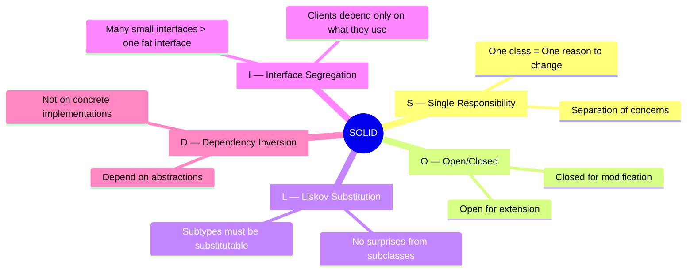

---

### S — Single Responsibility Principle (SRP)

> **"A class should have only one reason to change."** — Robert C. Martin

#### 🧒 5-Year-Old Version
A firefighter fights fires. A doctor treats patients. If one person had to do BOTH jobs, they'd be terrible at both and exhausted. Each person has ONE job.

#### The Rule
Every class should be responsible for **one thing**. If you can describe what a class does and you use the word "AND", it probably has too many responsibilities.

#### UML: Before vs After

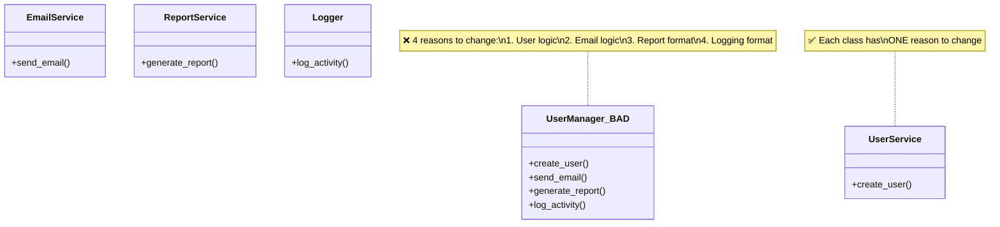

#### Which Patterns Embody SRP?
| Pattern | How It Uses SRP |
|---------|----------------|
| **Strategy** (Ch 20) | Extracts algorithm into its own class |
| **Command** (Ch 14) | Extracts action into its own object |
| **Observer** (Ch 18) | Separates event source from event handlers |
| **Chain of Responsibility** (Ch 13) | Each handler does one thing |

---

### O — Open/Closed Principle (OCP)

> **"Software entities should be open for extension, but closed for modification."** — Bertrand Meyer

#### 🧒 5-Year-Old Version
A phone case: you can change the case (extension) without opening up and rewiring the phone (modification). The phone is "closed" — you don't touch its guts. But it's "open" — you can add new cases, screen protectors, and pop sockets.

#### The Rule
You should be able to add new behavior **without changing existing code**. Achieve this through abstraction (interfaces, abstract classes) and polymorphism.

#### Flow: Violation → Fix

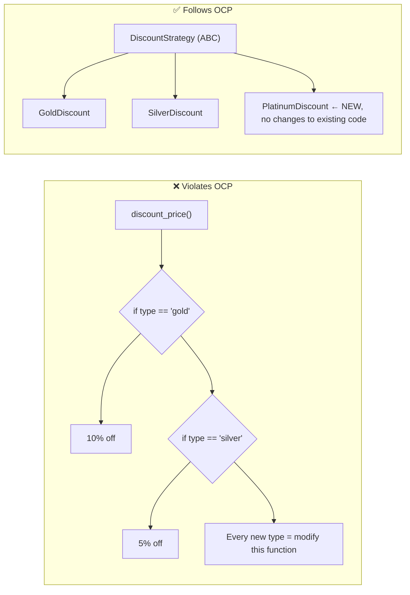

#### Which Patterns Embody OCP?
| Pattern | How It Uses OCP |
|---------|----------------|
| **Strategy** (Ch 20) | New algorithms = new classes, no modification |
| **Decorator** (Ch 09) | New behavior wraps existing, no modification |
| **Factory Method** (Ch 02) | New products = new factory subclasses |
| **Template Method** (Ch 21) | New steps = new subclasses, skeleton unchanged |

---

### L — Liskov Substitution Principle (LSP)

> **"Objects of a superclass should be replaceable with objects of its subclasses without breaking the application."** — Barbara Liskov

#### 🧒 5-Year-Old Version
If you ask for a "bird" and someone gives you a penguin, you shouldn't be surprised when it can't fly. If `fly()` is promised by "Bird", then penguins shouldn't be birds in your code. Don't make promises your children can't keep.

#### The Rule
A subclass must be able to **stand in** for its parent class. If substituting a subclass breaks the program, you've violated LSP. The classic violator: `Square extends Rectangle` (changing width also changes height — surprise!).

#### UML: The Classic Violation

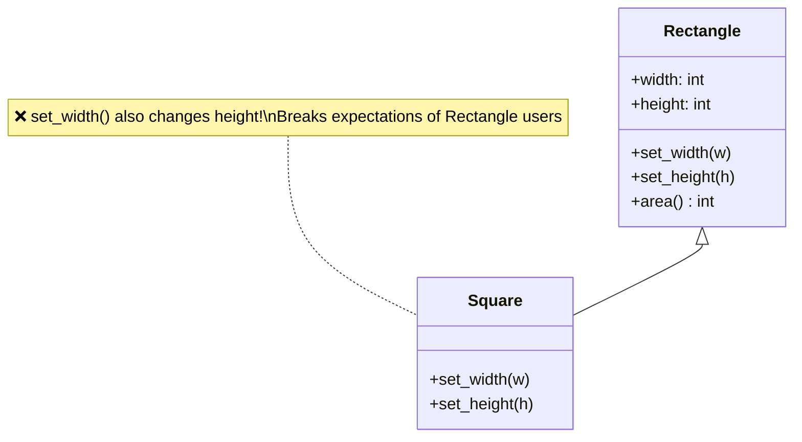

#### Which Patterns Embody LSP?
| Pattern | How It Uses LSP |
|---------|----------------|
| **Abstract Factory** (Ch 03) | All factories are interchangeable |
| **Strategy** (Ch 20) | All strategies are interchangeable |
| **State** (Ch 19) | All states are interchangeable |
| **Composite** (Ch 08) | Leaf and Composite both implement Component |

---

### I — Interface Segregation Principle (ISP)

> **"No client should be forced to depend on methods it does not use."** — Robert C. Martin

#### 🧒 5-Year-Old Version
Imagine a TV remote with 200 buttons — but you only use 5. All those extra buttons are confusing and wasteful. Better to have a simple remote with just the buttons you need.

#### The Rule
Split fat interfaces into smaller, focused ones. A class should only need to implement the methods it actually uses.

#### UML: Fat vs Lean Interfaces

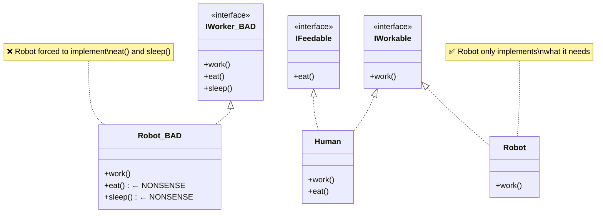

#### Which Patterns Embody ISP?
| Pattern | How It Uses ISP |
|---------|----------------|
| **Adapter** (Ch 06) | Exposes only the interface the client needs |
| **Facade** (Ch 10) | Hides complex subsystem behind simple interface |
| **Proxy** (Ch 12) | Same interface, controlled access |

---

### D — Dependency Inversion Principle (DIP)

> **"High-level modules should not depend on low-level modules. Both should depend on abstractions."** — Robert C. Martin

#### 🧒 5-Year-Old Version
When you plug in a lamp, you don't wire it directly to the power plant. You plug it into a **wall outlet** (the abstraction). The lamp doesn't know or care if the electricity comes from solar, wind, or coal. And the power plant doesn't know or care if it's powering a lamp, a fridge, or a TV.

#### The Rule
Don't import concrete classes directly. Depend on interfaces/protocols. This is the foundation of **Dependency Injection** (Chapter 24).

#### Architecture: Before vs After

```mermaid
flowchart TB
    subgraph "❌ Without DIP"
        A["OrderService"] -->|"directly imports"| B["MySQLDatabase"]
        A -->|"directly imports"| C["SMTPEmailSender"]
    end

    subgraph "✅ With DIP"
        D["OrderService"] -->|"depends on"| E["Database (Protocol)"]
        D -->|"depends on"| F["EmailSender (Protocol)"]
        E <|.. G["MySQLDatabase"]
        E <|.. H["PostgresDatabase"]
        F <|.. I["SMTPEmailSender"]
        F <|.. J["SendGridSender"]
    end
```

#### Which Patterns Embody DIP?
| Pattern | How It Uses DIP |
|---------|----------------|
| **Dependency Injection** (Ch 24) | THE pattern for DIP |
| **Abstract Factory** (Ch 03) | Client depends on factory interface, not concrete factories |
| **Bridge** (Ch 07) | Abstraction depends on implementor interface |
| **Repository** (Ch 23) | Business logic depends on repository interface, not DB |

---

## 🧘 Three Mantras: DRY, KISS, YAGNI

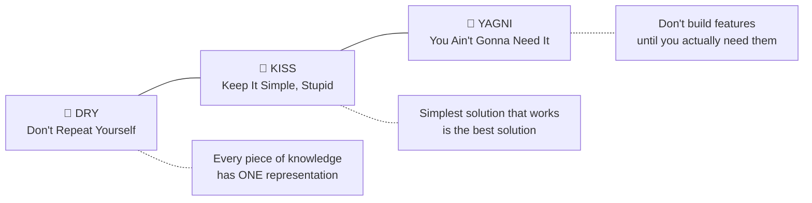

| Mantra | One-Liner | Anti-Example |
|--------|-----------|-------------|
| **DRY** | If you're copy-pasting, you're doing it wrong | Same validation logic in 5 different endpoints |
| **KISS** | If a junior dev can't understand it in 5 minutes, simplify | Using a 3-level metaclass hierarchy when a simple function works |
| **YAGNI** | Build for today, design for tomorrow | Building a plugin system when you have 1 plugin |

> **⚠️ Tension Alert**: These mantras can conflict. DRY might push you to create abstractions that violate KISS. YAGNI might stop you from applying a pattern that DRY demands. **Use judgment.** When in doubt: KISS > DRY > YAGNI.

---

## ⚔️ Composition vs Inheritance

This is the **#1 most important design decision** in OOP. The Gang of Four themselves said:

> **"Favor composition over inheritance."** — GoF, Design Patterns (1994)

### What's the Difference?

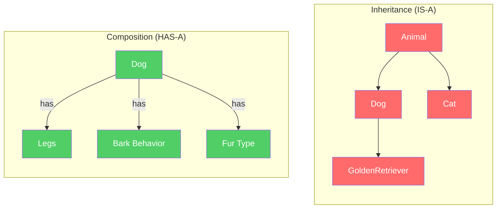

### Side-by-Side Comparison

| Aspect | Inheritance | Composition |
|--------|-------------|-------------|
| **Relationship** | IS-A (Dog IS-A Animal) | HAS-A (Dog HAS-A BarkBehavior) |
| **Coupling** | Tight — child depends on parent's implementation | Loose — components are independent |
| **Flexibility** | Fixed at compile time | Swappable at runtime |
| **Hierarchy depth** | Deep hierarchies become fragile | Flat, modular |
| **Reusability** | Subclass locked to one parent | Components reusable across unrelated classes |
| **When to use** | True IS-A relationship, shared implementation | Behavior varies, runtime flexibility needed |

### Decision Flowchart

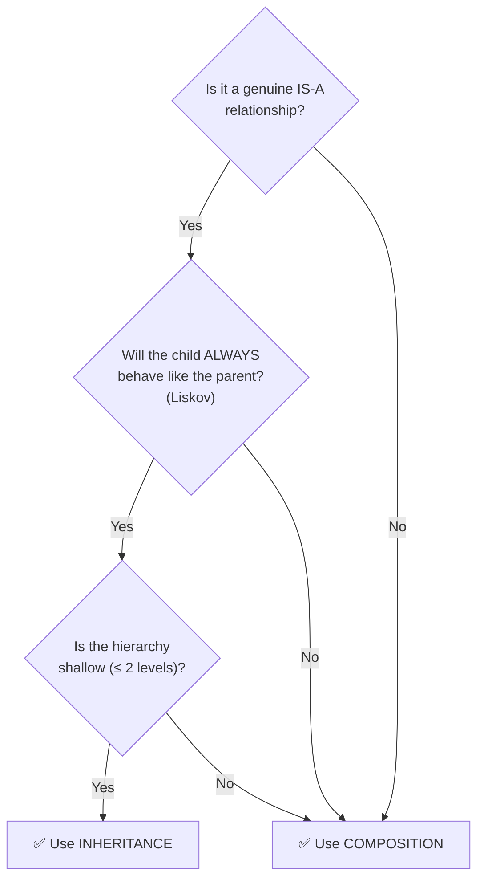

### Which Patterns Use Which?

| Uses Inheritance | Uses Composition |
|-----------------|------------------|
| Template Method (Ch 21) | Strategy (Ch 20) |
| Factory Method (Ch 02) | Decorator (Ch 09) |
| State (Ch 19) — state classes | Bridge (Ch 07) |
| | Observer (Ch 18) |
| | Composite (Ch 08) |
| | Command (Ch 14) |

> **Rule of thumb**: If you're torn, **choose composition**. You can always refactor to inheritance later if needed, but the reverse is painful.

---

## 📐 UML Cheat Sheet

Every chapter in this repository uses **Mermaid UML diagrams**. Here's how to read them.

### Class Diagram Symbols

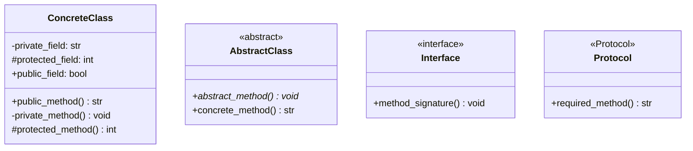

### Relationship Arrows

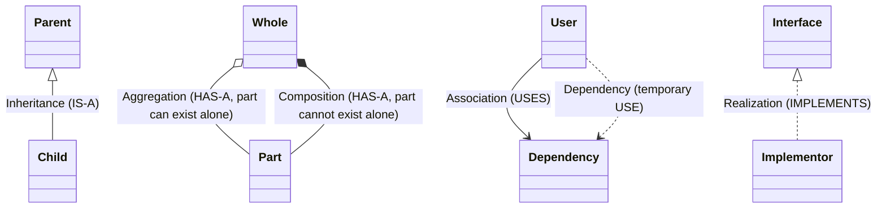

| Arrow | Meaning | Python Equivalent |
|-------|---------|-------------------|
| `──▷` (solid, closed) | Inheritance | `class Child(Parent)` |
| `──▷` (dashed, closed) | Realization/Implementation | `class Concrete(ABC)` or `Protocol` |
| `──>` (solid, open) | Association (permanent reference) | `self.other = Other()` |
| `..>` (dashed, open) | Dependency (temporary usage) | `def method(other: Other)` |
| `◇──` (open diamond) | Aggregation (has-a, independent lifetime) | `self.items = items  # passed in` |
| `◆──` (filled diamond) | Composition (has-a, dependent lifetime) | `self.engine = Engine()  # created internally` |

### Sequence Diagram Basics

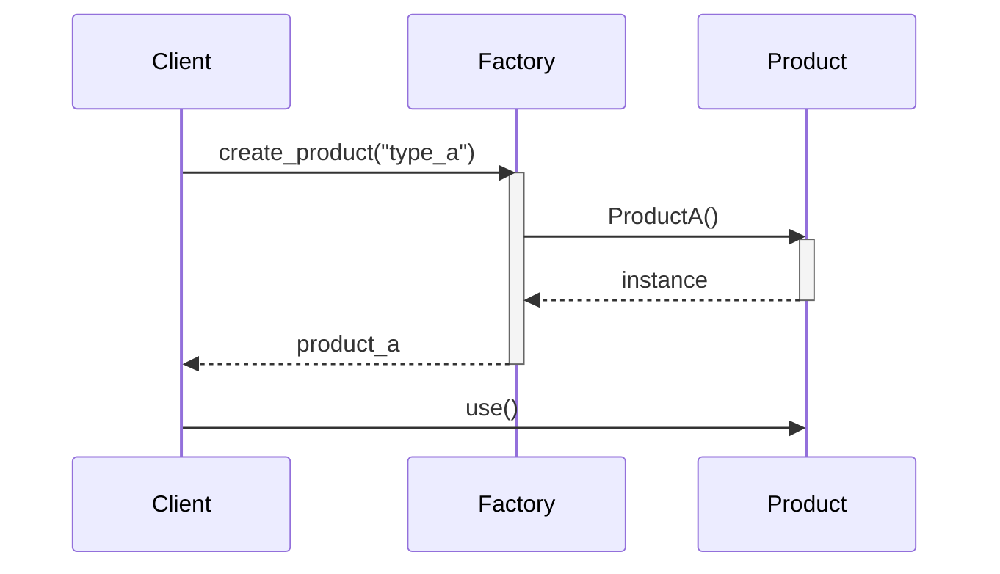

| Arrow | Meaning |
|-------|---------|
| `->>` (solid) | Synchronous call |
| `-->>` (dashed) | Return |
| `--)` (solid, open) | Async message |
| `activate/deactivate` | Lifeline (object is active) |

---

## 🗺️ Design Pattern Categories — Master Map

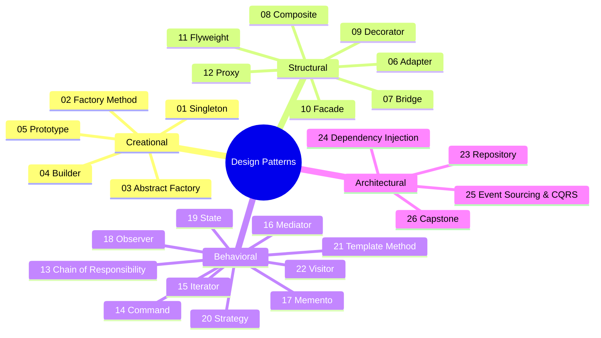

---

## 🔗 SOLID ↔ Pattern Cross-Reference

| SOLID Principle | Patterns That Embody It |
|----------------|------------------------|
| **S** — Single Responsibility | Strategy, Command, Observer, Chain of Responsibility |
| **O** — Open/Closed | Strategy, Decorator, Factory Method, Template Method |
| **L** — Liskov Substitution | Abstract Factory, Strategy, State, Composite |
| **I** — Interface Segregation | Adapter, Facade, Proxy |
| **D** — Dependency Inversion | Dependency Injection, Abstract Factory, Bridge, Repository |

---

## ✅ Examples in This Chapter

| # | File | What It Demonstrates |
|---|------|---------------------|
| 1 | `solid_principles.py` | All 5 SOLID principles with violation → fix code |
| 2 | `composition_vs_inheritance.py` | Side-by-side comparison with real-world scenario |
