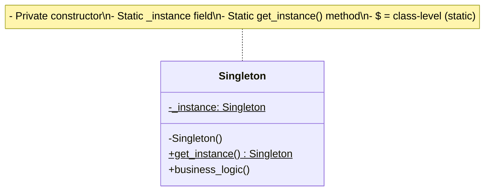
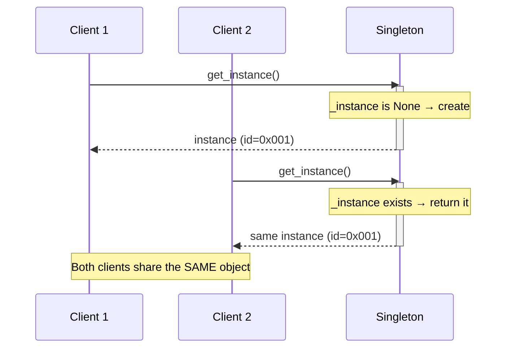
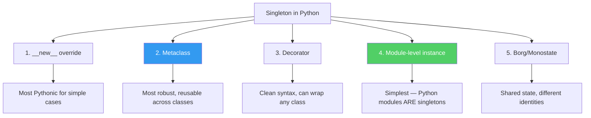
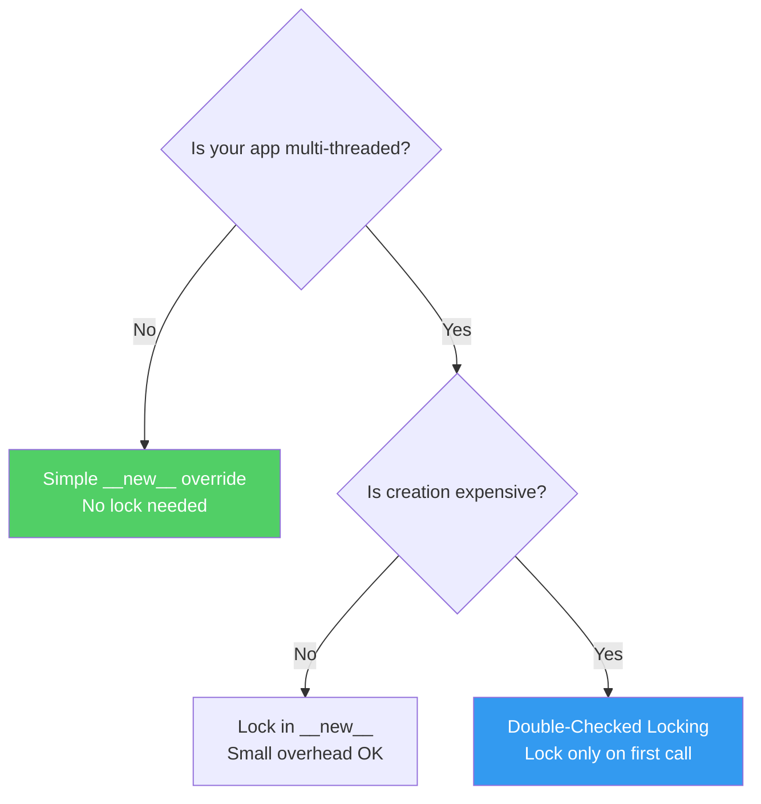
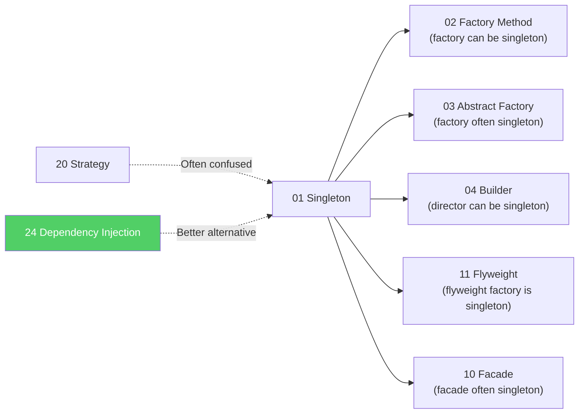

# Pattern 01: Singleton (Creational)

## 🧒 The 5-Year-Old Explanation

There's only **ONE principal** in your school. Every teacher, every student — when they say "the principal," they all mean the **same person**. You can't hire a second principal. If someone new walks in and asks for the principal, they get the same one everyone else talks to.

That's a Singleton: **one instance, shared by everyone**.

---

## 📦 Prerequisites

**You should be comfortable with:**
- Python classes, `__init__`, `__new__`
- Class variables vs instance variables
- What a metaclass is (we'll use one for thread-safe Singleton)
- Threading basics (`threading.Lock`)
- The Borg/Monostate alternative pattern

---

## 🔍 How to Spot This Pattern (Signal Detection)

**You should think of Singleton when you see:**
- "There must be exactly one instance of X in the system"
- Global configuration / settings object
- Connection pool, thread pool, or cache manager
- Logger that must be consistent across all modules
- Hardware interface (one printer spooler, one GPU manager)

**Common keywords in requirements:**
- "single instance," "global access," "shared state," "centralized," "one and only"

**Anti-signals (when NOT to use this pattern):**
- You need multiple instances with different configs → use **Factory Method** (Ch 02)
- You want to pass dependencies explicitly → use **Dependency Injection** (Ch 24)
- You just need shared data, not a shared object → use a module-level variable
- Testing requires isolated instances → Singleton makes mocking painful

> ⚠️ **Warning**: Singleton is the most **overused** and **misused** design pattern. In many cases, a simple module-level instance or dependency injection is cleaner. Know when NOT to use it.

---

## 🧩 The Core Idea (Technical Deep-Dive)

### Intent (GoF)
> Ensure a class has only one instance, and provide a global point of access to it.

### UML Class Diagram



### UML Sequence Diagram



### Step-by-Step Explanation

1. The class stores a **class-level reference** (`_instance`) to the single instance
2. The constructor (or `__new__`) checks if `_instance` already exists
3. **First call**: `_instance` is `None` → create the object, store it, return it
4. **All subsequent calls**: `_instance` exists → return the existing one
5. Every caller in the entire application gets the **same object**

---

## 🔧 Pattern Anatomy

### 1. Participants

| Participant | Python 3.14 Type | Role | Responsibility |
|-------------|-----------------|------|----------------|
| `Singleton` | `class` with overridden `__new__` or metaclass | The controlled class | Ensures only one instance exists |
| `_instance` | `cls` (class variable) | Instance store | Holds the single instance |
| `_lock` | `threading.Lock` | Thread guard | Prevents race conditions during creation |

### 2. Collaboration Flow

1. Client calls `Singleton()` or `Singleton.get_instance()`
2. `__new__` checks `cls._instance`
3. If `None`: acquire lock → double-check → create → store → release lock → return
4. If exists: return `cls._instance`

### 3. Invariants / Contracts

- **Invariant 1**: `Singleton() is Singleton()` → always `True`
- **Invariant 2**: `id(instance_a) == id(instance_b)` for any two references
- **Invariant 3**: Thread-safe version must hold lock only during first creation

---

## 📊 Visual Walkthrough

### Python Implementation Approaches



### Thread-Safety Decision Tree



---

## 🔄 Without Pattern → With Pattern Evolution

### Level 1: Naive (Global Variables)

```python
# BAD: Nothing prevents creating multiple instances
config1 = DatabaseConfig("postgres://localhost/db1")
config2 = DatabaseConfig("postgres://localhost/db2")
# Now which one is "the" config? Chaos.
```

- **Problem**: No control over instantiation, no guarantee of uniqueness
- **Code smell**: Multiple instances of what should be a shared resource

### Level 2: Module-Level Instance (Often Good Enough!)

```python
# config.py
class _DatabaseConfig:
    def __init__(self):
        self.host = "localhost"
        self.port = 5432

# THE singleton — Python modules are only imported once
db_config = _DatabaseConfig()
```

- **What improved**: Single instance guaranteed by Python's import system
- **Remaining issue**: Can still call `_DatabaseConfig()` directly; no enforcement

### Level 3: Full Singleton Pattern

```python
class DatabaseConfig:
    _instance = None

    def __new__(cls):
        if cls._instance is None:
            cls._instance = super().__new__(cls)
            cls._instance._initialized = False
        return cls._instance

    def __init__(self):
        if self._initialized:
            return
        self.host = "localhost"
        self.port = 5432
        self._initialized = True
```

- **Key insight**: `__new__` controls object creation BEFORE `__init__` runs

---

## ⏱️ Trade-offs & Complexity

| Aspect | Assessment |
|--------|-----------|
| **Added Complexity** | Low (simple `__new__` override) to Medium (metaclass/thread-safe) |
| **SOLID Principle Embodied** | None directly — actually **risks violating** SRP (class + lifecycle control) |
| **When Justified** | True "one and only one" requirement: DB connection pools, hardware drivers, app config |
| **When Over-engineered** | When a module-level instance would suffice (90% of cases in Python) |
| **Simpler Alternative** | Module-level instance (`config = Config()` at module scope) |

---

## 🏗️ Template / Boilerplate (Python 3.14)

### Approach 1: `__new__` Override (Simple)

```python
class Singleton:
    _instance: "Singleton | None" = None

    def __new__(cls) -> "Singleton":
        if cls._instance is None:
            cls._instance = super().__new__(cls)
        return cls._instance
```

### Approach 2: Thread-Safe with Double-Checked Locking

```python
import threading

class ThreadSafeSingleton:
    _instance: "ThreadSafeSingleton | None" = None
    _lock: threading.Lock = threading.Lock()

    def __new__(cls) -> "ThreadSafeSingleton":
        if cls._instance is None:              # Fast path (no lock)
            with cls._lock:                     # Slow path (lock)
                if cls._instance is None:       # Double-check
                    cls._instance = super().__new__(cls)
        return cls._instance
```

### Approach 3: Metaclass (Reusable)

```python
class SingletonMeta(type):
    _instances: dict[type, object] = {}

    def __call__(cls, *args, **kwargs):
        if cls not in cls._instances:
            cls._instances[cls] = super().__call__(*args, **kwargs)
        return cls._instances[cls]

class MyService(metaclass=SingletonMeta):
    pass  # Automatically a singleton!
```

---

## 🌍 Real-World Framework Sightings

### Django
- **Where**: `django.conf.settings` — the global settings object
- **How**: `LazySettings` wraps a single `Settings` instance, created on first access
- **Also**: `django.db.connections` — database connection handler is a singleton-like object

### Python Standard Library
- **Where**: `logging.getLogger(name)` — returns the SAME logger for the same name
- **How**: Internal registry (`logging.Manager`) acts as a flyweight/singleton hybrid
- **Also**: `None`, `True`, `False` — literal singletons enforced by the interpreter

### SQLAlchemy
- **Where**: `create_engine()` with `pool_size` — engine typically created once
- **How**: While not strictly Singleton, the pattern of "create once, share everywhere" is identical

---

## 🔗 Pattern Connections



---

## ⚠️ Common Mistakes & Pitfalls

1. **Mistake**: Forgetting that `__init__` is called EVERY TIME, even when `__new__` returns existing instance → **Fix**: Use an `_initialized` flag to skip re-initialization

2. **Mistake**: Not making it thread-safe in multi-threaded apps → **Fix**: Use double-checked locking or a metaclass with a lock

3. **Mistake**: Using Singleton when Dependency Injection would be cleaner → **Fix**: Ask "do I NEED to enforce one instance, or do I just want to SHARE one instance?" If the latter, use DI

4. **Mistake**: Singleton makes unit testing painful (global state persists between tests) → **Fix**: Add a `_reset()` classmethod for test teardown, or use DI instead

5. **Mistake**: Subclassing a Singleton — the subclass and parent share `_instance` → **Fix**: Use a metaclass that stores instances per-class in a dict

---

## 🎤 Interview Communication Guide

**Opening statement template:**
> "This calls for a Singleton because we need to guarantee exactly one instance of [resource] across the entire application, with a global access point."

**System Design connections:**
- Database connection pool manager
- Configuration service in microservices
- Cache manager (Redis client wrapper)
- Logger in distributed systems

**Follow-up questions to expect:**
- *"Why not just use a global variable?"* → "A global variable doesn't prevent creating multiple instances. Singleton enforces the constraint."
- *"How do you handle thread safety?"* → "Double-checked locking: first check without lock (fast path), then lock + second check (safe path)."
- *"What about testing?"* → "Singleton can make testing harder. I'd consider Dependency Injection if testability is a priority."
- *"Is Singleton an anti-pattern?"* → "It CAN be. It introduces global state, which couples modules. In Python, a module-level instance is often cleaner. I'd use Singleton only when enforcement of 'exactly one' is critical."

**What the interviewer wants to hear:**
- ✅ You know the pattern AND its drawbacks
- ✅ You can discuss thread-safety unprompted
- ✅ You mention DI as the modern alternative
- ✅ You know Python-specific approaches (`__new__`, metaclass, module-level)

---

## 🧪 Self-Test Questions

1. What is the difference between `__new__` and `__init__` in Python, and why does Singleton override `__new__`?
2. Why is double-checked locking needed for thread safety? Why not just always use a lock?
3. In Python, modules are only imported once. How does this make modules "natural singletons"?
4. What happens if you subclass a `__new__`-based Singleton? Does the subclass get its own instance?
5. (Trick) You need 3 different database connections in your app (read replica, write primary, analytics). Should you use Singleton?
6. What is the Borg/Monostate pattern and how does it differ from Singleton?

<details>
<summary>Answers</summary>

1. `__new__` creates the object (controls identity), `__init__` initializes it (sets attributes). Singleton overrides `__new__` because we need to control WHETHER a new object is created, not just how it's initialized.

2. Always locking adds unnecessary overhead — after the first creation, every call pays the lock cost. Double-checked locking only acquires the lock when `_instance` is `None` (first call), then the outer check short-circuits all subsequent calls.

3. When you `import config`, Python executes `config.py` once and caches the module in `sys.modules`. All subsequent imports get the cached module. So `config.db = Database()` at module level creates exactly one `Database` instance.

4. No! The subclass and parent share `cls._instance` if using a simple `__new__` override. The first one created wins. Use a metaclass with a per-class dict to fix this.

5. **No!** Singleton guarantees ONE instance. You need THREE. Use **Factory Method** (Ch 02) or **Dependency Injection** (Ch 24) to create and manage multiple configured instances.

6. Borg shares **state** (same `__dict__`) but creates **different objects** (`id()` differs). Singleton shares the **object itself** (same `id()`). Borg is useful when identity doesn't matter but shared state does.

</details>

---

## ✅ Examples in This Chapter

| # | Example | Framework | Key Concept |
|---|---------|-----------|-------------|
| 1 | Classic Singleton | Pure Python | `__new__` override, `_initialized` flag |
| 2 | Thread-Safe Singleton | Pure Python | Double-checked locking with `threading.Lock` |
| 3 | Django Settings | Django | Real-world `LazySettings` singleton in action |
| 4 | Borg / Monostate | Pure Python | Shared state alternative to Singleton |
