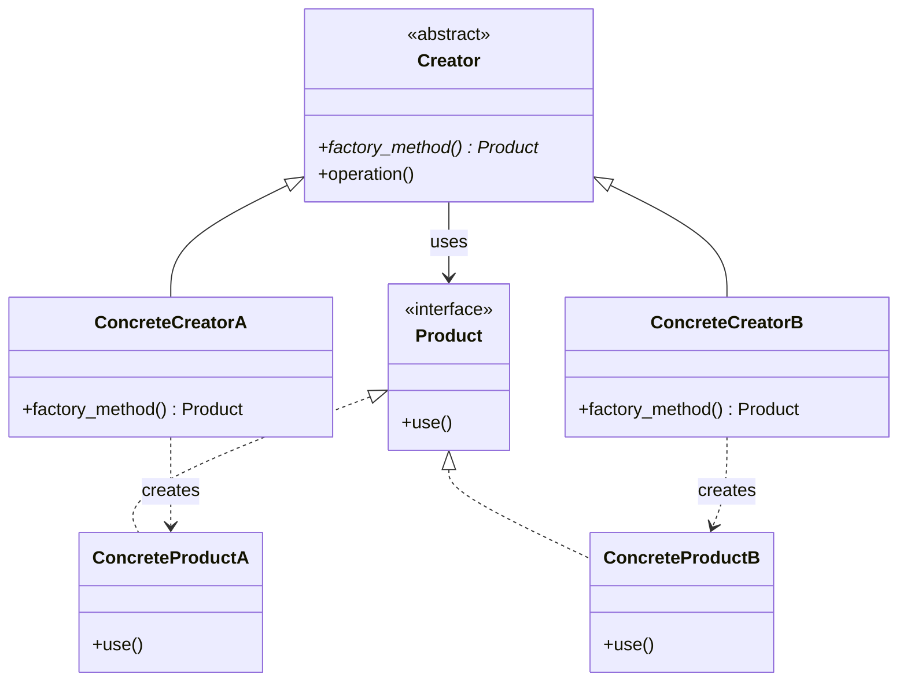
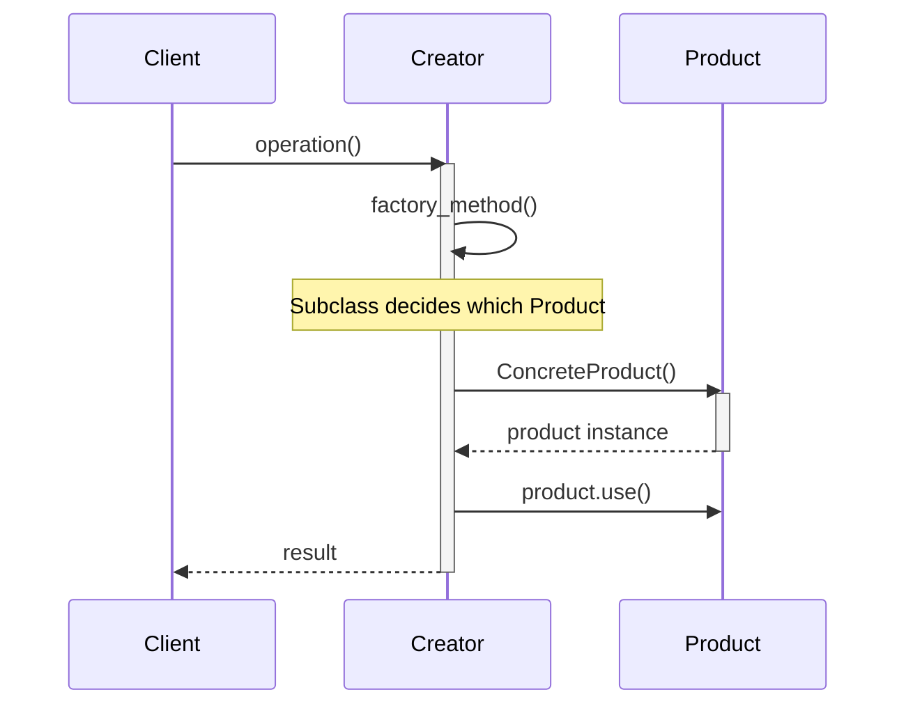
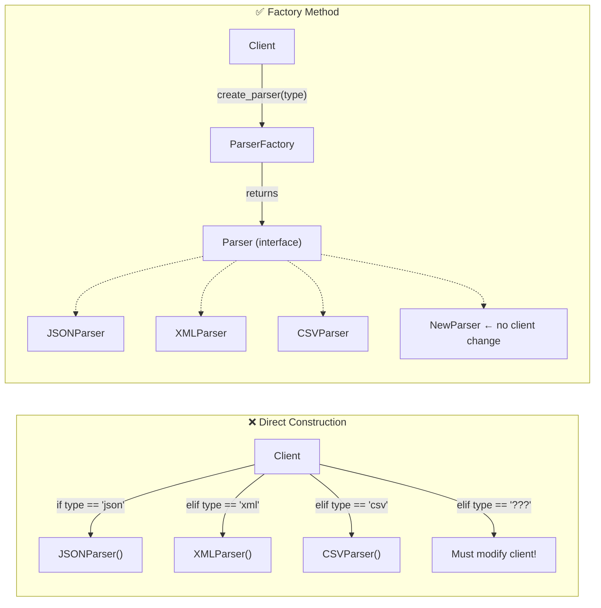
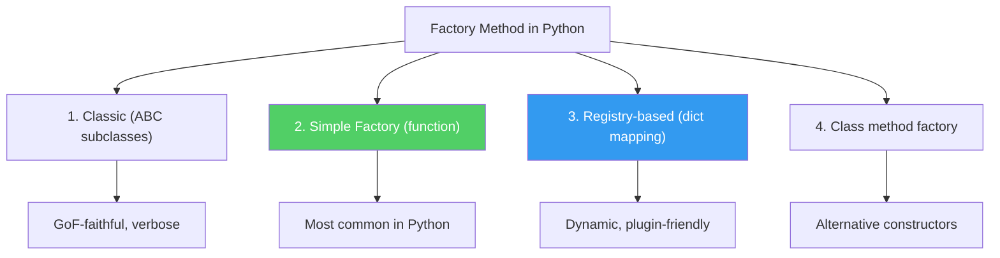
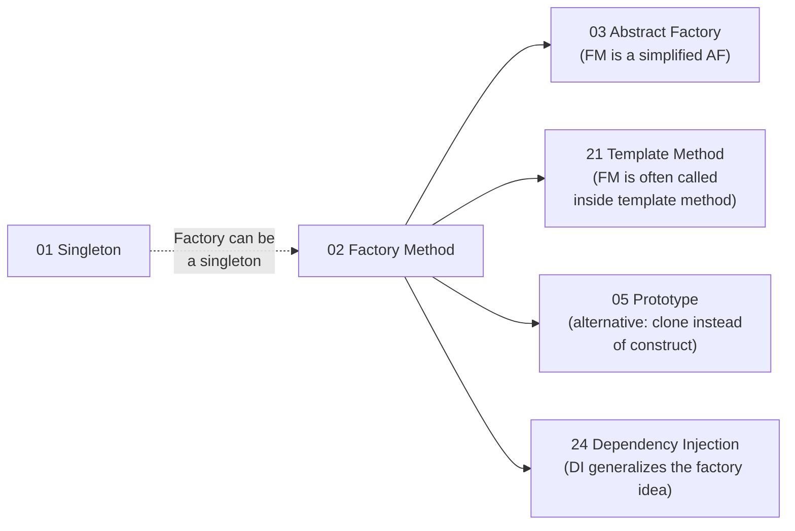

# Pattern 02: Factory Method (Creational)

## 🧒 The 5-Year-Old Explanation

Imagine a **toy factory** with different machines. You press a button labeled "car" → a toy car pops out. Press "doll" → a toy doll pops out. You don't build the toy yourself — you just tell the factory WHAT you want, and it figures out HOW to make it.

The Factory Method is that button: **you ask for a product by type, and the factory creates the right one for you**.

---

## 📦 Prerequisites

**You should be comfortable with:**
- Python ABC, `@abstractmethod`
- Polymorphism — calling the same method on different objects
- `Protocol` for structural typing
- SOLID: **Open/Closed Principle** (this pattern is OCP incarnate)

---

## 🔍 How to Spot This Pattern (Signal Detection)

**You should think of Factory Method when you see:**
- "Create objects without specifying the exact class"
- Multiple similar classes that share an interface
- Object creation logic needs to be centralized
- The type of object depends on input / configuration / environment

**Common keywords in requirements:**
- "parser," "serializer," "handler," "connector," "transport," "renderer"
- "based on type," "depending on format," "plugin system"

**Anti-signals (when NOT to use this pattern):**
- Only one product type → just use the constructor directly
- Creation logic is trivial (no branching needed) → YAGNI
- You need families of related objects → use **Abstract Factory** (Ch 03)

---

## 🧩 The Core Idea (Technical Deep-Dive)

### Intent (GoF)
> Define an interface for creating an object, but let subclasses decide which class to instantiate. Factory Method lets a class defer instantiation to subclasses.

### UML Class Diagram



### UML Sequence Diagram



---

## 🔧 Pattern Anatomy

### 1. Participants

| Participant | Python 3.14 Type | Role | Responsibility |
|-------------|-----------------|------|----------------|
| `Creator` | `ABC` | Abstract factory | Declares `factory_method()` |
| `ConcreteCreator` | Subclass of `Creator` | Specific factory | Implements `factory_method()` to return a specific product |
| `Product` | `Protocol` or `ABC` | Product interface | Defines the product contract |
| `ConcreteProduct` | Class | Specific product | Implements the product interface |

### 2. Collaboration Flow
1. Client calls `Creator.operation()`
2. `operation()` calls `self.factory_method()` internally
3. The **subclass's** `factory_method()` creates and returns the right product
4. `operation()` uses the product through the common `Product` interface

### 3. Invariants / Contracts
- `factory_method()` always returns an object implementing the `Product` interface
- Client code depends ONLY on `Creator` and `Product` abstractions
- Adding new product types requires ZERO changes to existing code (OCP)

---

## 📊 Visual Walkthrough

### Factory Method vs Direct Construction



### Pythonic Variations



---

## 🔄 Without Pattern → With Pattern Evolution

### Level 1: Naive — if/elif chain

```python
# BAD: Adding a new format requires modifying this function
def parse(data: str, fmt: str):
    if fmt == "json":
        return json.loads(data)
    elif fmt == "xml":
        return xml.parse(data)
    elif fmt == "csv":       # ← Every new format = another elif
        return csv.parse(data)
```

### Level 2: Simple Factory Function

```python
# BETTER: Centralized creation, but still hardcoded types
def create_parser(fmt: str) -> Parser:
    parsers = {"json": JSONParser, "xml": XMLParser, "csv": CSVParser}
    return parsers[fmt]()
```

### Level 3: Registry-Based Factory (Optimal)

```python
# BEST: Open for extension — register new parsers without touching factory
class ParserFactory:
    _registry: dict[str, type[Parser]] = {}

    @classmethod
    def register(cls, fmt: str, parser: type[Parser]):
        cls._registry[fmt] = parser

    @classmethod
    def create(cls, fmt: str) -> Parser:
        return cls._registry[fmt]()

# New parser? Just register it. Zero changes to factory.
ParserFactory.register("yaml", YAMLParser)
```

---

## ⏱️ Trade-offs & Complexity

| Aspect | Assessment |
|--------|-----------|
| **Added Complexity** | Low — a function or method that returns objects |
| **SOLID Principle Embodied** | **Open/Closed** (new types = new classes, not modifications) + **Dependency Inversion** (client depends on interface) |
| **When Justified** | Multiple product types behind a common interface; type determined at runtime |
| **When Over-engineered** | Only one product type; creation logic is trivial |
| **Simpler Alternative** | Direct constructor call: `product = ConcreteProduct()` |

---

## 🏗️ Template / Boilerplate (Python 3.14)

```python
from abc import ABC, abstractmethod
from typing import Protocol

class Product(Protocol):
    def operation(self) -> str: ...

class ConcreteProductA:
    def operation(self) -> str:
        return "Product A"

class ConcreteProductB:
    def operation(self) -> str:
        return "Product B"

# Approach 1: Simple factory function
def create_product(product_type: str) -> Product:
    registry: dict[str, type] = {
        "a": ConcreteProductA,
        "b": ConcreteProductB,
    }
    if product_type not in registry:
        raise ValueError(f"Unknown type: {product_type}")
    return registry[product_type]()

# Approach 2: ABC-based creator
class Creator(ABC):
    @abstractmethod
    def factory_method(self) -> Product: ...

    def operation(self) -> str:
        product = self.factory_method()
        return product.operation()
```

---

## 🌍 Real-World Framework Sightings

### Django
- **Where**: `django.forms.Field` subclasses — each field type creates its own widget
- **How**: `Field.widget_class` is a factory method pattern — each field decides its widget
- **Also**: `django.db.backends` — each database backend creates its own connection

### FastAPI
- **Where**: `Depends()` — dependency injection creates the right dependency at runtime
- **How**: The dependency function IS the factory; FastAPI calls it and injects the result

### SQLAlchemy
- **Where**: `create_engine("postgresql://...")` — the connection string determines which dialect/driver to instantiate
- **How**: Registry of dialects maps URL schemes to engine implementations

---

## 🔗 Pattern Connections



---

## ⚠️ Common Mistakes & Pitfalls

1. **Mistake**: Returning different INTERFACES from the factory (some products have methods others don't) → **Fix**: All products must implement the same `Product` interface

2. **Mistake**: Using Factory Method when there's only one product → **Fix**: Just call the constructor. YAGNI

3. **Mistake**: Making the factory an instance when it should be a classmethod or static function → **Fix**: In Python, a simple function is usually the best "factory"

4. **Mistake**: Forgetting to handle unknown types (KeyError) → **Fix**: Explicit error: `raise ValueError(f"Unknown type: {t}")`

---

## 🎤 Interview Communication Guide

**Opening statement template:**
> "I'd use a Factory Method here because we need to create objects of different types behind a common interface, and the type is determined by [input/config]. This keeps the client code decoupled from the concrete classes."

**System Design connections:**
- Serializer/deserializer selection (JSON, XML, Protobuf)
- Payment processor creation (Stripe, PayPal, Square)
- Notification channel creation (Email, SMS, Push)
- Database driver instantiation (Postgres, MySQL, SQLite)

**What the interviewer wants to hear:**
- ✅ You use OCP reasoning ("adding new types shouldn't modify existing code")
- ✅ You know the Pythonic way (dict registry, not deep class hierarchies)
- ✅ You distinguish Factory Method from Abstract Factory

---

## 🧪 Self-Test Questions

1. What SOLID principle does Factory Method embody most directly?
2. In Python, what's the simplest form of a factory? (Hint: not a class)
3. How does Factory Method differ from Abstract Factory?
4. What is the "registry pattern" and why is it the Pythonic way to do factories?
5. (Trick) You need to create a `User` object from form data. Should you use Factory Method?

<details>
<summary>Answers</summary>

1. **Open/Closed Principle**: new product types = new classes, no modification to existing factory code.

2. A **function** that returns different objects based on input. Python doesn't need the ceremony of creator/product class hierarchies.

3. Factory Method creates **one product**. Abstract Factory creates **families of related products** (e.g., a "Modern" factory creates modern chairs AND modern tables).

4. A dict mapping type names to classes: `{"json": JSONParser, "xml": XMLParser}`. The factory does `registry[type]()`. Adding new types is just `registry["yaml"] = YAMLParser` — zero code changes.

5. **No**. There's only one product type (`User`). Just use `User(**form_data)` or a classmethod: `User.from_form(data)`. Factory Method is for when you have MULTIPLE product types.

</details>

---

## ✅ Examples in This Chapter

| # | Example | Framework | Key Concept |
|---|---------|-----------|-------------|
| 1 | Basic Factory | Pure Python | Simple factory function + registry |
| 2 | Serializer Factory | Pure Python | Multi-format serialization |
| 3 | FastAPI Dependency Factory | FastAPI-style | DI as factory method |
