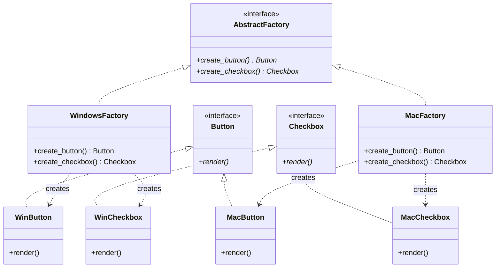
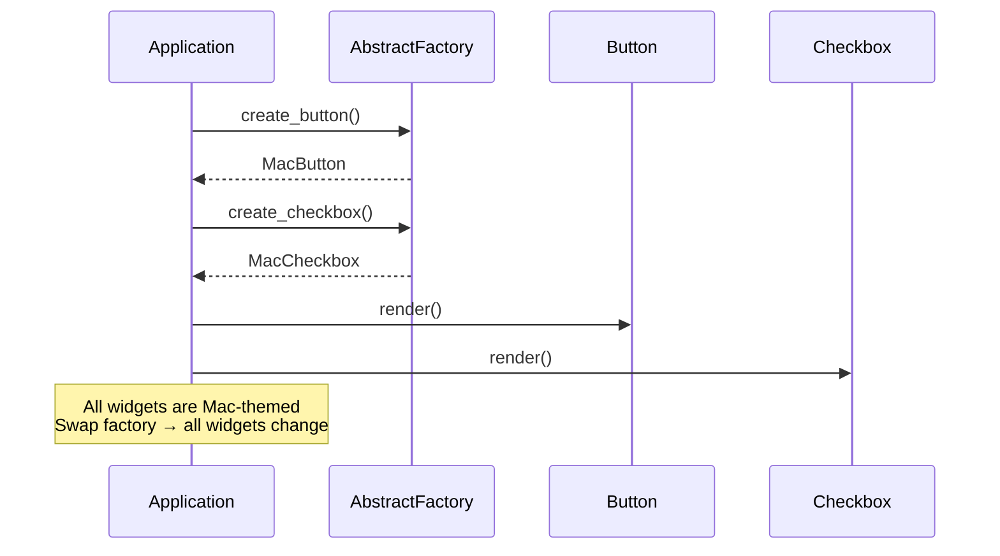

# Pattern 03: Abstract Factory (Creational)

## 🧒 The 5-Year-Old Explanation

Imagine a **furniture catalog**. You pick a STYLE: "Modern" or "Victorian." Once you pick the style, **everything matches** — the chair, the table, the sofa are ALL in that style. You don't mix a modern chair with a Victorian table. The catalog (abstract factory) ensures every piece comes from the **same family**.

---

## 📦 Prerequisites

**You should be comfortable with:**
- Factory Method (Ch 02) — Abstract Factory uses factory methods internally
- ABC + `@abstractmethod` for abstract factories and products
- SOLID: **Dependency Inversion** (depend on abstract factory, not concrete)

---

## 🔍 How to Spot This Pattern

**Think of Abstract Factory when you see:**
- Families of related objects that must be used together
- Cross-platform UI (Windows/Mac widgets), multi-database support
- Theme/skin systems where all elements must be consistent
- "Swap the entire set" requirements

**Anti-signals:**
- Only one product type → **Factory Method** (Ch 02)
- Products are unrelated → separate factories, not an abstract factory

---

## 🧩 The Core Idea

### UML Class Diagram



### UML Sequence Diagram



---

## 🔧 Pattern Anatomy

### Participants

| Participant | Python Type | Role |
|-------------|------------|------|
| `AbstractFactory` | `Protocol` / `ABC` | Declares creation methods for each product |
| `ConcreteFactory` | Class | Creates products from ONE family |
| `AbstractProduct` | `Protocol` / `ABC` | Interface for a type of product |
| `ConcreteProduct` | Class | Specific product in a family |
| `Client` | Function/class | Uses factories and products through abstract interfaces only |

---

## 🔄 Without Pattern → With Pattern Evolution

### Level 1: Hardcoded platform checks everywhere
```python
# BAD: Platform checks scattered across entire codebase
if platform == "mac":
    button = MacButton()
    checkbox = MacCheckbox()
    # ... 50 more places
```

### Level 3: Abstract Factory
```python
# GOOD: One decision point, consistent family
factory = get_factory(platform)  # returns MacFactory or WinFactory
button = factory.create_button()    # Always gets matching product
checkbox = factory.create_checkbox()
```

---

## ⏱️ Trade-offs

| Aspect | Assessment |
|--------|-----------|
| **Complexity** | Medium — more classes than Factory Method |
| **SOLID** | DIP (client depends on abstract factory) + OCP (new families = new factories) |
| **When Justified** | Multiple product types that MUST be used together in matching families |
| **When Over-engineered** | Only one product type (use Factory Method) or families never change |

---

## 🌍 Real-World Framework Sightings

### SQLAlchemy
- **Where**: `create_engine("postgresql://...")` vs `create_engine("sqlite://...")`
- **How**: Each dialect is an abstract factory producing matching connections, compilers, and type objects

### Django
- **Where**: `django.db.backends` — each database backend is a factory for connections, cursors, operations, and schema editors

---

## ✅ Examples in This Chapter

| # | Example | Framework | Key Concept |
|---|---------|-----------|-------------|
| 1 | GUI Toolkit Factory | Pure Python | Cross-platform UI widgets |
| 2 | Database Connector Factory | SQLAlchemy-style | Multi-DB abstraction |
