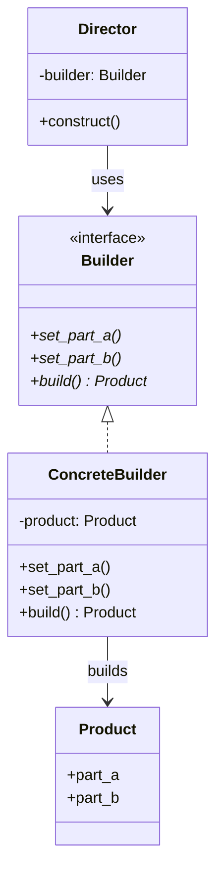
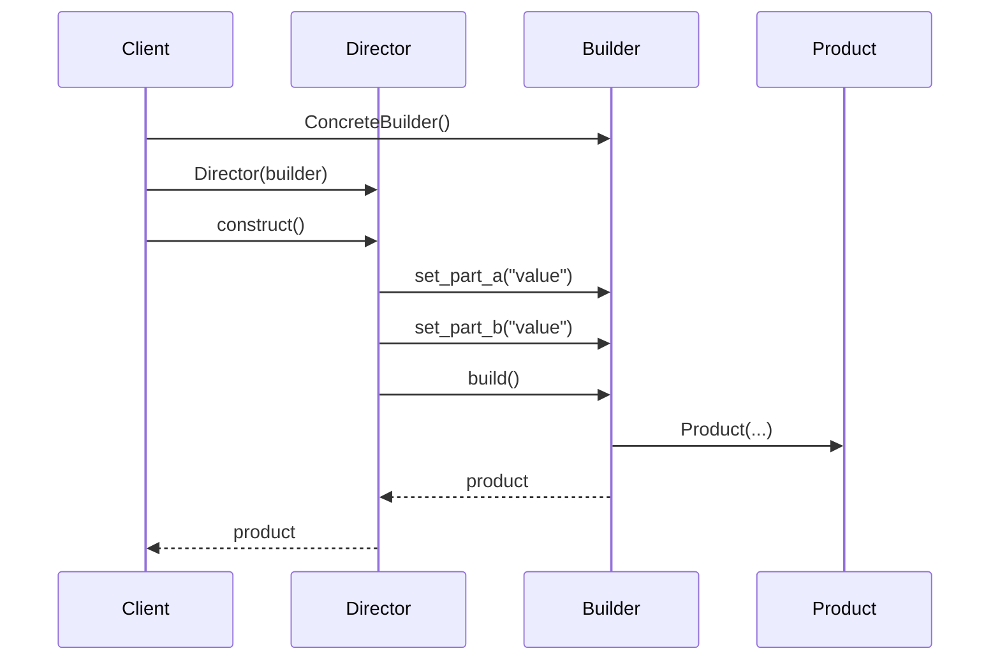

# Pattern 04: Builder (Creational)

## 🧒 The 5-Year-Old Explanation

Ordering a **custom pizza**: First you pick the crust (thin or thick), then the sauce (tomato or white), then toppings one by one (pepperoni, mushrooms, olives). You control EACH step, and at the end you get exactly the pizza you designed. The pizza maker (builder) follows your instructions step by step.

---

## 📦 Prerequisites

**You should be comfortable with:**
- Method chaining (fluent interfaces): `builder.set_x().set_y().build()`
- `@dataclass` for product classes
- Optional parameters and default values

---

## 🔍 How to Spot This Pattern

**Think of Builder when you see:**
- Complex object with many optional parameters
- Constructor with 5+ arguments (telescoping constructor anti-pattern)
- Object needs to be constructed step-by-step
- Same construction process should create different representations

**Anti-signals:**
- Object has few required params → just use the constructor
- No step-by-step construction → use **Factory Method** (Ch 02)

---

## 🧩 The Core Idea

### Intent (GoF)
> Separate the construction of a complex object from its representation so the same construction process can create different representations.

### UML Class Diagram



### UML Sequence Diagram



---

## 🔄 Without Pattern → With Pattern

### Level 1: Telescoping Constructor
```python
# BAD: 10 parameters, most optional — which is which?
query = Query("users", ["name"], True, False, None, 10, 0, "name", "ASC", None)
```

### Level 3: Builder with Fluent API
```python
# GOOD: Clear, readable, self-documenting
query = (QueryBuilder("users")
    .select("name", "email")
    .where("active = true")
    .order_by("name")
    .limit(10)
    .build())
```

---

## ⏱️ Trade-offs

| Aspect | Assessment |
|--------|-----------|
| **Complexity** | Low-Medium — simple for fluent builders |
| **SOLID** | SRP (builder = construction, product = domain logic) |
| **When Justified** | Complex objects with many optional parts; step-by-step construction |
| **Simpler Alternative** | `@dataclass` with defaults; keyword arguments |

---

## 🌍 Real-World Framework Sightings

### SQLAlchemy
- `Query.filter().order_by().limit()` — fluent query builder

### Django
- `QuerySet.filter().exclude().order_by()[:10]` — chainable query API

### Pydantic
- `model_validator` + `model_construct()` — step-by-step model building

---

## ✅ Examples in This Chapter

| # | Example | Framework | Key Concept |
|---|---------|-----------|-------------|
| 1 | SQL Query Builder | Pure Python | Fluent API with method chaining |
| 2 | HTTP Request Builder | Pure Python | Step-by-step request construction |
