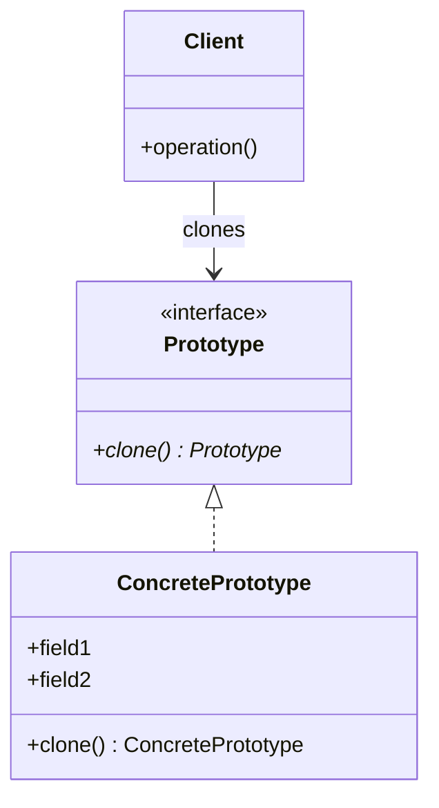
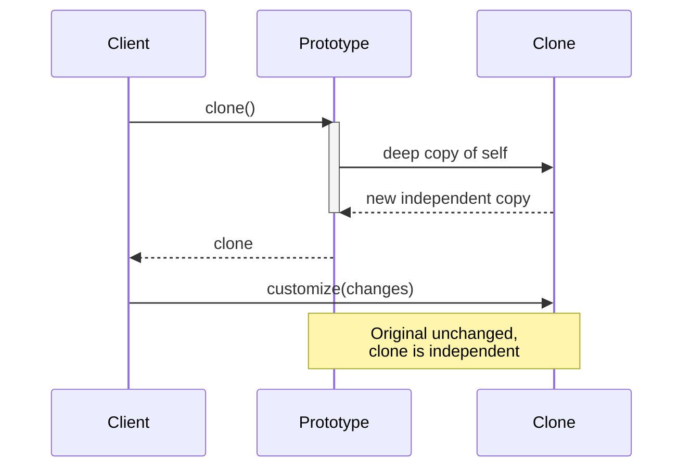
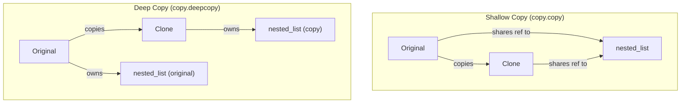

# Pattern 05: Prototype (Creational)

## 🧒 The 5-Year-Old Explanation

Using a **photocopier**: instead of drawing a picture from scratch every time, you put the original in the copier and press "copy." The copy is identical but independent — you can color on the copy without ruining the original. That's Prototype: **clone an existing object instead of building one from scratch**.

---

## 📦 Prerequisites

**You should be comfortable with:**
- Python `copy` module: `copy.copy()` (shallow) vs `copy.deepcopy()` (deep)
- Mutable vs immutable objects
- `__copy__` and `__deepcopy__` magic methods

---

## 🔍 How to Spot This Pattern

**Think of Prototype when you see:**
- Creating objects is expensive (DB queries, network calls, complex initialization)
- You need many similar objects with slight variations
- "Template" objects that serve as starting points
- Dynamic class registration (clone a prototype from a registry)

**Anti-signals:**
- Object creation is cheap → just use the constructor
- Objects are immutable → no need to clone, share the same instance
- Each object is completely different → Factory Method is better

---

## 🧩 The Core Idea

### UML Class Diagram

### UML Sequence Diagram

---

## 🔄 Shallow vs Deep Copy

---

## ⏱️ Trade-offs

| Aspect | Assessment |
|--------|-----------|
| **Complexity** | Low — Python's `copy` module does the heavy lifting |
| **When Justified** | Expensive initialization; many similar objects; template-based creation |
| **Simpler Alternative** | Direct construction with shared defaults |

---

## 🌍 Real-World Framework Sightings

### Django
- `Model.objects.get(pk=1)` → modify → `instance.pk = None; instance.save()` clones a DB row

### Python Standard Library
- `copy.copy()` / `copy.deepcopy()` — built-in prototype support
- `list.copy()`, `dict.copy()` — shallow clone methods

---

## ✅ Examples in This Chapter

| # | Example | Framework | Key Concept |
|---|---------|-----------|-------------|
| 1 | Document Cloning | Pure Python | Deep copy with customization |
| 2 | Game Object Prototypes | Pure Python | Registry of prototypes |
