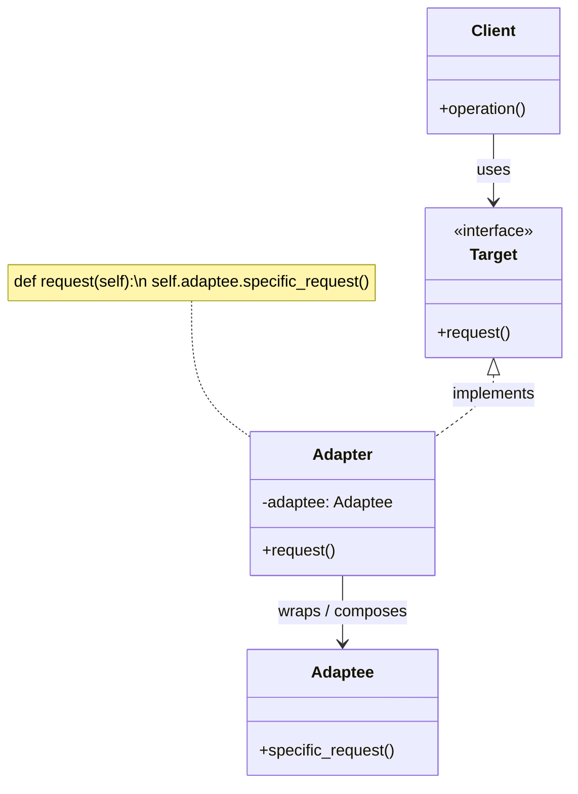
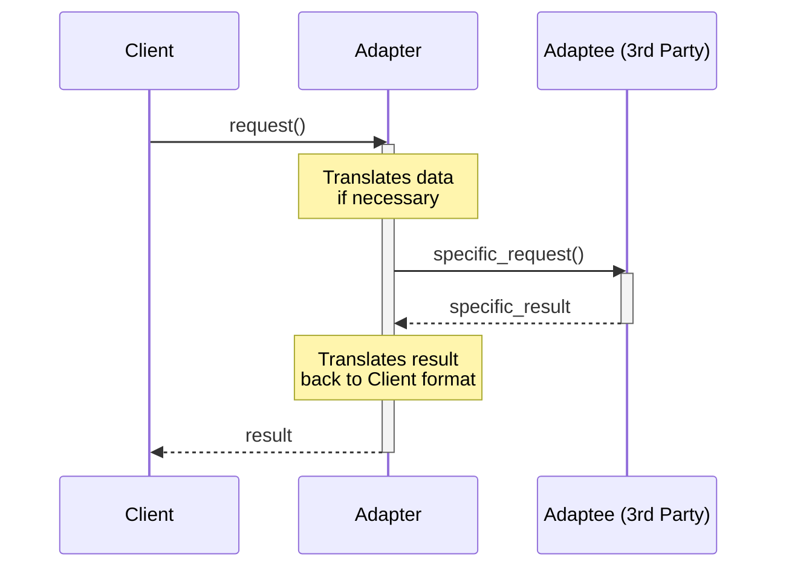
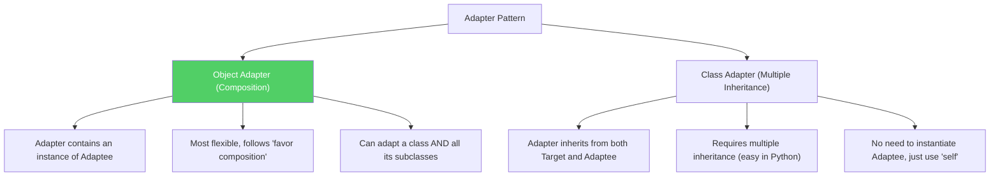

# Pattern 06: Adapter (Structural)

## 🧒 The 5-Year-Old Explanation

You travel to Europe, and your phone charger has two flat prongs. But the wall socket in Europe has two round holes. You can't plug your charger in! What do you do? You buy a **travel adapter**. The adapter has round prongs on one side (to fit the wall) and flat holes on the other (to fit your charger).

The Adapter pattern does exactly this for code: **it makes two incompatible interfaces work together without changing either of them**.

---

## 📦 Prerequisites

**You should be comfortable with:**
- Python's Multiple Inheritance (for Class Adapters)
- Object Composition vs Inheritance (Ch 00)
- Protocols/ABCs

---

## 🔍 How to Spot This Pattern

**Think of Adapter when you see:**
- You want to use an existing class, but its interface doesn't match what you need.
- You're integrating a third-party library or legacy code and want to hide its weird API.
- You have several existing subclasses that lack some common functionality, and you can't just modify the superclass.

**Anti-signals:**
- You want to change the *behavior* of an object, not just its interface → **Decorator** (Ch 09)
- You want to simplify a complex set of interfaces → **Facade** (Ch 10)

---

## 🧩 The Core Idea

### Intent (GoF)
> Convert the interface of a class into another interface clients expect. Adapter lets classes work together that couldn't otherwise because of incompatible interfaces.

### UML Class Diagram (Object Adapter - Composition)



### UML Sequence Diagram



---

## 🔧 Pattern Anatomy

### Participants

| Participant | Python Type | Role |
|-------------|------------|------|
| `Target` | `Protocol` or `ABC` | The interface the Client expects |
| `Client` | Class / Function | Collaborates with objects conforming to the Target interface |
| `Adaptee` | Class | The existing, incompatible interface (often 3rd party or legacy) |
| `Adapter` | Class | Adapts the Adaptee to the Target interface |

---

## 📊 Visual Walkthrough

### Object Adapter vs Class Adapter



---

## 🔄 Without Pattern → With Pattern

### Level 1: Bleeding Legacy Code
```python
# BAD: Client code has to know about the weird legacy API
class ModernSystem:
    def process(self, data):
        # We want to call save_data(), but we are forced to use LegacyDB
        legacy = LegacyDB()
        # Have to convert data to XML manually here...
        xml_data = dict_to_xml(data)
        legacy.insert_record_xml(xml_data) 
```

### Level 3: Adapter Pattern
```python
# GOOD: Client only knows the clean interface
class ModernSystem:
    def __init__(self, db: ModernDatabaseInterface):
        self.db = db
        
    def process(self, data):
        self.db.save_data(data)  # Clean!

# The adapter hides the ugly XML conversion
class LegacyDBAdapter(ModernDatabaseInterface):
    def __init__(self, legacy_db: LegacyDB):
        self.legacy_db = legacy_db
        
    def save_data(self, data: dict):
        xml_data = dict_to_xml(data)
        self.legacy_db.insert_record_xml(xml_data)
```

---

## ⏱️ Trade-offs

| Aspect | Assessment |
|--------|-----------|
| **Complexity** | Low - just a wrapper class. |
| **SOLID** | SRP (separates data conversion from primary logic), OCP (new adapters can be added without breaking client code) |
| **When Justified** | Reusing existing classes with incompatible APIs. |
| **When Over-engineered** | If you can just modify the original class to match the interface. |

---

## 🌍 Real-World Framework Sightings

### Python Standard Library
- `io.TextIOWrapper` acts as an adapter, providing a text-oriented interface on top of a buffered binary stream.

### Django / SQLAlchemy
- Database backends act as adapters, providing a unified ORM interface over wildly different database driver APIs (e.g., `psycopg2` vs `sqlite3`).

---

## ✅ Examples in This Chapter

| # | Example | Framework | Key Concept |
|---|---------|-----------|-------------|
| 1 | Object Adapter (Composition) | Pure Python | Adapting a legacy XML API to a modern JSON-expecting client |
| 2 | Class Adapter (Multiple Inheritance) | Pure Python | Adapting via multiple inheritance (Python specific) |
