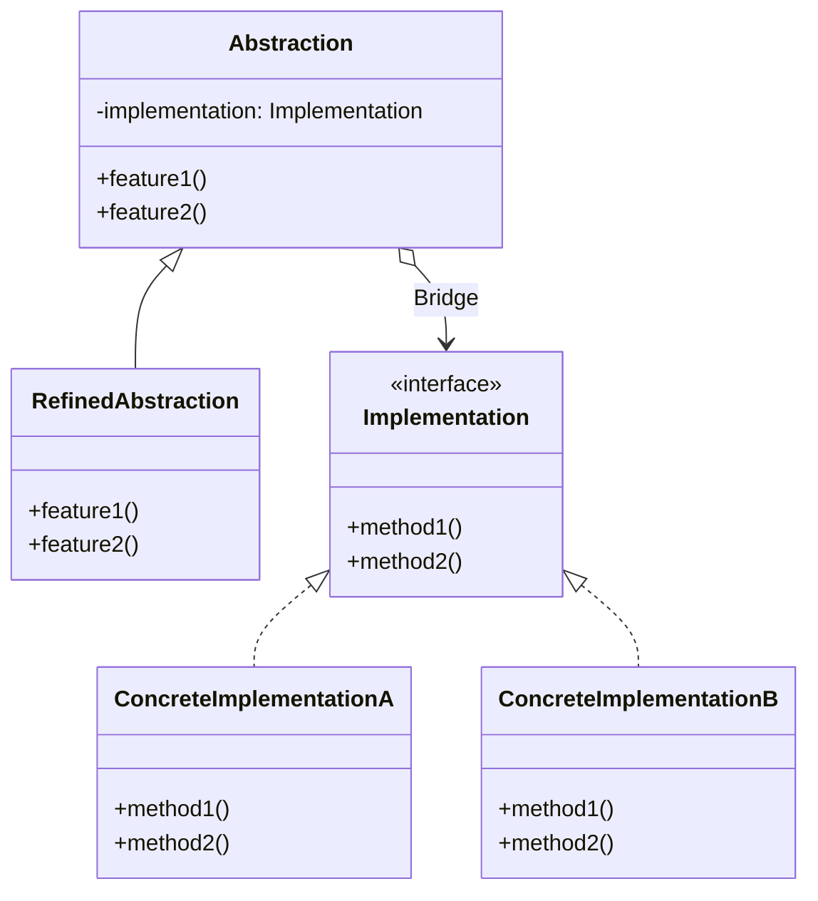
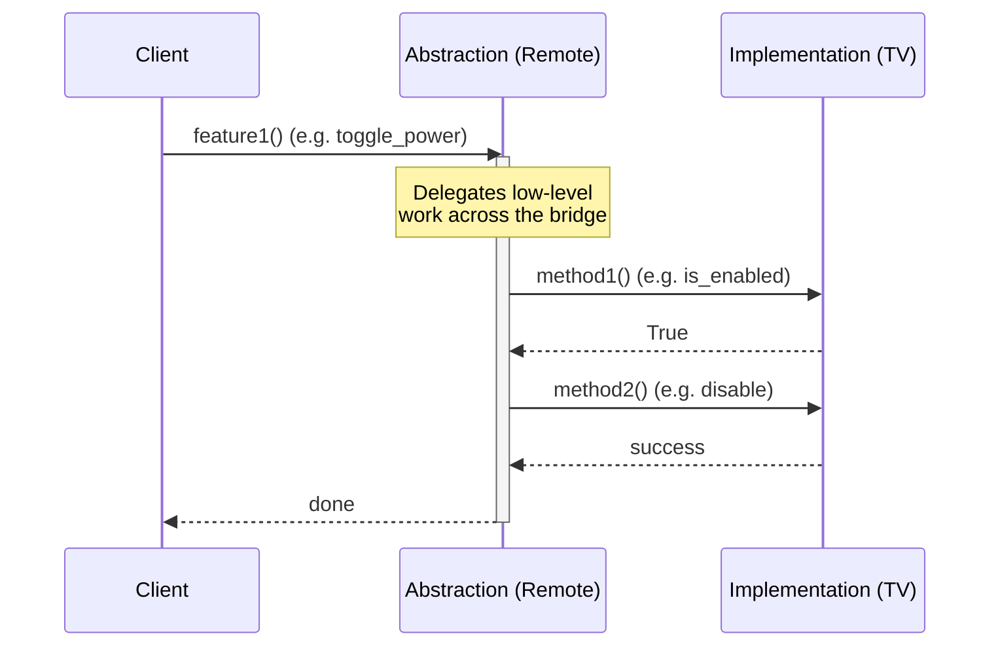
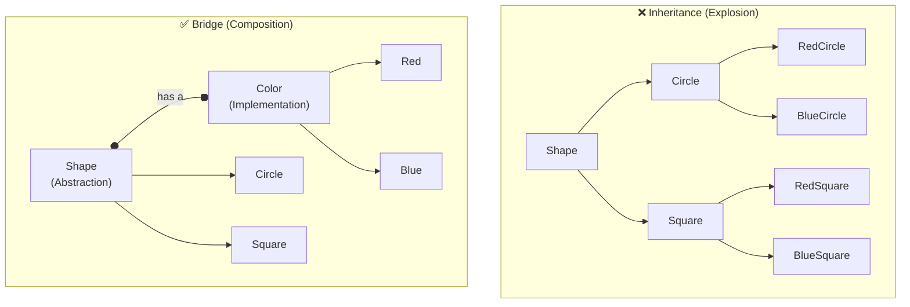

# Pattern 07: Bridge (Structural)

## 🧒 The 5-Year-Old Explanation

Think about universal remote controls and TVs. You can have a Samsung TV or an LG TV. You can have a basic remote or a smart remote. If you tried to make a class for every combination, you'd have: `SamsungBasicRemote`, `SamsungSmartRemote`, `LGBasicRemote`, `LGSmartRemote`. That's too many!

Instead, you build a **Bridge**. You have one Remote (the "Abstraction") that holds a connection to a TV (the "Implementation"). You can swap the TV or swap the remote independently without creating 100 confusing combinations.

---

## 📦 Prerequisites

**You should be comfortable with:**
- Composition vs Inheritance (Ch 00)
- Interfaces / Protocols

---

## 🔍 How to Spot This Pattern

**Think of Bridge when you see:**
- A class hierarchy growing in two independent dimensions (e.g., Shape/Color, GUI/OS, Remote/Device) causing a Cartesian product explosion of subclasses.
- You want to separate the high-level logic (Abstraction) from the low-level platform details (Implementation) so they can vary independently.
- You need to switch implementations at runtime.

**Anti-signals:**
- The two dimensions are tightly coupled and will never vary independently.
- You are trying to make two *existing, incompatible* interfaces work together → **Adapter** (Ch 06).

---

## 🧩 The Core Idea

### Intent (GoF)
> Decouple an abstraction from its implementation so that the two can vary independently.

### UML Class Diagram



### UML Sequence Diagram



---

## 🔧 Pattern Anatomy

### Participants

| Participant | Python Type | Role |
|-------------|------------|------|
| `Abstraction` | Class | High-level control layer (e.g., GUI, Remote). Holds a reference to the Implementation. |
| `RefinedAbstraction` | Subclass | Extends the Abstraction with more features (e.g., SmartRemote). |
| `Implementation` | `Protocol` / `ABC` | Low-level execution layer interface (e.g., OS API, TV API). |
| `ConcreteImplementation` | Class | Concrete low-level logic (e.g., Windows API, Samsung TV API). |

---

## 📊 Visual Walkthrough

### The Subclass Explosion (Inheritance) vs Bridge (Composition)



---

## 🔄 Without Pattern → With Pattern

### Level 1: Subclass Explosion
```python
# BAD: If we add a new OS (Linux) or a new GUI element (Checkbox),
# we have to create many new classes (LinuxButton, MacCheckbox, etc.)
class MacButton(Button): pass
class WindowsButton(Button): pass
class MacWindow(Window): pass
class WindowsWindow(Window): pass
```

### Level 3: Bridge
```python
# GOOD: GUI elements (Abstraction) and OS APIs (Implementation) vary independently
class GUIElement:
    def __init__(self, renderer: OSRenderer):
        self.renderer = renderer  # The Bridge

class Button(GUIElement):
    def click(self):
        self.renderer.render_button()

class WindowsRenderer(OSRenderer):
    def render_button(self): pass
    
class MacRenderer(OSRenderer):
    def render_button(self): pass
```

---

## ⏱️ Trade-offs

| Aspect | Assessment |
|--------|-----------|
| **Complexity** | High - requires designing two parallel class hierarchies. |
| **SOLID** | OCP (add new abstractions or implementations independently), SRP (separates high-level logic from low-level platform details). |
| **When Justified** | Avoiding an exponential explosion of subclasses caused by multiple orthogonal dimensions of variation. |

---

## 🌍 Real-World Framework Sightings

### Python Standard Library
- The `logging` module separates the `Logger` (Abstraction) from the `Handler` (Implementation). You can log to a file, stream, or network socket without changing how you call `logger.info()`.

---

## ✅ Examples in This Chapter

| # | Example | Framework | Key Concept |
|---|---------|-----------|-------------|
| 1 | Remote and Devices | Pure Python | Decoupling controllers (remotes) from devices (TV/Radio) |
