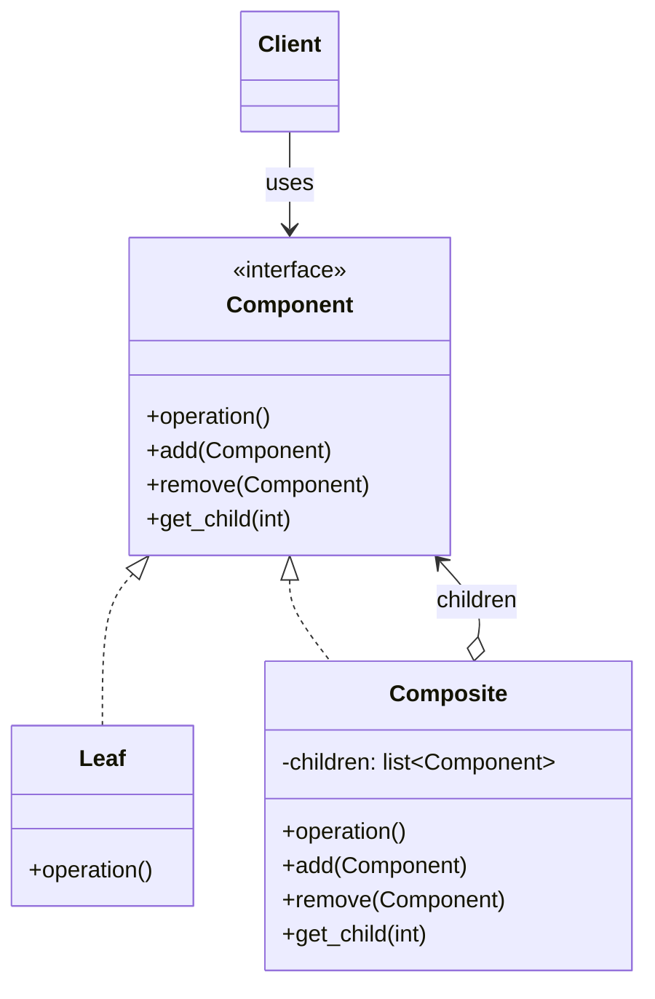
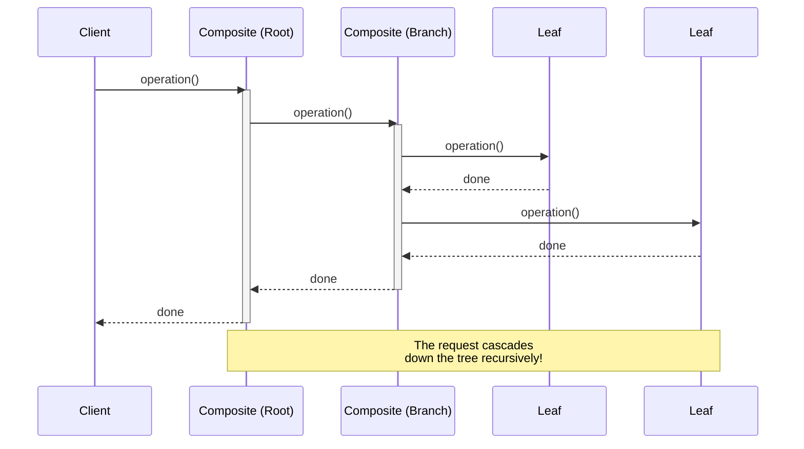

# Pattern 08: Composite (Structural)

## 🧒 The 5-Year-Old Explanation

Imagine a **box of toys**. Inside the box, you have individual toys (like a car or a ball), but you also have smaller boxes inside! If I tell you "move the big box to the car," you move EVERYTHING inside it automatically. 

The Composite pattern lets you treat a single object (a toy) and a group of objects (a box of toys) exactly the same way. 

---

## 📦 Prerequisites

**You should be comfortable with:**
- Recursion (functions calling themselves)
- Tree data structures (Nodes, Leaves, Branches)
- Protocols/ABCs for defining a common interface

---

## 🔍 How to Spot This Pattern

**Think of Composite when you see:**
- A **Part-Whole** hierarchy (trees).
- You want clients to ignore the difference between individual objects (Leaves) and compositions of objects (Branches/Composites).
- Files and Directories, UI components (a Panel contains Buttons and other Panels), Menus and Sub-menus.

**Anti-signals:**
- The objects don't form a tree structure.
- You don't need to treat groups and individual items uniformly.

---

## 🧩 The Core Idea

### Intent (GoF)
> Compose objects into tree structures to represent part-whole hierarchies. Composite lets clients treat individual objects and compositions of objects uniformly.

### UML Class Diagram



### UML Sequence Diagram



---

## 🔧 Pattern Anatomy

### Participants

| Participant | Python Type | Role |
|-------------|------------|------|
| `Component` | `Protocol` / `ABC` | Declares the interface for objects in the composition. |
| `Leaf` | Class | Represents leaf objects in the composition. A leaf has no children. Implements the `Component` interface. |
| `Composite` | Class | Represents a complex component that may have children. Implements the `Component` interface and routes calls to its children. |

---

## 🔄 Without Pattern → With Pattern

### Level 1: Checking Types (The Anti-Pattern)
```python
# BAD: Client has to know if it's dealing with a single item or a list
def get_total_price(item):
    if isinstance(item, Box):
        total = 0
        for child in item.items:
            total += get_total_price(child) # Recursion mixed with type checking
        return total
    elif isinstance(item, Product):
        return item.price
```

### Level 3: Composite Pattern
```python
# GOOD: Client just calls the method. It doesn't care if it's a Box or a Product.
def get_total_price(item: Item):
    return item.get_price() # Polymorphism and recursion handle it!
```

---

## ⏱️ Trade-offs

| Aspect | Assessment |
|--------|-----------|
| **Complexity** | Medium - conceptualizing trees and recursion can be tricky. |
| **SOLID** | OCP (you can introduce new component types without breaking existing code). Can violate ISP if leaf nodes are forced to implement `add()`/`remove()` methods that throw errors (though in modern Python, we often leave those out of the Protocol and use structural typing). |
| **When Justified** | Dealing with tree structures where groups and individuals should be treated identically. |

---

## 🌍 Real-World Framework Sightings

### GUI Frameworks (Tkinter, PyQt)
- A `Window` contains `Frames`, which contain `Buttons` and `Labels`. Calling `draw()` or `hide()` on the `Window` cascades down to all children.

### DOM (Document Object Model)
- An HTML page is a tree. A `<div>` (Composite) contains `<p>` and `<span>` tags (Leaves).

---

## ✅ Examples in This Chapter

| # | Example | Framework | Key Concept |
|---|---------|-----------|-------------|
| 1 | File System (Files and Directories) | Pure Python | Recursively calculating sizes and rendering trees |
