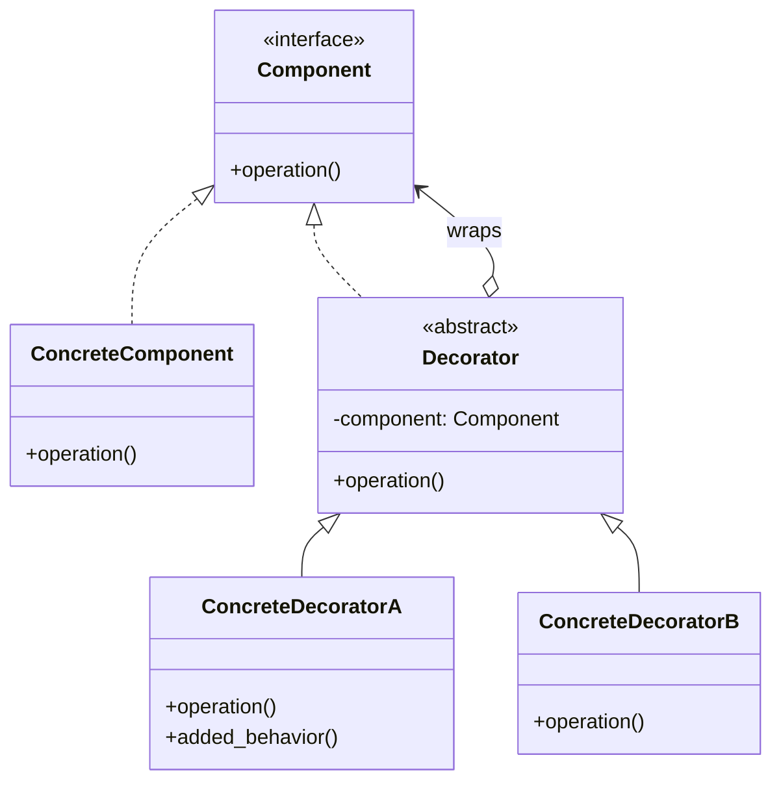
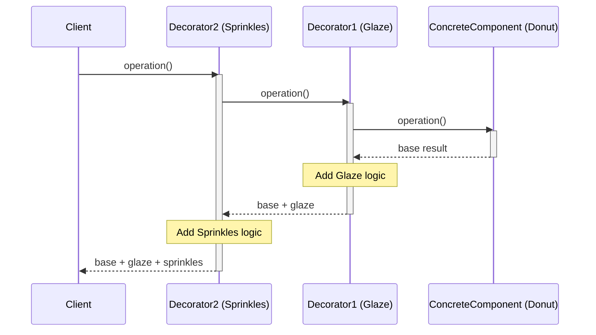
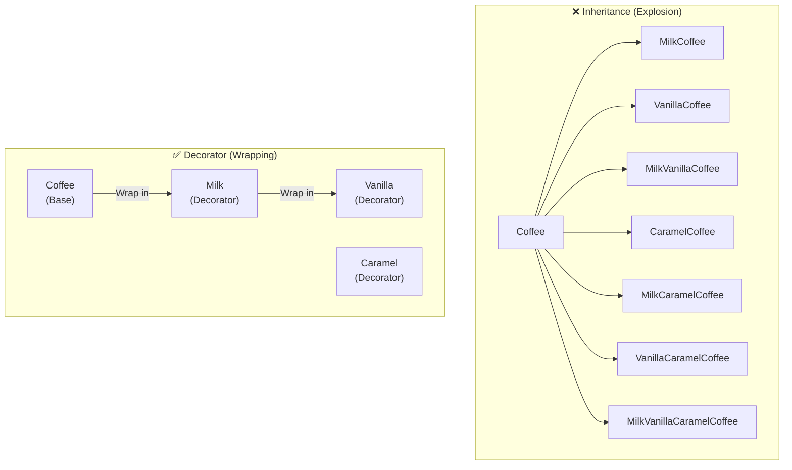

# Pattern 09: Decorator (Structural)

## 🧒 The 5-Year-Old Explanation

Imagine you have a plain **donut**. It's good, but you want more. You add **glaze** to it. Now it's a glazed donut. Then you add **sprinkles**. Now it's a glazed donut with sprinkles. 

You didn't bake a whole new type of donut from scratch; you just wrapped the original donut in new layers (glaze, then sprinkles). 

The Decorator pattern lets you attach new behaviors to an object by putting it inside special wrapper objects that contain those behaviors.

---

## 📦 Prerequisites

**You should be comfortable with:**
- Python `@decorator` syntax (functions wrapping functions)
- Object Composition vs Inheritance
- Protocols / ABCs

---

## 🔍 How to Spot This Pattern

**Think of Decorator when you see:**
- You want to add functionality to an object dynamically, at runtime, without affecting other objects of the same class.
- You have a class explosion because of different combinations of features (e.g., `Coffee`, `MilkCoffee`, `VanillaCoffee`, `MilkVanillaCoffee`).
- You see layers or "onion-like" structures where an object is wrapped repeatedly.

**Anti-signals:**
- You want to change the *interface* of the object to match something else → **Adapter** (Ch 06)
- You want to control *access* to the object (lazy loading, caching) → **Proxy** (Ch 12)

---

## 🧩 The Core Idea

### Intent (GoF)
> Attach additional responsibilities to an object dynamically. Decorators provide a flexible alternative to subclassing for extending functionality.

### UML Class Diagram



### UML Sequence Diagram



---

## 🔧 Pattern Anatomy

### Participants

| Participant | Python Type | Role |
|-------------|------------|------|
| `Component` | `Protocol` / `ABC` | The interface shared by both the base objects and the decorators. |
| `ConcreteComponent` | Class | The base object being decorated (the plain donut). |
| `Decorator` | Class | Maintains a reference to a `Component` object and defines an interface that conforms to `Component`'s interface. |
| `ConcreteDecorator` | Class | Adds state or behavior to the component (the glaze, the sprinkles). |

---

## 📊 Visual Walkthrough

### Inheritance vs Decorator (Subclass Explosion vs Wrapping)



---

## 🔄 Without Pattern → With Pattern

### Level 1: Subclass Explosion (The Anti-Pattern)
```python
# BAD: We need a new class for every possible combination!
class Text:
    def render(self): return "hello"

class BoldText(Text):
    def render(self): return f"<b>{super().render()}</b>"
    
class ItalicText(Text):
    def render(self): return f"<i>{super().render()}</i>"
    
class BoldItalicText(Text):  # The explosion begins...
    def render(self): return f"<b><i>{super().render()}</i></b>"
```

### Level 3: Decorator Pattern (Object-Oriented)
```python
# GOOD: We can wrap components endlessly!
base = Text("hello")
bold = BoldDecorator(base)
bold_italic = ItalicDecorator(bold)
print(bold_italic.render())  # <i><b>hello</b></i>
```

---

## 🐍 Python's Native Decorators (`@`) vs GoF Decorator

It is crucial to distinguish between the **GoF Decorator Pattern** and **Python's `@decorator` syntax**.

1. **GoF Decorator**: A structural pattern dealing with *objects*. Wraps objects inside other objects to change behavior dynamically at runtime.
2. **Python `@decorator`**: A language feature dealing with *functions/methods/classes*. Wraps a function inside another function, usually applied at definition time.

*However*, they conceptually do the exact same thing (wrapping to extend behavior). Python's `@` syntax is just a highly optimized, functional implementation of the pattern applied to functions.

---

## ⏱️ Trade-offs

| Aspect | Assessment |
|--------|-----------|
| **Complexity** | Low - standard object composition. |
| **SOLID** | SRP (each decorator handles one specific behavior), OCP (add new decorators without altering existing code). |
| **When Justified** | When you need to combine behaviors dynamically and avoid subclass explosion. |
| **When Over-engineered** | If you only have one or two static variations, subclassing might be simpler. |

---

## 🌍 Real-World Framework Sightings

### Python Standard Library
- `gzip.GzipFile` can wrap standard file objects to add compression transparently.
- Standard decorators like `@classmethod`, `@staticmethod`, `@property`.

### Web Frameworks (Django, Flask, FastAPI)
- Middleware is a perfect example of the Decorator pattern. A request comes in, gets wrapped/modified by auth middleware, logging middleware, etc., before hitting the core view function.

---

## ✅ Examples in This Chapter

| # | Example | Framework | Key Concept |
|---|---------|-----------|-------------|
| 1 | Coffee Shop (Object Decorator) | Pure Python | The classic GoF Object Decorator for adding features dynamically. |
