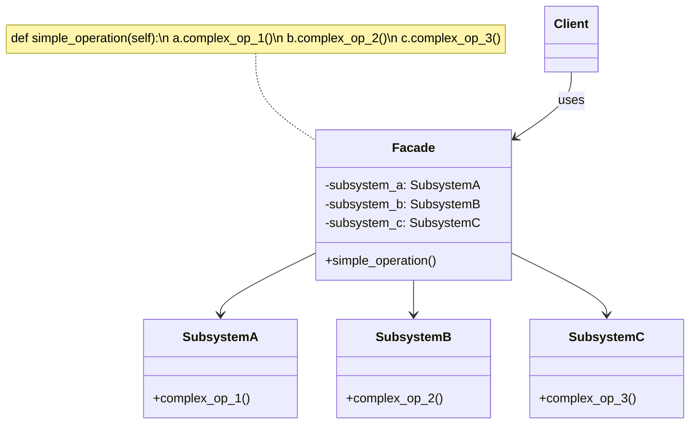
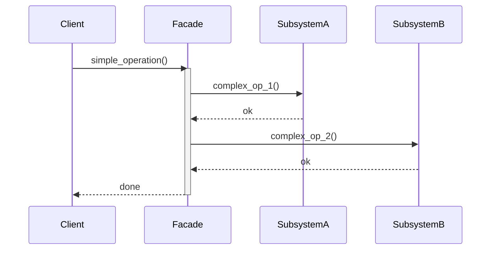
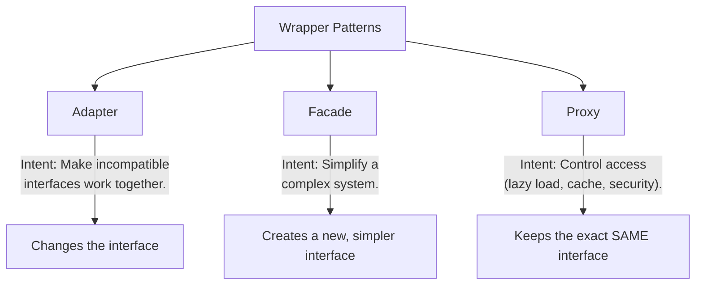

# Pattern 10: Facade (Structural)

## 🧒 The 5-Year-Old Explanation

When you want to watch a movie, you have to:
1. Turn on the TV.
2. Switch the TV input to HDMI 1.
3. Turn on the soundbar.
4. Set the soundbar volume to 50.
5. Turn on the Apple TV.
6. Open the Netflix app.

That's too many buttons! A **Facade** is like a smart home "Movie Mode" button. You press ONE button, and it does all 6 steps for you behind the scenes. It gives you a simple interface to a complicated system.

---

## 📦 Prerequisites

**You should be comfortable with:**
- Object Composition
- API Design (making things easy for the caller)

---

## 🔍 How to Spot This Pattern

**Think of Facade when you see:**
- You need to interact with a complex subsystem (many classes, many methods) but only need a simple, common use case.
- You want to structure a subsystem into layers.
- You want to decouple your client code from a messy 3rd party library by wrapping it in a clean, simple class.

**Anti-signals:**
- You are trying to add *new functionality* to an object → **Decorator** (Ch 09)
- You want to restrict access or add caching → **Proxy** (Ch 12)
- You need to adapt an incompatible interface to match an *existing* interface the client expects → **Adapter** (Ch 06)

---

## 🧩 The Core Idea

### Intent (GoF)
> Provide a unified interface to a set of interfaces in a subsystem. Facade defines a higher-level interface that makes the subsystem easier to use.

### UML Class Diagram



### UML Sequence Diagram



---

## 🔧 Pattern Anatomy

### Participants

| Participant | Python Type | Role |
|-------------|------------|------|
| `Facade` | Class | Knows which subsystem classes are responsible for a request. Delegates client requests to appropriate subsystem objects. |
| `Subsystem Classes` | Classes | Implement subsystem functionality. Handle work assigned by the Facade object. Have NO knowledge of the facade. |

---

## 📊 Visual Walkthrough

### Adapter vs Facade vs Proxy

They all act as wrappers, but their *intent* is different:



---

## 🔄 Without Pattern → With Pattern

### Level 1: Client Does All the Work
```python
# BAD: Client code is coupled to the complex internals of the video encoding system
file = VideoFile("funny_cats.mp4")
source_codec = CodecFactory.extract(file)
destination_codec = MPEG4CompressionCodec()
buffer = BitrateReader.read(file, source_codec)
result = BitrateReader.convert(buffer, destination_codec)
audio = AudioMixer.fix(result)
```

### Level 3: Facade Pattern
```python
# GOOD: Client just calls one method. The Facade handles the complexity.
converter = VideoConverterFacade()
result = converter.convert("funny_cats.mp4", "mp4")
```

---

## ⏱️ Trade-offs

| Aspect | Assessment |
|--------|-----------|
| **Complexity** | Very Low. It's just a wrapper class. |
| **SOLID** | SRP (client code is simplified, facade handles orchestration), Law of Demeter (client talks to one friend instead of strangers). |
| **When Justified** | Hiding complex, ugly, or highly coupled subsystems behind a clean API. |
| **When Over-engineered** | If the subsystem is already simple. |
| **Risk** | The Facade can become a "God Object" coupled to every class in the app. |

---

## 🌍 Real-World Framework Sightings

### requests (Python library)
- The `requests.get()` function is a massive Facade. It hides the extreme complexity of `urllib3`, connection pooling, SSL verification, cookie handling, and header construction.

### Django / FastAPI
- A REST API endpoint is often a Facade. It takes a simple JSON request and internally orchestrates the Database (ORM), Authentication service, Cache, and Message Queue (Celery).

---

## ✅ Examples in This Chapter

| # | Example | Framework | Key Concept |
|---|---------|-----------|-------------|
| 1 | Video Conversion | Pure Python | Hiding a complex subsystem of codecs and bitrates behind one method. |
