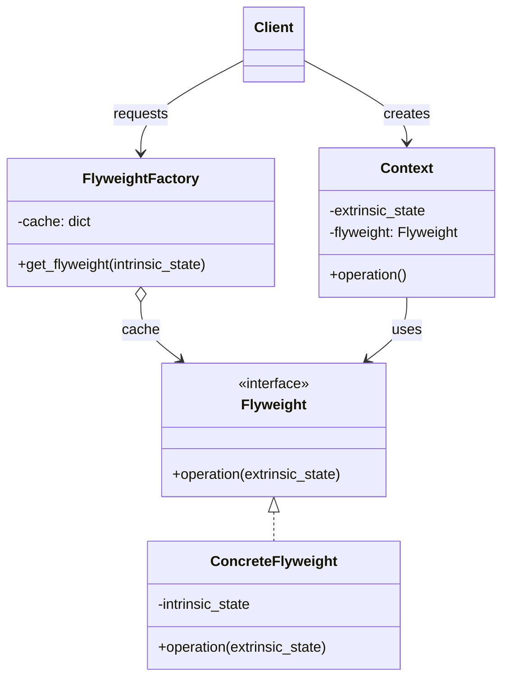
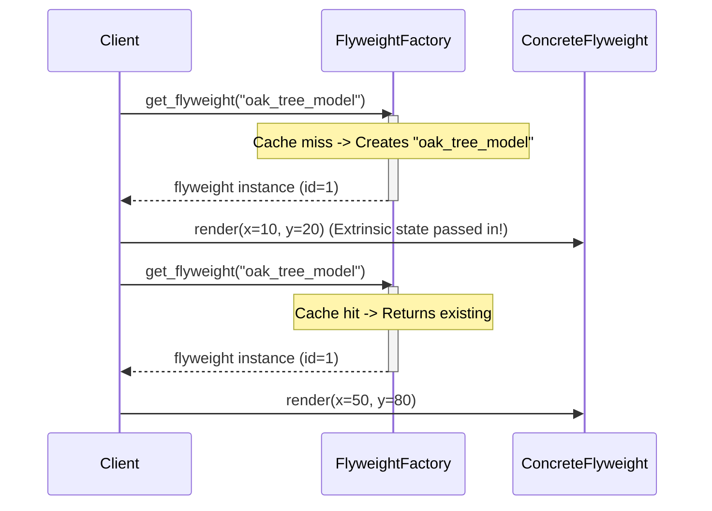
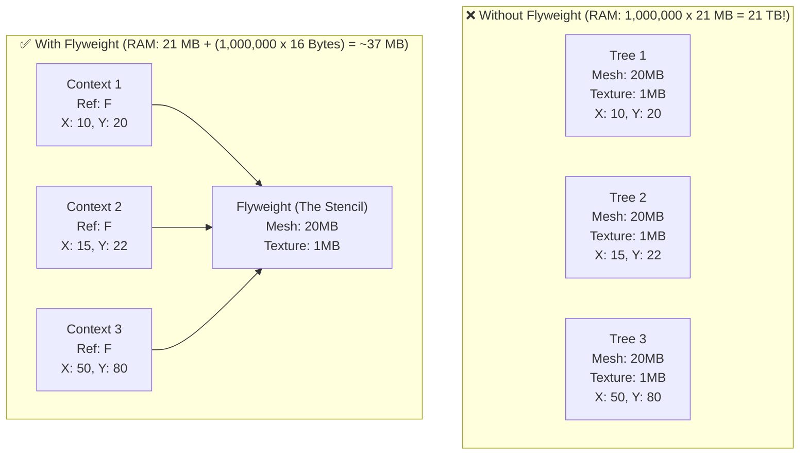

# Pattern 11: Flyweight (Structural)

## 🧒 The 5-Year-Old Explanation

Imagine you're drawing a forest with 1,000,000 trees. If you draw every single leaf and branch for every tree, your hand will cramp and you'll run out of paper (RAM). 

Instead, you draw **one** perfect tree shape on a piece of cardboard and cut it out to make a stencil. Then, for the 1,000,000 trees, you just use the stencil and only record where it goes on the paper (X and Y coordinates). 

You saved a ton of paper by sharing the heavy, detailed part (the stencil) and only keeping track of the small, changing parts (the coordinates). That's the **Flyweight** pattern!

---

## 📦 Prerequisites

**You should be comfortable with:**
- Memory management (how objects consume RAM)
- Intrinsic vs Extrinsic state
- Singleton pattern (Flyweight factories are often Singletons)

---

## 🔍 How to Spot This Pattern

**Think of Flyweight when you see:**
- An application needs to spawn a massive number of objects (e.g., bullets in a game, characters in a text editor, trees in a 3D landscape).
- The application is running out of RAM (OutOfMemoryException).
- The objects share a lot of duplicate state that can be factored out.

**Anti-signals:**
- You only have a few hundred objects. Modern computers have gigabytes of RAM. Don't optimize prematurely!
- The objects have completely unique states with no duplication.

---

## 🧩 The Core Idea

### Intent (GoF)
> Use sharing to support large numbers of fine-grained objects efficiently.

### Intrinsic vs Extrinsic State

This is the most important concept in Flyweight. You must split your object's state into two pieces:

1. **Intrinsic State (The Stencil)**: 
   - Constant data that is the same across many objects.
   - Stored *inside* the Flyweight object.
   - Example: A tree's 3D mesh, texture, and color.

2. **Extrinsic State (The Coordinates)**:
   - Data that is unique to each specific instance.
   - Passed *into* the Flyweight methods from the outside.
   - Example: A tree's X/Y coordinates on the map, its current health.

### UML Class Diagram



### UML Sequence Diagram



---

## 🔧 Pattern Anatomy

### Participants

| Participant | Python Type | Role |
|-------------|------------|------|
| `Flyweight` | `Protocol` / `ABC` | Declares an interface through which flyweights can receive and act on extrinsic state. |
| `ConcreteFlyweight` | Class | Implements the interface and stores **intrinsic state**. Must be immutable! |
| `FlyweightFactory` | Class | Creates and manages flyweight objects. Ensures that flyweights are shared properly via a cache. |
| `Context` | Class | Contains the **extrinsic state** and a reference to the flyweight. |

---

## 📊 Visual Walkthrough

### RAM Savings Visualization



---

## 🔄 Without Pattern → With Pattern

### Level 1: Out of Memory
```python
# BAD: We instantiate the heavy texture 1 million times.
class Particle:
    def __init__(self, x, y, color):
        self.x = x
        self.y = y
        self.color = color
        self.sprite = load_10mb_image() # 10MB per particle!
```

### Level 3: Flyweight
```python
# GOOD: The heavy data is shared.
class ParticleFlyweight:
    def __init__(self, color):
        self.color = color
        self.sprite = load_10mb_image() # Loaded ONCE per color

class ParticleContext:
    def __init__(self, x, y, flyweight: ParticleFlyweight):
        self.x = x
        self.y = y
        self.flyweight = flyweight # Just a reference (8 bytes)
```

---

## ⏱️ Trade-offs

| Aspect | Assessment |
|--------|-----------|
| **Complexity** | High - requires analyzing state and refactoring code to pass extrinsic state via method parameters. |
| **RAM vs CPU** | Trades RAM for CPU. You save RAM by sharing objects, but spend a tiny bit of CPU retrieving them from the factory and passing extrinsic data. |
| **When Justified** | STRICTLY an optimization pattern. Only use it when you actually run out of RAM due to massive numbers of similar objects. |

---

## 🌍 Real-World Framework Sightings

### Python Standard Library
- Python does this internally with small integers (e.g., `-5` to `256`) and short strings (string interning). `a = 100; b = 100; a is b` is `True` because Python uses a Flyweight cache for small ints!

### Game Engines (Unity, Unreal)
- Rendering millions of grass blades or trees. The engine loads the mesh into the GPU once (Flyweight) and uses instanced rendering (passing an array of transforms/extrinsic state) to draw them all rapidly.

---

## ✅ Examples in This Chapter

| # | Example | Framework | Key Concept |
|---|---------|-----------|-------------|
| 1 | Forest Simulator | Pure Python | Separating heavy tree models (Intrinsic) from coordinates (Extrinsic). |
