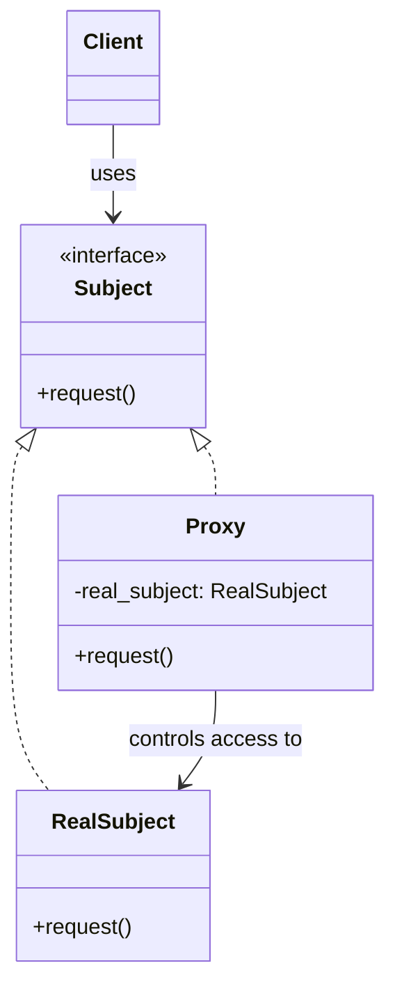
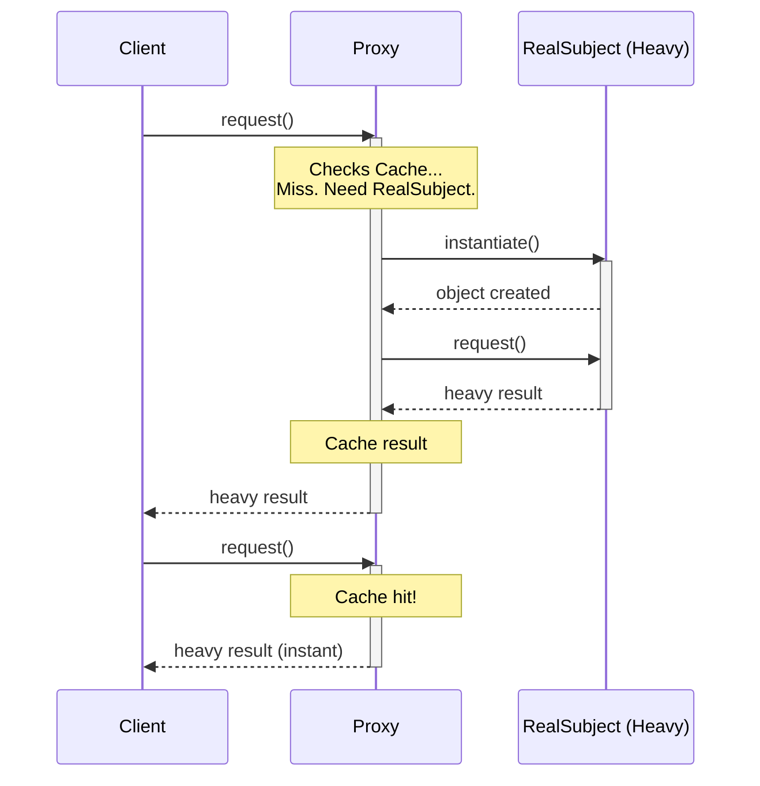
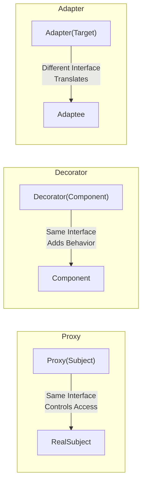

# Pattern 12: Proxy (Structural)

## 🧒 The 5-Year-Old Explanation

You want to buy a toy from the store. You can't just walk in and take it, and you don't have a credit card. So, you ask your dad. Your dad acts as your **Proxy**. 

He checks if you have enough allowance (Security/Access Control). He checks if you already bought that toy yesterday (Caching). If everything is okay, he actually goes to the store and buys it for you (Delegation). The store thinks it's dealing with a customer, but it's really your dad standing in for you.

---

## 📦 Prerequisites

**You should be comfortable with:**
- The concept of interfaces (Protocols/ABCs) ensuring two classes look identical.
- Lazy evaluation (delaying heavy work until absolutely necessary).

---

## 🔍 How to Spot This Pattern

**Think of Proxy when you see:**
- You want to control access to an object (Security Proxy).
- You want to delay creating a heavy object until it's actually used (Virtual/Lazy Proxy).
- You want to cache the results of expensive operations on an object (Caching Proxy).
- You want to represent an object that is in a different address space, like across the network (Remote Proxy / RPC).

**Anti-signals:**
- You want to *change* the interface → **Adapter** (Ch 06)
- You want to *simplify* the interface → **Facade** (Ch 10)
- You want to *add behavior* dynamically (like sprinkles) → **Decorator** (Ch 09)

---

## 🧩 The Core Idea

### Intent (GoF)
> Provide a surrogate or placeholder for another object to control access to it.

### UML Class Diagram



### UML Sequence Diagram (Caching/Lazy Proxy)



---

## 🔧 Pattern Anatomy

### Participants

| Participant | Python Type | Role |
|-------------|------------|------|
| `Subject` | `Protocol` / `ABC` | Interface shared by `RealSubject` and `Proxy`. Allows the client to treat them identically. |
| `RealSubject` | Class | The real, heavy, or sensitive object that does the actual work. |
| `Proxy` | Class | Maintains a reference to the `RealSubject`. Controls access to it (creates it, deletes it, caches it, checks permissions). |

---

## 📊 Visual Walkthrough

### The "Wrapper" Siblings (Recap)



*Note: Proxy and Decorator look structurally identical in UML! The difference is entirely in their **intent**.*

---

## 🔄 Without Pattern → With Pattern

### Level 1: Doing the Heavy Lifting Immediately
```python
# BAD: We connect to the DB immediately, even if we never run a query!
class DatabaseService:
    def __init__(self):
        self.connect_to_db() # Takes 5 seconds!
        
    def query(self, sql):
        return self.connection.execute(sql)

# Application startup is delayed by 5 seconds...
db = DatabaseService() 
```

### Level 3: Virtual Proxy (Lazy Initialization)
```python
# GOOD: We only connect when the first query is run.
class DatabaseProxy(DatabaseInterface):
    def __init__(self):
        self._real_db = None # Don't connect yet!
        
    def query(self, sql):
        if self._real_db is None:
            self._real_db = DatabaseService() # Connect NOW
        return self._real_db.query(sql)

# Instant startup!
db = DatabaseProxy() 
```

---

## ⏱️ Trade-offs

| Aspect | Assessment |
|--------|-----------|
| **Complexity** | Low - standard wrapper class. |
| **SOLID** | SRP (separates security/caching from core logic), OCP (add new proxies without changing the real subject). |
| **When Justified** | When you want to add access control, lazy initialization, logging, or caching to an object *without* modifying its code. |

---

## 🌍 Real-World Framework Sightings

### Django
- `django.utils.functional.LazyObject` is a virtual proxy. It delays evaluating something (like the current user or a translated string) until the absolute last moment when it's accessed.

### SQLAlchemy
- When you define a relationship (`user.posts`), SQLAlchemy doesn't load the posts immediately. It returns an "instrumented list" (a Proxy). When you actually loop over `user.posts`, the Proxy intercepts the call, hits the database, and returns the real data (Lazy Loading).

---

## ✅ Examples in This Chapter

| # | Example | Framework | Key Concept |
|---|---------|-----------|-------------|
| 1 | Protection Proxy | Pure Python | Checking permissions before delegating a request to the real subject. |
| 2 | Virtual Proxy (Lazy Loading) | Pure Python | Delaying the creation of a heavy object until it's actually needed. |
