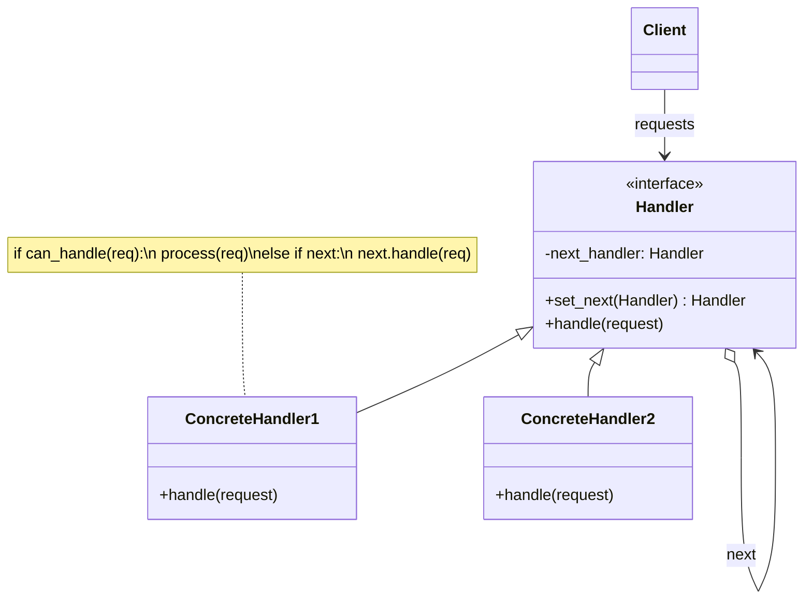
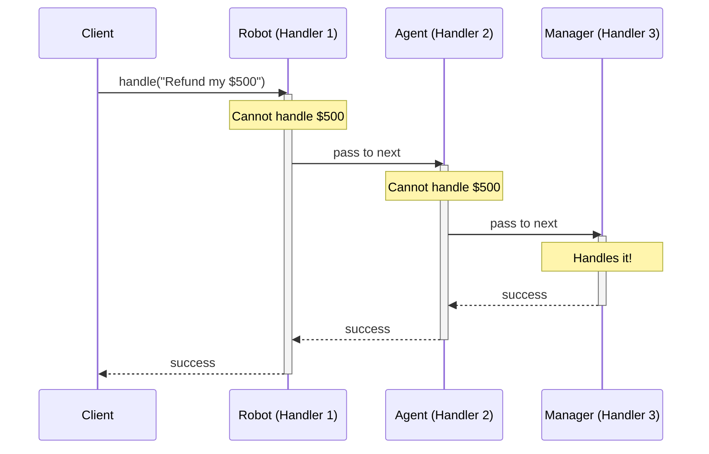

# Pattern 13: Chain of Responsibility (Behavioral)

## 🧒 The 5-Year-Old Explanation

Imagine you are calling a big company's customer service. 
You talk to a robot first. If the robot can't help you, it passes you to a human agent. If the human agent can't help, they pass you to their manager. 

You (the client) just made one request. The company has a **Chain** of people. The request travels down the chain until someone says, "I can handle this!" (or until the chain ends).

---

## 📦 Prerequisites

**You should be comfortable with:**
- Linked Lists (the structural foundation of this pattern)
- Recursion or while loops
- Object Composition (holding a reference to the `next` handler)

---

## 🔍 How to Spot This Pattern

**Think of Chain of Responsibility when you see:**
- You have a request, and multiple objects could potentially process it.
- You don't want the sender of the request to know exactly *which* object will process it.
- You want to execute multiple handlers in a specific order (like middleware).
- You see `if/elif/elif/elif` chains where each block represents a totally different subsystem trying to handle the same data.

**Anti-signals:**
- The sender needs an immediate, guaranteed return value from a *specific* receiver.
- Every receiver must process every request simultaneously (use **Observer/PubSub** instead).

---

## 🧩 The Core Idea

### Intent (GoF)
> Avoid coupling the sender of a request to its receiver by giving more than one object a chance to handle the request. Chain the receiving objects and pass the request along the chain until an object handles it.

### UML Class Diagram



### UML Sequence Diagram



---

## 🔧 Pattern Anatomy

### Participants

| Participant | Python Type | Role |
|-------------|------------|------|
| `Handler` | `Protocol` / `ABC` | Defines an interface for handling requests. (Optional: implements the successor link logic). |
| `ConcreteHandler` | Class | Handles requests it is responsible for. Can access its successor. If it can handle the request, it does so; otherwise, it forwards the request to its successor. |
| `Client` | Class/Script | Initiates the request to a `Handler` object on the chain. |

---

## 📊 Visual Walkthrough

### The Two Variations of the Chain

There are two primary ways the chain can operate:

1. **The "One-and-Done" Chain (GoF Classic)**: The request travels down the chain. The FIRST handler that can process it does so, and the chain STOPS. (e.g., Customer Support).
2. **The "Middleware" Chain (Modern)**: The request travels down the chain. EVERY handler does a little piece of processing, modifies the request, and passes it to the next. (e.g., Express.js / Django middleware).

```mermaid
flowchart LR
    subgraph "GoF Classic (Stop at First Handler)"
        R1["Request"] --> H1["Auth"]
        H1 -->|"Not my job"| H2["Cache"]
        H2 -->|"I can do this!"| End["Return Response"]
        End -.x H3["Database (Ignored)"]
    end
    
    subgraph "Modern Middleware (Pass Through All)"
        R2["Request"] --> M1["Auth (Verifies)"]
        M1 --> M2["Logging (Logs)"]
        M2 --> M3["Database (Queries)"]
        M3 --> Resp["Return Response"]
    end
```

---

## 🔄 Without Pattern → With Pattern

### Level 1: Monolithic if/elif hell
```python
# BAD: The client is tightly coupled to every single handler.
def handle_support_ticket(ticket):
    if ticket.type == "password_reset":
        return RobotHandler().reset_password(ticket)
    elif ticket.type == "billing" and ticket.amount < 100:
        return Tier1Agent().process_refund(ticket)
    elif ticket.type == "billing" and ticket.amount >= 100:
        return Manager().process_refund(ticket)
    # The function grows forever...
```

### Level 3: Chain of Responsibility
```python
# GOOD: Client only knows about the front of the chain.
# The chain configures itself.
robot = RobotHandler()
agent = Tier1Agent()
manager = Manager()

robot.set_next(agent).set_next(manager) # Build the chain

# Client just throws the ticket at the robot. It figures it out.
robot.handle(ticket) 
```

---

## ⏱️ Trade-offs

| Aspect | Assessment |
|--------|-----------|
| **Complexity** | Low - standard linked list setup. |
| **SOLID** | SRP (each handler does one specific check/task), OCP (easy to add new handlers without changing existing code or client). |
| **When Justified** | You need to process a request sequentially through multiple potential handlers, and the order or exact handlers might change dynamically. |
| **Risk** | A request might reach the end of the chain unhandled, failing silently if not caught. |

---

## 🌍 Real-World Framework Sightings

### Web Frameworks (Django, FastAPI, Flask, Express)
- **Middleware**: A classic implementation of the Chain of Responsibility. An incoming HTTP request passes through CORS checks, Authentication, CSRF protection, and Logging before finally reaching your view function. 

### Python standard library
- `logging`: When you log a message, it is passed to a `Logger`. If that logger doesn't handle it (or is set to `propagate=True`), it passes the message up the chain to the parent logger, all the way to the root logger.

---

## ✅ Examples in This Chapter

| # | Example | Framework | Key Concept |
|---|---------|-----------|-------------|
| 1 | Customer Support (Classic) | Pure Python | The request stops at the first handler that can process it. |
| 2 | Web Middleware (Modern) | Pure Python | The request passes through all handlers sequentially. |
