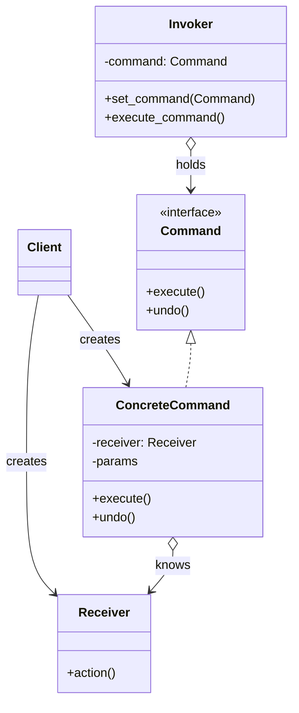
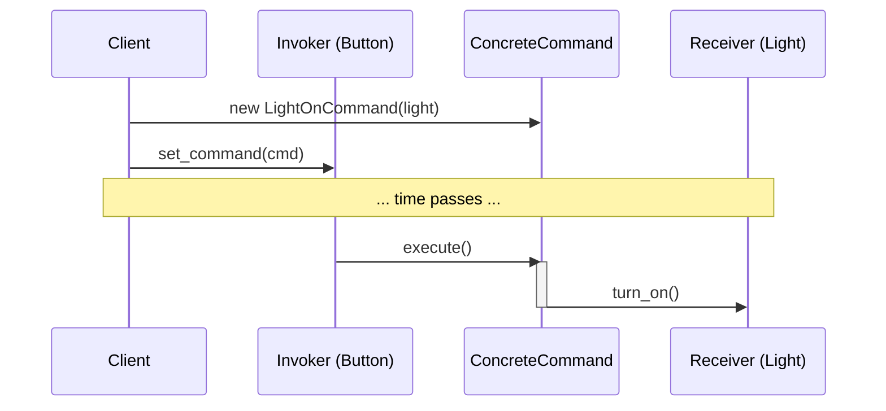

# Pattern 14: Command (Behavioral)

## 🧒 The 5-Year-Old Explanation

When you order food at a restaurant, you don't walk into the kitchen and tell the chef how to cook your burger. Instead, you give an **Order** (a piece of paper) to the waiter. The waiter takes that piece of paper, puts it on a queue in the kitchen, and later, the chef reads it and cooks the food.

The **Command** pattern is that piece of paper. It takes a request (make a burger) and turns it into a standalone object. Because it's an object, you can put it in a list (queues), save it for later (scheduling), or even throw it in the trash if you change your mind (undo).

---

## 📦 Prerequisites

**You should be comfortable with:**
- First-class functions (in Python, functions are objects, which can sometimes replace this pattern).
- Object composition.
- The concept of Undo/Redo stacks.

---

## 🔍 How to Spot This Pattern

**Think of Command when you see:**
- You want to parameterize objects with operations (e.g., UI buttons that trigger different actions).
- You want to queue operations, schedule their execution, or execute them remotely.
- You need to implement **Undo/Redo** functionality.
- You want to log changes so they can be reapplied later (Event Sourcing / Transaction logs).

**Anti-signals:**
- The operation is very simple and executed immediately. (Just call the method directly!)
- You are writing Python and just need to pass a simple callback. (Use a lambda or a function reference instead of a full Command class).

---

## 🧩 The Core Idea

### Intent (GoF)
> Encapsulate a request as an object, thereby letting you parameterize clients with different requests, queue or log requests, and support undoable operations.

### UML Class Diagram



### UML Sequence Diagram



---

## 🔧 Pattern Anatomy

### Participants

| Participant | Python Type | Role |
|-------------|------------|------|
| `Command` | `Protocol` / `ABC` | Declares an interface for executing an operation (usually just `execute()` and `undo()`). |
| `ConcreteCommand` | Class | Defines a binding between a `Receiver` object and an action. Implements `execute()` by invoking the corresponding operations on the Receiver. |
| `Client` | Class/Script | Creates a `ConcreteCommand` object and sets its receiver. |
| `Invoker` | Class | Asks the command to carry out the request. (Does NOT know *how* the command works, just calls `execute()`). |
| `Receiver` | Class | Knows how to perform the actual operations. Any class can serve as a Receiver. |

---

## 🔄 Without Pattern → With Pattern

### Level 1: Tightly Coupled UI
```python
# BAD: The UI Button is tightly coupled to the Business Logic (Document).
class Button:
    def __init__(self, document: Document):
        self.doc = document
        
    def click(self):
        self.doc.save() # The Button knows exactly what it's doing
```

### Level 3: Command Pattern
```python
# GOOD: The Button just holds a Command. It doesn't know what the Command does.
class Button:
    def __init__(self, command: Command):
        self.command = command
        
    def click(self):
        self.command.execute() # Could be Save, Print, Delete, anything!

save_cmd = SaveCommand(document)
btn = Button(save_cmd)
```

---

## 🐍 Python-Specific Note: Functions as Commands

Because Python treats functions as first-class objects, you often don't need a full `Command` class for simple use cases. You can just pass a function:

```python
class Button:
    def __init__(self, on_click: Callable):
        self.on_click = on_click
        
    def click(self):
        self.on_click()

btn = Button(lambda: document.save())
```
**When to use a full Class instead of a Function:**
1. When you need `undo()` functionality (the class stores the previous state).
2. When the command needs to be serialized/saved to a database (Event Sourcing).
3. When the command requires complex parameterization that spans multiple methods.

---

## ⏱️ Trade-offs

| Aspect | Assessment |
|--------|-----------|
| **Complexity** | Medium - introduces many small classes (one for every action). |
| **SOLID** | SRP (decouples the class that invokes the operation from the class that performs it), OCP (you can add new commands without breaking existing code). |
| **When Justified** | Undo/Redo systems, Macro recording, Task scheduling, transaction logging. |

---

## 🌍 Real-World Framework Sightings

### Django / Celery
- **Celery Tasks**: When you call `my_task.delay(args)`, you are creating a Command object, serializing it, and putting it on a queue (Redis/RabbitMQ). A worker (the Invoker) later pops it off and executes it.

### Text Editors
- Every action (type a letter, delete a line, paste) is encapsulated in a Command object. The editor keeps a stack of these objects. When you press `Ctrl+Z`, it pops the last command off the stack and calls `command.undo()`.

---

## ✅ Examples in This Chapter

| # | Example | Framework | Key Concept |
|---|---------|-----------|-------------|
| 1 | Smart Home Remote | Pure Python | Parameterizing an invoker (remote) with commands. |
| 2 | Text Editor Undo/Redo | Pure Python | Using commands to implement history stacks. |
