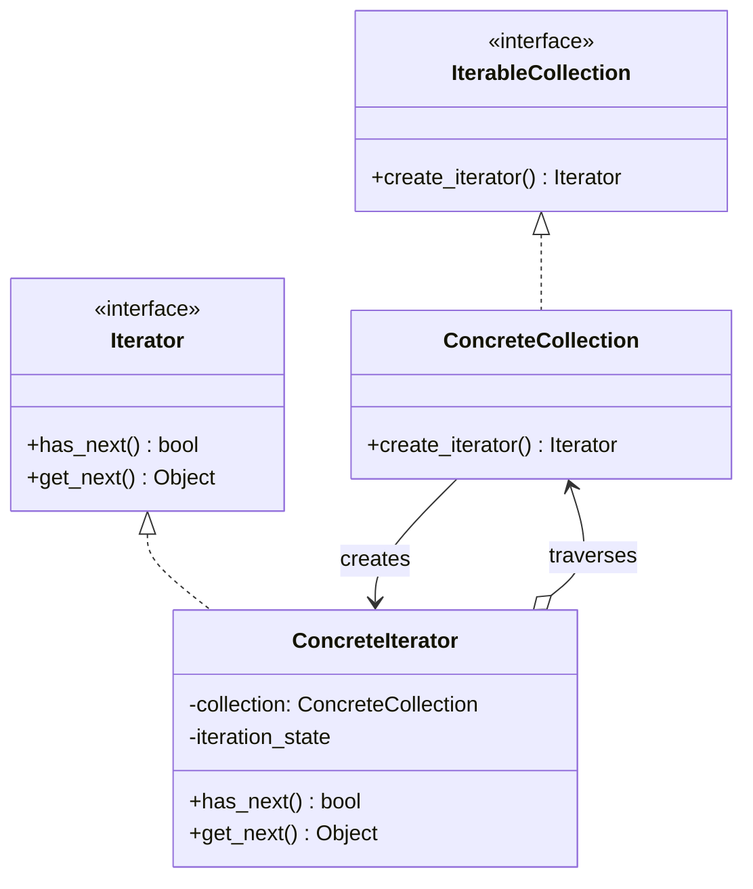
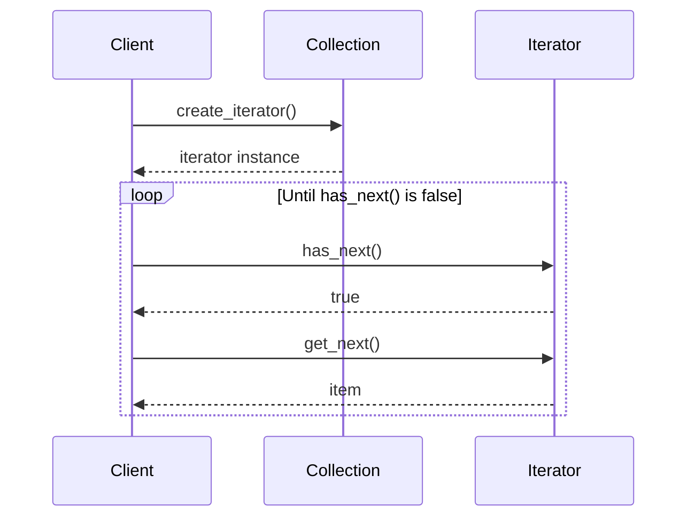

# Pattern 15: Iterator (Behavioral)

## 🧒 The 5-Year-Old Explanation

Imagine you have a big box of Lego blocks, and you want to look at every single one. You don't need to know how the blocks are stacked inside the box; you just want a magic hand that hands you one block, then the next, until the box is empty.

The **Iterator** is that magic hand. It lets you loop through a collection of things without needing to know if they are stored in a simple list, a complex tree, or a messy pile.

---

## 📦 Prerequisites

**You should be comfortable with:**
- Python's `__iter__()` and `__next__()` dunder methods.
- The `StopIteration` exception.
- Python generators (`yield`).

---

## 🔍 How to Spot This Pattern

**Think of Iterator when you see:**
- You want to hide the complex underlying data structure (like a Tree or Graph) behind a simple `for item in collection:` loop.
- You want multiple ways to traverse the same collection (e.g., Depth-First vs Breadth-First search).
- You want multiple independent traversals happening at the same time (two different iterators on the same collection).

**Anti-signals:**
- The collection is just a standard Python list and you only ever traverse it sequentially. (Python's built-in iterator is all you need).

---

## 🧩 The Core Idea

### Intent (GoF)
> Provide a way to access the elements of an aggregate object sequentially without exposing its underlying representation.

### UML Class Diagram



### UML Sequence Diagram



---

## 🐍 Python-Specific Implementation

In Python, the Iterator pattern is built directly into the language. You do not need to invent `create_iterator`, `has_next`, or `get_next`. You MUST use Python's native protocol:

| GoF Concept | Python Dunder Method | Notes |
|-------------|----------------------|-------|
| `IterableCollection` | `__iter__(self)` | Returns an Iterator object. Triggered when you do `for x in my_obj`. |
| `Iterator` | `__next__(self)` | Returns the next item. Raises `StopIteration` when done. |
| `Iterator` | `__iter__(self)` | Iterators in Python must also be Iterable (they return `self`). |

**Furthermore**, Python has **Generators** (`yield`), which allow you to create Iterators automatically without writing full classes.

---

## 🔄 Without Pattern → With Pattern

### Level 1: Exposing the internal structure
```python
# BAD: The client has to understand how the Binary Tree is built!
tree = BinaryTree()
node = tree.root
# Client has to manually write a recursive DFS function just to see the items
```

### Level 3: Iterator Pattern (Pythonic)
```python
# GOOD: The tree hides its complexity behind __iter__
tree = BinaryTree()
for item in tree:  # Pure magic!
    print(item)
```

---

## ⏱️ Trade-offs

| Aspect | Assessment |
|--------|-----------|
| **Complexity** | Low (especially in Python using `yield`). |
| **SOLID** | SRP (extracts complex traversal algorithms out of the collection), OCP (you can add new traversal algorithms without modifying the collection). |
| **When Justified** | Hiding complex data structures (Trees, Graphs, custom APIs) behind standard `for` loops. |

---

## 🌍 Real-World Framework Sightings

### Python Standard Library
- Literally everywhere. Lists, dicts, strings, sets, files, `range()`. They all implement the Iterator protocol.

### SQLAlchemy
- When you execute a query, it returns a `ResultProxy` (an Iterator). As you loop over it, it fetches rows from the database in batches rather than loading 1,000,000 rows into RAM at once.

---

## ✅ Examples in This Chapter

| # | Example | Framework | Key Concept |
|---|---------|-----------|-------------|
| 1 | Tree Traversals (DFS vs BFS) | Pure Python | Implementing multiple iterators for a complex data structure using both Classes and Generators. |
