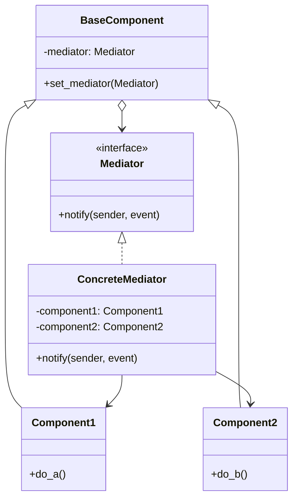
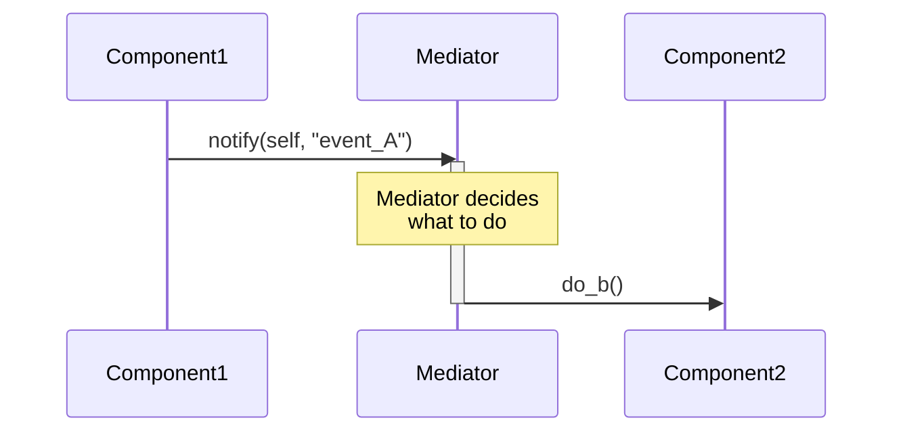
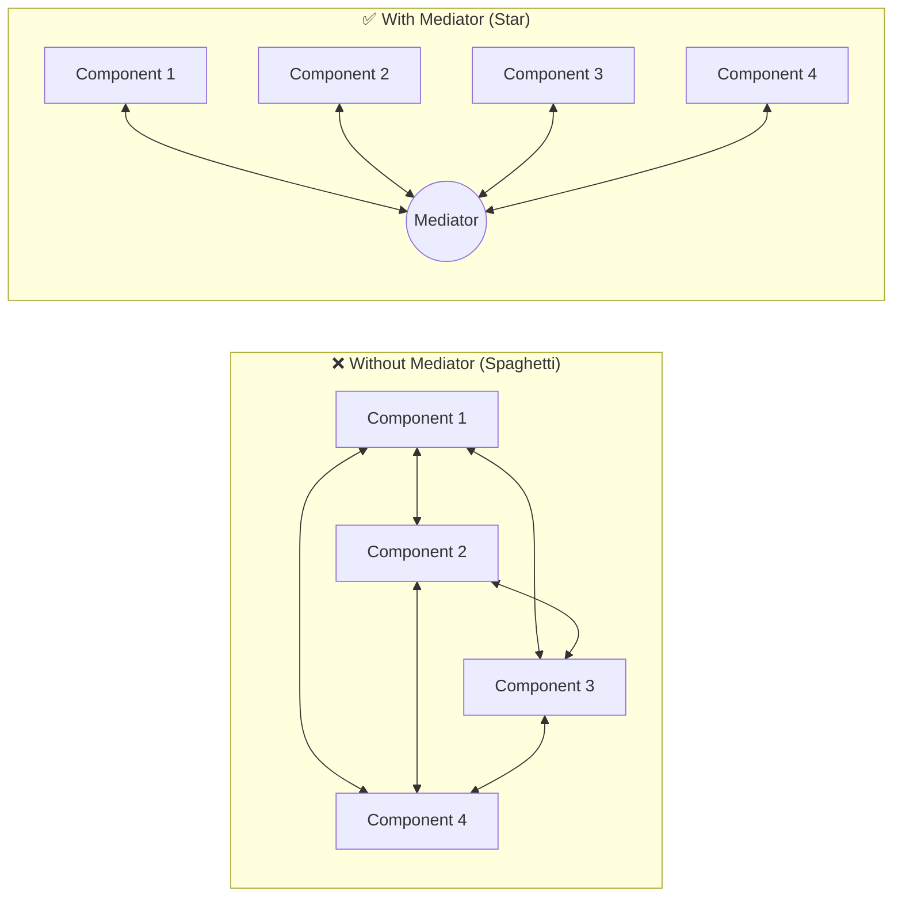

# Pattern 16: Mediator (Behavioral)

## 🧒 The 5-Year-Old Explanation

Imagine an airport with 50 airplanes. If every airplane had to talk to every other airplane to avoid crashing, it would be chaos! Everyone would be screaming on the radio.

Instead, they all talk to the **Air Traffic Controller** (the Mediator). The airplanes only need to know how to talk to the tower. The tower figures out who can land and who needs to wait, and gives the orders.

---

## 📦 Prerequisites

**You should be comfortable with:**
- Object Composition
- The concept of tight coupling (Spaghetti code)
- Event-driven architecture (Signals, Callbacks)

---

## 🔍 How to Spot This Pattern

**Think of Mediator when you see:**
- A set of objects communicate in well-defined but complex ways. The interdependencies are unstructured and difficult to understand ("Spaghetti").
- Reusing an object is difficult because it refers to and communicates with many other objects.
- You have a GUI dialog box where clicking a checkbox disables a text field, which enables a submit button, which triggers a dropdown.

**Anti-signals:**
- The objects only communicate with one or two other objects in a very simple, linear way.
- You want objects to be notified of state changes without caring who the listeners are (Use **Observer/PubSub** instead).

---

## 🧩 The Core Idea

### Intent (GoF)
> Define an object that encapsulates how a set of objects interact. Mediator promotes loose coupling by keeping objects from referring to each other explicitly, and it lets you vary their interaction independently.

### UML Class Diagram



### UML Sequence Diagram



---

## 🔧 Pattern Anatomy

### Participants

| Participant | Python Type | Role |
|-------------|------------|------|
| `Mediator` | `Protocol` / `ABC` | Defines an interface for communicating with `Component` objects. |
| `ConcreteMediator` | Class | Implements cooperative behavior by coordinating `Component` objects. It knows and maintains its components. |
| `BaseComponent` | Class | Provides basic functionality for storing a mediator's reference inside component objects. |
| `Components` | Classes | Various classes that contain some business logic. They do not communicate with other components, only with the mediator. |

---

## 📊 Visual Walkthrough

### The "Spaghetti" vs The "Star" Topology



---

## 🔄 Without Pattern → With Pattern

### Level 1: Tight Coupling (Spaghetti)
```python
# BAD: Checkbox knows about TextField. TextField knows about Button.
class Checkbox:
    def check(self):
        self.textfield.enable()
        self.button.disable()
```

### Level 3: Mediator Pattern
```python
# GOOD: Checkbox only knows about the Dialog (Mediator)
class Checkbox:
    def check(self):
        self.mediator.notify(self, "checkbox_checked")

class DialogMediator:
    def notify(self, sender, event):
        if event == "checkbox_checked":
            self.textfield.enable()
            self.button.disable()
```

---

## ⚖️ Mediator vs Observer (PubSub)

These two are very similar and often confused.

| Feature | Mediator | Observer (PubSub) |
|---------|----------|-------------------|
| **Topology** | **Centralized** (Star). The Mediator knows exactly who is involved. | **Decentralized**. Publishers don't know who the Subscribers are. |
| **Coupling** | Components are decoupled from each other, but coupled to the Mediator. | Publishers are entirely decoupled from Subscribers. |
| **Use Case** | Complex, multi-directional interactions (e.g., UI dialogs). | Simple one-way notifications (e.g., Event Streams). |

---

## ⏱️ Trade-offs

| Aspect | Assessment |
|--------|-----------|
| **Complexity** | Medium. |
| **SOLID** | SRP (extracts communication logic into one place), OCP (new mediators can be introduced without changing components). |
| **Risk** | The Mediator can easily become a **God Object** that knows too much and does too much. |

---

## 🌍 Real-World Framework Sightings

### GUI Frameworks (Tkinter, PyQt)
- Complex dialog boxes often act as Mediators. When a user changes a setting, the dialog receives the event and updates other UI elements accordingly.

### Django Models
- If you have highly coupled model `save()` methods (e.g., User saves -> updates Profile -> updates Account), a Service Layer or Signal Dispatcher often acts as a Mediator to orchestrate these saves without the models directly importing each other.

---

## ✅ Examples in This Chapter

| # | Example | Framework | Key Concept |
|---|---------|-----------|-------------|
| 1 | Air Traffic Control | Pure Python | Centralizing communication between decoupled airplanes. |
