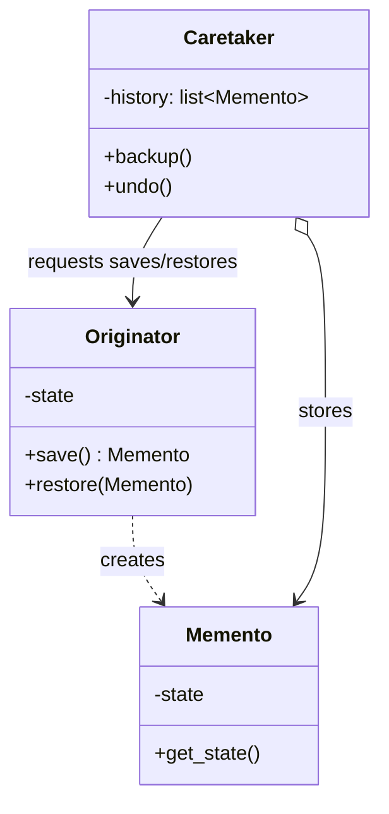
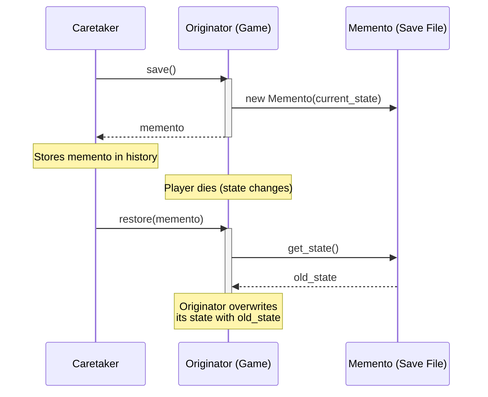

# Pattern 17: Memento (Behavioral)

## 🧒 The 5-Year-Old Explanation

Imagine you are playing a very hard video game. Before you walk into the boss room, you hit **Save Game**. You fight the boss, and you die. You hit **Load Game**, and you are right back before the boss room with all your health and items.

The game didn't just remember that you "walked forward" (like the Command pattern). It took a total snapshot of everything in your character's pockets and saved it in a memory box (a **Memento**).

---

## 📦 Prerequisites

**You should be comfortable with:**
- Encapsulation (Private variables).
- The difference between shallow and deep copies.

---

## 🔍 How to Spot This Pattern

**Think of Memento when you see:**
- You need to produce snapshots of an object's state to be able to restore a previous state (Save/Load functionality).
- You want to implement Undo/Redo, but the `Command` pattern is too complicated because the state changes are massive and unpredictable.
- Direct access to the object's fields/getters/setters would violate encapsulation.

**Anti-signals:**
- The object's state is tiny and public, so you can just read it normally.
- You can easily calculate the reverse of an action (e.g., `x + 5` reverses to `x - 5`), in which case `Command` is much more efficient than saving the entire state.

---

## 🧩 The Core Idea

### Intent (GoF)
> Without violating encapsulation, capture and externalize an object's internal state so that the object can be restored to this state later.

### UML Class Diagram



### UML Sequence Diagram



---

## 🔧 Pattern Anatomy

### Participants

| Participant | Python Type | Role |
|-------------|------------|------|
| `Originator` | Class | The object whose state we want to save (e.g., The Game). It creates a Memento containing a snapshot of its current internal state. |
| `Memento` | Class | A value object (often a Dataclass) that stores the Originator's state. It protects against access by objects other than the Originator (strict encapsulation). |
| `Caretaker` | Class | The object that knows *when* and *why* to capture the Originator's state, and keeps track of the Mementos. It never examines the contents of a Memento. |

---

## ⚖️ Memento vs Command for Undo/Redo

Both patterns can be used for Undo/Redo. Which one should you pick?

| Feature | Command Pattern (Delta) | Memento Pattern (Snapshot) |
|---------|-------------------------|----------------------------|
| **How it works** | Stores the *action taken* (`+5`) | Stores the *entire state* (`score=10`) |
| **RAM Usage** | Very Low (just stores the delta) | High (copies the whole object every time) |
| **Encapsulation** | May require exposing state to Commands | **Strict.** Only the Originator touches its state. |
| **Use Case** | Text editors, vector drawing apps. | Video games saves, database checkpoints. |

---

## 🔄 Without Pattern → With Pattern

### Level 1: Violating Encapsulation
```python
# BAD: The Caretaker has to manually reach in and grab private fields.
# If the Game adds a new field (e.g., `mana`), the Caretaker breaks!
class Game:
    def __init__(self):
        self._health = 100
        self._level = 1

class Caretaker:
    def save(self):
        # The Caretaker shouldn't know these details!
        self.save_file = (game._health, game._level)
```

### Level 3: Memento Pattern
```python
# GOOD: The Game handles its own snapshotting. The Caretaker is blind.
class Game:
    def save(self) -> GameMemento:
        return GameMemento(self._health, self._level) # Memento is opaque

class Caretaker:
    def save(self):
        self.save_file = game.save() # Caretaker just holds the box
```

---

## ⏱️ Trade-offs

| Aspect | Assessment |
|--------|-----------|
| **Complexity** | Low - just saving state to a dataclass. |
| **RAM Usage** | Very High. Creating deep copies of massive objects repeatedly consumes lots of memory. |
| **SOLID** | SRP (separates state-saving logic from the business logic). |

---

## 🌍 Real-World Framework Sightings

### Standard Python
- Python's `pickle` module is essentially a massive, dynamic Memento system. It serializes an object's exact state to bytes, which can be stored (Caretaker) and loaded later.

### Databases
- Database transactions use a form of Memento. When you start a transaction, the DB takes a snapshot of the relevant state. If you `ROLLBACK`, it restores the state from that snapshot.

---

## ✅ Examples in This Chapter

| # | Example | Framework | Key Concept |
|---|---------|-----------|-------------|
| 1 | Video Game Saves | Pure Python | Taking snapshots (Mementos) and restoring them without breaking encapsulation. |
