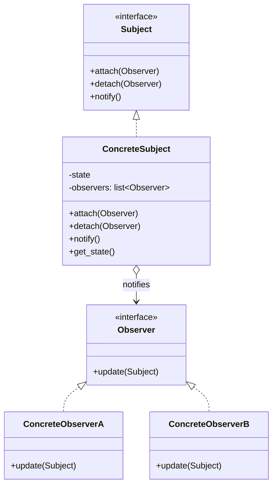
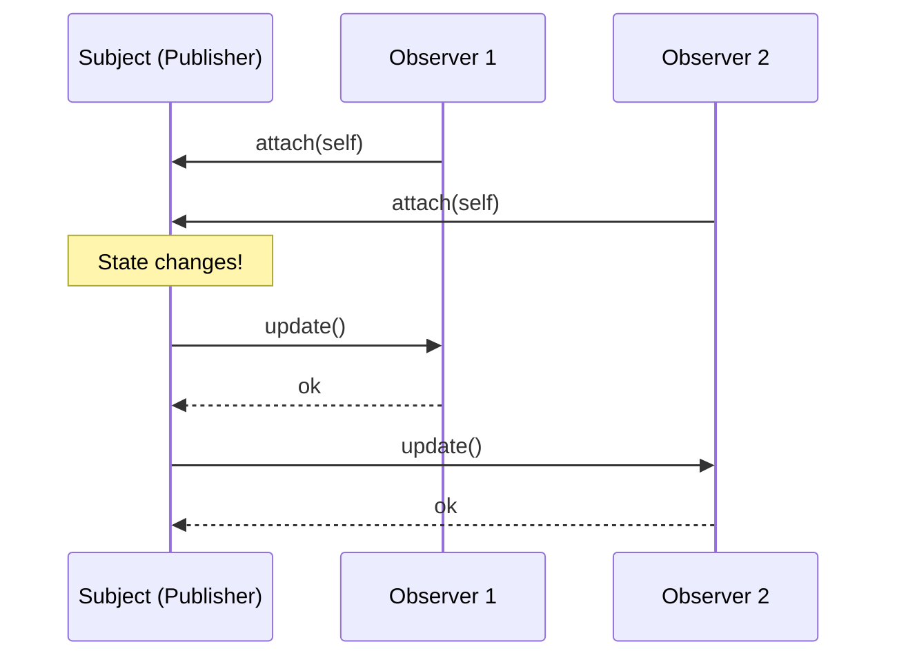

# Pattern 18: Observer (Behavioral)

## 🧒 The 5-Year-Old Explanation

Imagine you are waiting for a new video game to come out at a store. 

**Without Observer:** You go to the store every single day and ask, "Is it here yet?" The cashier says "No." You waste a lot of time checking. (This is called *Polling*).

**With Observer:** You give the cashier your phone number. You stay home and play outside. When the game arrives, the cashier sends a text to everyone on the list. You only go to the store when you get the text. (This is the *Observer* pattern / *PubSub*).

---

## 📦 Prerequisites

**You should be comfortable with:**
- Lists/Sets to hold references to objects.
- First-class functions (Callbacks) in Python.
- Event-driven architecture.

---

## 🔍 How to Spot This Pattern

**Think of Observer when you see:**
- Changes to one object require changing others, and you don't know how many objects need to be changed.
- Some objects in your app must observe others, but only for a limited time or in specific cases.
- You have a core business logic class that is getting cluttered with UI update code.
- You see terms like: `Event`, `Listener`, `Subscriber`, `Publisher`, `Signal`, `Callback`.

**Anti-signals:**
- The objects need to communicate back and forth in a complex, multi-directional way → **Mediator** (Ch 16).

---

## 🧩 The Core Idea

### Intent (GoF)
> Define a one-to-many dependency between objects so that when one object changes state, all its dependents are notified and updated automatically.

### UML Class Diagram



### UML Sequence Diagram



---

## 🔧 Pattern Anatomy

### Participants

| Participant | Python Type | Role |
|-------------|------------|------|
| `Subject` (Publisher) | Class | Issues events of interest to other objects. Keeps a list of subscribers. |
| `Observer` (Subscriber) | `Protocol` / `Callable` | The interface that the Subject uses to notify subscribers. |
| `ConcreteObserver` | Class | Performs some actions in response to notifications issued by the publisher. |

---

## 🔄 Without Pattern → With Pattern

### Level 1: Polling (The Anti-Pattern)
```python
# BAD: The CPU is constantly spinning, checking for a change.
def wait_for_data(sensor):
    while True:
        data = sensor.get_data()
        if data > 100:
            trigger_alarm()
        time.sleep(1) 
```

### Level 3: Observer Pattern
```python
# GOOD: The sensor pushes data to us ONLY when it happens.
class Alarm:
    def update(self, data):
        if data > 100: trigger_alarm()

sensor.attach(Alarm())
# Now we do nothing. We just wait for the sensor to call Alarm.update()
```

---

## 🐍 Python-Specific Implementation

In statically typed languages (Java/C++), Observers are almost always Classes implementing an interface (e.g., `void update(Event e)`).

In Python, functions are first-class objects. Therefore, an Observer is often just a **callback function**. We don't need a whole class just to receive an event!

```python
# Pythonic Observer
def on_data_received(data):
    print(f"Got {data}")

subject.subscribe(on_data_received) # Pass the function directly!
```

---

## ⏱️ Trade-offs

| Aspect | Assessment |
|--------|-----------|
| **Complexity** | Low - standard list of callbacks. |
| **SOLID** | OCP (you can introduce new subscriber classes without having to change the publisher's code). |
| **Risk: Memory Leaks** | The Lapsed Listener Problem. If a Subject holds a reference to an Observer, the Observer will NEVER be garbage collected. Always provide a `detach()` method, or use `weakref` in Python! |
| **Risk: Ordering** | Subscribers are notified in random/unpredictable order. Do not rely on order! |

---

## 🌍 Real-World Framework Sightings

### Django Signals
- `django.db.models.signals.post_save`: You can subscribe to this signal to execute code whenever ANY model is saved to the database, completely decoupling the save logic from the subsequent action (like sending a welcome email).

### Frontend Frameworks (React, Vue)
- The entire concept of Reactive UI is built on the Observer pattern. When the state changes, the UI components observing that state are automatically re-rendered.

---

## ✅ Examples in This Chapter

| # | Example | Framework | Key Concept |
|---|---------|-----------|-------------|
| 1 | YouTube Channel Subscriptions | Pure Python | The classic GoF Object-Oriented Observer with Classes. |
| 2 | Pythonic Event Emitter | Pure Python | Using functions/callbacks instead of Classes for a modern Python approach. |
