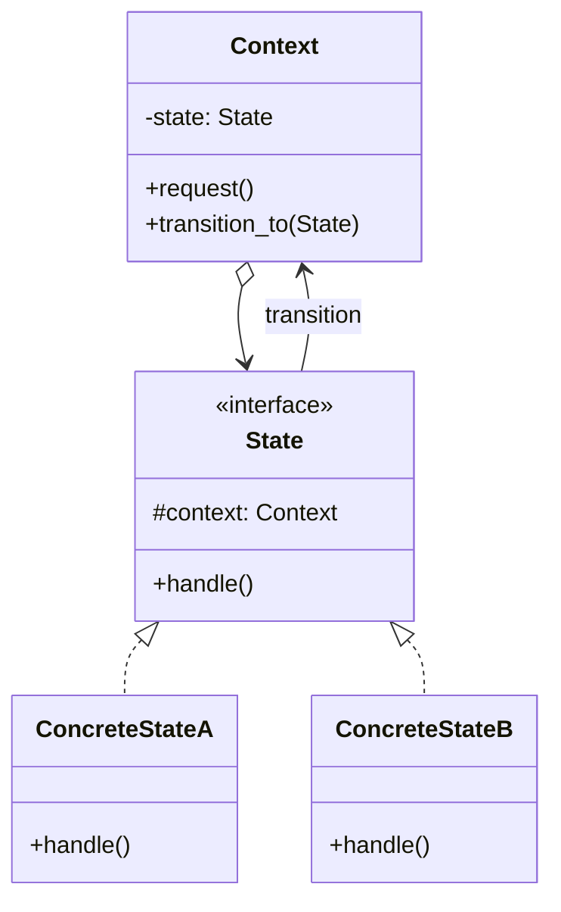
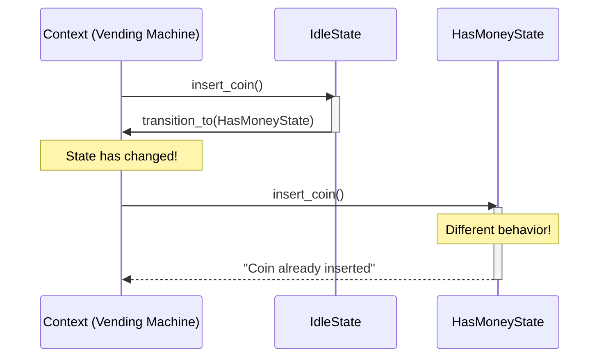
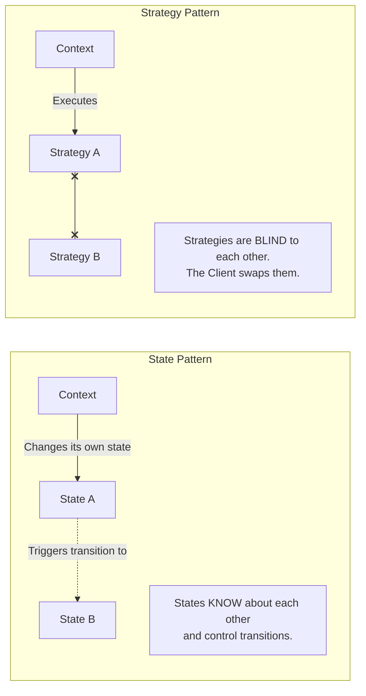

# Pattern 19: State (Behavioral)

## 🧒 The 5-Year-Old Explanation

Think about a **Smartphone**. 
- If the phone is unlocked, pressing the home button goes to the home screen.
- If the phone is locked, pressing the home button brings up the password screen.
- If the phone is turned off, pressing the home button does absolutely nothing.

The **same button** does three totally different things depending on the **State** of the phone. The State pattern lets an object change its behavior when its internal state changes, as if it changed its entire class.

---

## 📦 Prerequisites

**You should be comfortable with:**
- Finite State Machines (FSM).
- Object Composition.

---

## 🔍 How to Spot This Pattern

**Think of State when you see:**
- An object behaves differently depending on its current state.
- Massive `if/elif/elif` statements inside multiple methods, where every condition checks the exact same state variable (e.g., `if self.state == "LOCKED": ...`).
- You need to build a State Machine (e.g., an Order going from Pending -> Paid -> Shipped -> Delivered).

**Anti-signals:**
- The object has only two states (e.g., True/False) and the behavior change is very simple. A boolean flag is fine; don't over-engineer.
- You want to change the algorithm used to perform a specific task, but the object itself hasn't fundamentally changed its status → **Strategy** (Ch 20).

---

## 🧩 The Core Idea

### Intent (GoF)
> Allow an object to alter its behavior when its internal state changes. The object will appear to change its class.

### UML Class Diagram



### UML Sequence Diagram



---

## 🔧 Pattern Anatomy

### Participants

| Participant | Python Type | Role |
|-------------|------------|------|
| `Context` | Class | Maintains an instance of a `ConcreteState` subclass that defines the current state. |
| `State` | `Protocol` / `ABC` | Defines an interface for encapsulating the behavior associated with a particular state of the Context. |
| `ConcreteState` | Class | Each subclass implements a behavior associated with a state of the Context. Can trigger state transitions. |

---

## 📊 Visual Walkthrough

### State vs Strategy

These two patterns look identical in UML, but they solve different problems.



---

## 🔄 Without Pattern → With Pattern

### Level 1: The "if/elif" Hell
```python
# BAD: Every single method has to check every single state.
class AudioPlayer:
    def click_play(self):
        if self.state == "LOCKED":
            pass
        elif self.state == "PLAYING":
            self.pause()
            self.state = "PAUSED"
        elif self.state == "READY":
            self.play()
            self.state = "PLAYING"
            
    def click_next(self):
        if self.state == "LOCKED":
            pass
        elif self.state == "PLAYING":
            self.next_song()
        # ... it never ends
```

### Level 3: State Pattern
```python
# GOOD: Context delegates to the current state object
class AudioPlayer:
    def click_play(self):
        self.state.click_play() # The state object knows what to do!
        
class LockedState(State):
    def click_play(self): pass # Do nothing
    
class ReadyState(State):
    def click_play(self):
        self.player.play()
        self.player.change_state(PlayingState()) # Transition!
```

---

## ⏱️ Trade-offs

| Aspect | Assessment |
|--------|-----------|
| **Complexity** | High - creates many new classes for a single Context. |
| **SOLID** | SRP (organizes state-specific code into separate classes), OCP (new states can be added easily without changing existing state classes or the context). |
| **When Justified** | Finite State Machines with 3+ states, where behavior changes drastically per state, and transitions are complex. |

---

## 🌍 Real-World Framework Sightings

### TCP/IP Networking
- The classic example. A TCP connection has states like `LISTEN`, `ESTABLISHED`, `FIN_WAIT`. Calling `close()` on a `LISTEN` socket does something entirely different than calling it on an `ESTABLISHED` socket.

### E-Commerce (Order Management)
- An Order entity often acts as the Context. It moves through states: `Cart` -> `Checkout` -> `Paid` -> `Shipped`. You cannot `cancel()` a `Shipped` order, but you can `cancel()` a `Paid` one.

---

## ✅ Examples in This Chapter

| # | Example | Framework | Key Concept |
|---|---------|-----------|-------------|
| 1 | Vending Machine | Pure Python | A classic FSM. Idle -> HasCoin -> Dispensing. |
