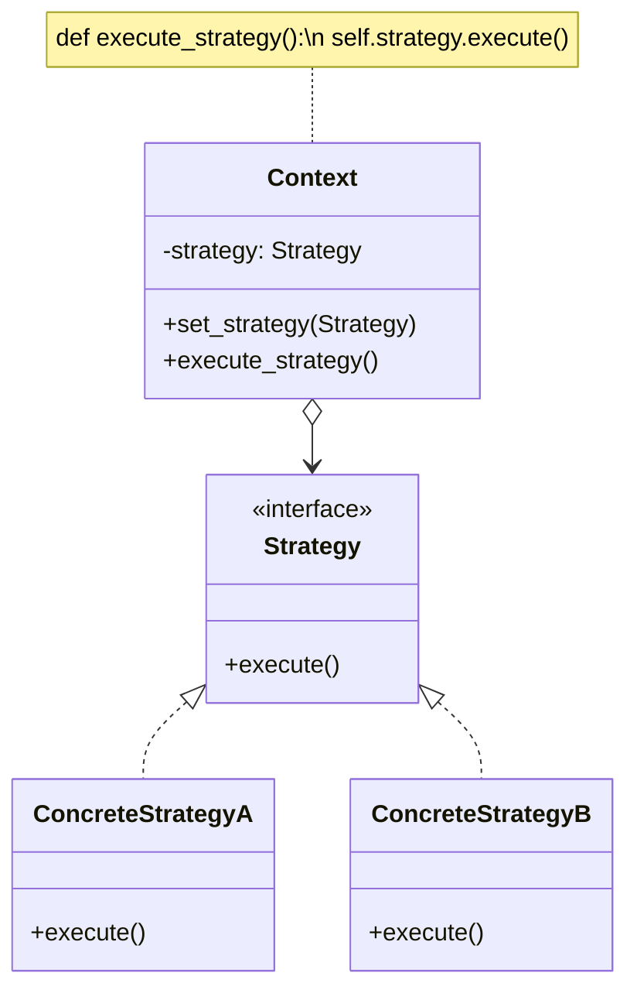
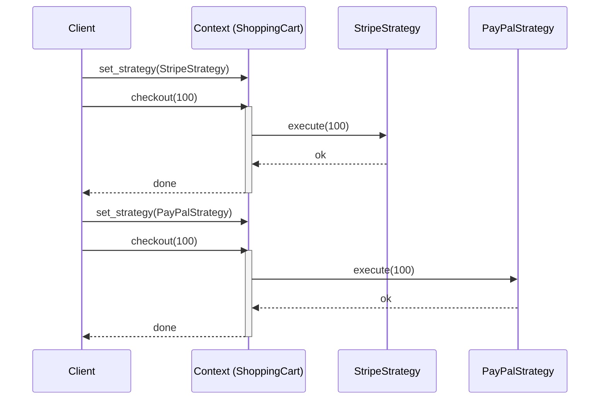

# Pattern 20: Strategy (Behavioral)

## 🧒 The 5-Year-Old Explanation

You need to get to the airport. You have three choices (strategies):
1. Take a taxi (expensive, fast).
2. Take a bus (cheap, slow).
3. Walk (free, very slow).

You are the Context. The destination is the same, but you get to **swap out the strategy** based on how much money and time you have. The Strategy pattern lets you plug in different algorithms to solve the same problem at runtime.

---

## 📦 Prerequisites

**You should be comfortable with:**
- Dependency Injection (passing an object into another object's constructor).
- First-class functions (Python).
- Interfaces / Protocols.

---

## 🔍 How to Spot This Pattern

**Think of Strategy when you see:**
- You have a lot of similar classes that only differ in the way they execute some behavior (e.g., `QuickSort`, `MergeSort`, `BubbleSort`).
- You have massive `if/elif/elif` blocks where each block contains a complex algorithm to achieve the exact same goal (e.g., `if payment_type == "paypal": ... elif payment_type == "stripe": ...`).
- You want to swap algorithms at runtime without modifying the client code.

**Anti-signals:**
- The object fundamentally changes its status and controls its own transitions → **State** (Ch 19).
- The algorithm never changes; there is only one way to do it.

---

## 🧩 The Core Idea

### Intent (GoF)
> Define a family of algorithms, encapsulate each one, and make them interchangeable. Strategy lets the algorithm vary independently from clients that use it.

### UML Class Diagram



### UML Sequence Diagram



---

## 🔧 Pattern Anatomy

### Participants

| Participant | Python Type | Role |
|-------------|------------|------|
| `Context` | Class | Maintains a reference to one of the Strategy objects. Does not know *how* the strategy executes, just calls the interface. |
| `Strategy` | `Protocol` / `Callable` | Interface common to all supported algorithms. |
| `ConcreteStrategy` | Class / Function | Implements the algorithm using the Strategy interface. |

---

## 🐍 Python-Specific Implementation

In Java/C++, Strategies are always full classes. In Python, because functions are objects, **a Strategy can often just be a function**. If your Strategy only has one method (`execute()`), don't write a class. Just pass a function!

```python
# The "Class" way
class StripePayment:
    def pay(self, amount): print(f"Stripe {amount}")

# The "Pythonic" way
def stripe_payment(amount): print(f"Stripe {amount}")

cart = ShoppingCart(strategy=stripe_payment)
```

---

## 🔄 Without Pattern → With Pattern

### Level 1: The Monolith
```python
# BAD: The Context is huge, fragile, and violates OCP.
class Navigation:
    def build_route(self, a, b, mode):
        if mode == "walking":
            # 50 lines of walking logic
        elif mode == "driving":
            # 50 lines of driving logic
        elif mode == "transit":
            # 50 lines of transit logic
```

### Level 3: Strategy Pattern
```python
# GOOD: Context is completely ignorant of routing algorithms.
class Navigation:
    def __init__(self, strategy: RouteStrategy):
        self.strategy = strategy
        
    def build_route(self, a, b):
        return self.strategy.build(a, b)
```

---

## ⏱️ Trade-offs

| Aspect | Assessment |
|--------|-----------|
| **Complexity** | Low - it's basic Dependency Injection. |
| **SOLID** | OCP (add new strategies without modifying Context), SRP (extracts algorithms into separate classes). |
| **When Justified** | Dealing with different variations of an algorithm (payment gateways, sorting algorithms, compression types). |

---

## 🌍 Real-World Framework Sightings

### Python Standard Library
- The `sorted()` function takes a `key` argument. That `key` is a Strategy! You pass a function that tells `sorted()` exactly *how* to extract a comparison key from each element. `sorted(items, key=lambda x: x.age)`

### Django
- Password hashing. Django has a Context that handles authentication, but you can configure different password hashing strategies (`PBKDF2`, `Argon2`, `BCrypt`) in the settings.

---

## ✅ Examples in This Chapter

| # | Example | Framework | Key Concept |
|---|---------|-----------|-------------|
| 1 | E-Commerce Payment Gateways | Pure Python | Swapping out payment strategies (Classes) at runtime. |
| 2 | Pythonic Sorting | Pure Python | Using first-class functions as strategies. |
