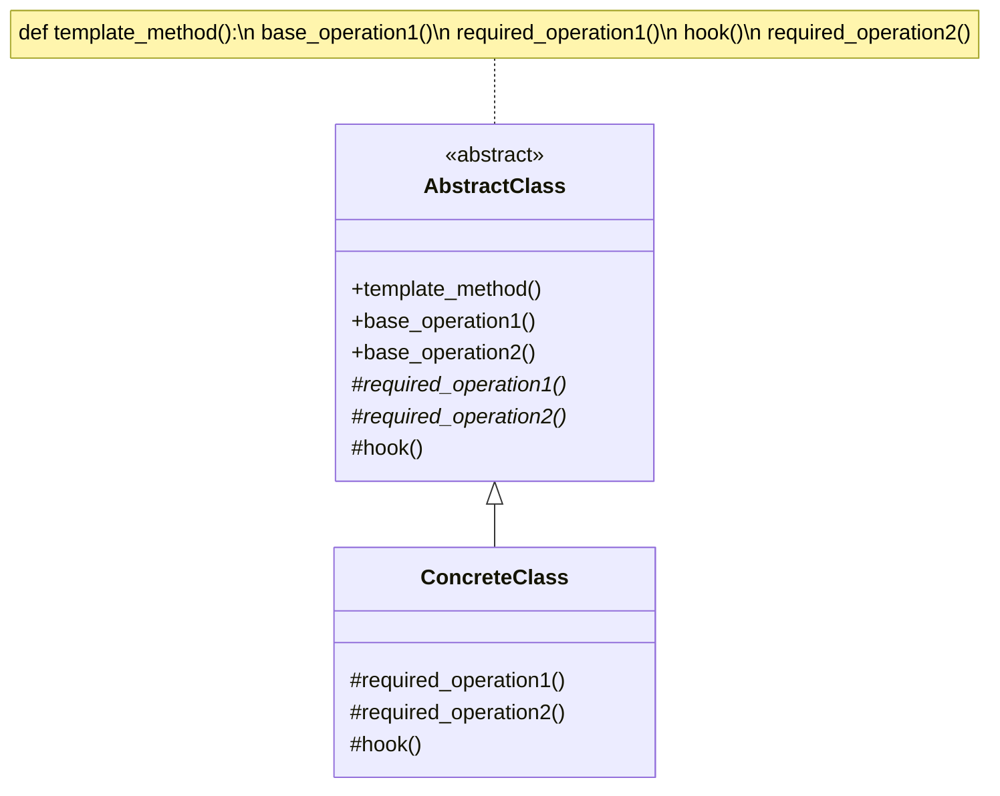
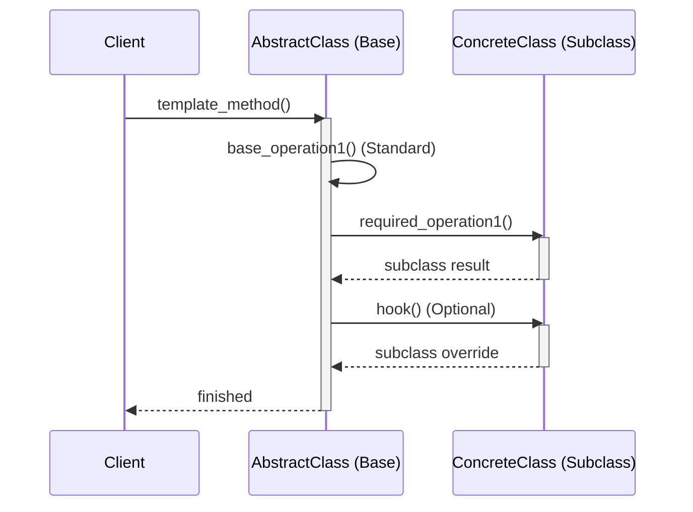

# Pattern 21: Template Method (Behavioral)

## 🧒 The 5-Year-Old Explanation

Think about baking a cake. Every cake follows the exact same steps:
1. Mix the dry ingredients.
2. Mix the wet ingredients.
3. Bake for 30 minutes.
4. Add frosting.

The **Skeleton** (the recipe) is always the same. But the **Details** change depending on the cake. For a chocolate cake, you add cocoa powder in step 1. For a vanilla cake, you add vanilla extract in step 2.

The **Template Method** puts the skeleton in a Base Class, and lets Subclasses fill in the specific details without changing the recipe's order.

---

## 📦 Prerequisites

**You should be comfortable with:**
- Inheritance and Abstract Base Classes (`ABC`).
- The Hollywood Principle ("Don't call us, we'll call you").
- The difference between `abstractmethod` and concrete methods in Python.

---

## 🔍 How to Spot This Pattern

**Think of Template Method when you see:**
- Multiple classes have the exact same sequence of steps, but different implementations for some of those steps.
- You want to enforce an algorithm's structure, but let clients override specific parts.
- You see code duplication across subclasses that can be factored up into a superclass.

**Anti-signals:**
- The algorithm's structure changes completely between implementations.
- You want to swap out the entire algorithm at runtime without subclassing → **Strategy** (Ch 20).

---

## 🧩 The Core Idea

### Intent (GoF)
> Define the skeleton of an algorithm in an operation, deferring some steps to subclasses. Template Method lets subclasses redefine certain steps of an algorithm without changing the algorithm's structure.

### UML Class Diagram



### UML Sequence Diagram



---

## 🔧 Pattern Anatomy

### Participants

| Participant | Python Type | Role |
|-------------|------------|------|
| `AbstractClass` | `ABC` | Defines abstract primitive operations that concrete subclasses define. Implements the template method defining the skeleton of an algorithm. |
| `ConcreteClass` | Class | Implements the primitive operations to carry out subclass-specific steps of the algorithm. |

---

## ⚖️ Template Method vs Strategy

Both deal with algorithms, but they approach it fundamentally differently.

| Feature | Template Method | Strategy |
|---------|-----------------|----------|
| **Mechanism** | **Inheritance** (Subclassing) | **Composition** (Dependency Injection) |
| **Granularity** | Changes *parts* of an algorithm | Changes the *entire* algorithm |
| **Level** | Class level (Static at compile time) | Object level (Dynamic at runtime) |
| **Control Flow** | Base class calls subclass methods (Hollywood Principle) | Client calls the Strategy |

---

## 🪝 Hooks vs Abstract Methods

In a Template Method, you will encounter two types of steps for subclasses to implement:

1. **Abstract Methods (`@abstractmethod`)**: Subclasses MUST implement these. If they don't, Python will throw an error when instantiating the class.
2. **Hooks**: Methods with an empty or default implementation in the base class. Subclasses MAY override them, but they don't have to. Hooks are often placed before or after crucial steps to allow subclasses to inject custom behavior (like `before_save()` or `after_save()`).

---

## 🔄 Without Pattern → With Pattern

### Level 1: Duplicated Boilerplate
```python
# BAD: The structural boilerplate (connect, read, close) is duplicated everywhere.
class PDFMiner:
    def extract(self):
        file = open()
        data = parse_pdf(file) # Only this line changes
        file.close()
        
class CSVMiner:
    def extract(self):
        file = open()
        data = parse_csv(file) # Only this line changes
        file.close()
```

### Level 3: Template Method
```python
# GOOD: The Base Class handles the boilerplate. Subclasses handle the details.
class DataMiner(ABC):
    def extract(self):
        self.open()
        self.parse() # Abstract method
        self.close()

class PDFMiner(DataMiner):
    def parse(self): ... # Just implement the details
```

---

## 🌍 Real-World Framework Sightings

### Django / Django REST Framework
- Django's Class-Based Views (CBVs) are entirely built on the Template Method pattern. The base `View` class has a `dispatch()` method that acts as the template. Subclasses implement specific steps like `get()`, `post()`, `get_queryset()`, or `get_context_data()`.

### Unit Testing (`unittest` module)
- When you write tests, you inherit from `unittest.TestCase`. The framework runs `setUp()`, then `test_something()`, then `tearDown()`. `setUp` and `tearDown` are Hooks provided by the Template Method in the test runner.

---

## ✅ Examples in This Chapter

| # | Example | Framework | Key Concept |
|---|---------|-----------|-------------|
| 1 | Data Mining / ETL | Pure Python | Using Abstract methods for required steps and Hooks for optional behavior. |
