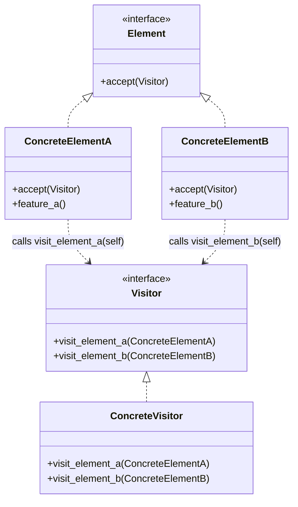

# Pattern 22: Visitor (Behavioral)

## 🧒 The 5-Year-Old Explanation

Imagine you are an Insurance Agent. You have to visit three buildings: a **House**, a **Bank**, and a **Factory**.
For the House, you check the fire alarms.
For the Bank, you check the vault doors.
For the Factory, you check the safety goggles.

Instead of writing `sell_insurance()` inside the House class, the Bank class, and the Factory class (which ruins their clean code), you put all that logic into the **InsuranceAgent** (the Visitor). The buildings just open their doors and let the agent in.

---

## 📦 Prerequisites

**You should be comfortable with:**
- Single vs Double Dispatch.
- Method overloading (and why Python *doesn't* have it natively).
- The `functools.singledispatch` module in Python.

---

## 🔍 How to Spot This Pattern

**Think of Visitor when you see:**
- You need to perform an operation on all elements of a complex object structure (like a Tree or an AST).
- The classes you are operating on rarely change, but the operations you want to perform on them change frequently.
- You want to clean up business logic by extracting operations (like `export_xml()`, `draw()`, `calculate_tax()`) out of the data classes and into a dedicated class.

**Anti-signals:**
- The object hierarchy changes frequently (adding new node types). If you add a new node type, you have to update every single Visitor!
- You only have one operation to perform on a flat list of objects. (Just use a standard function and `isinstance()` checks).

---

## 🧩 The Core Idea

### Intent (GoF)
> Represent an operation to be performed on the elements of an object structure. Visitor lets you define a new operation without changing the classes of the elements on which it operates.

### UML Class Diagram



### Double Dispatch (The Magic Trick)

In statically typed languages (Java/C++), `Visitor` relies on **Double Dispatch**.
1. **First Dispatch**: The Client calls `element.accept(visitor)`. (Determines the concrete Element type).
2. **Second Dispatch**: The Element calls `visitor.visit(self)`. (Determines the concrete Visitor type AND resolves method overloading based on `self`).

---

## 🐍 Python-Specific Implementation

Python does not support method overloading by type. You cannot write:
```python
def visit(self, element: House): pass
def visit(self, element: Bank): pass
```
The second definition will just overwrite the first!

### Two ways to do it in Python:

1. **The Classic GoF Way (Naming Convention)**:
   Name the methods explicitly: `visit_house()`, `visit_bank()`.
   The `House` class implements `def accept(visitor): visitor.visit_house(self)`.

2. **The Modern Pythonic Way (`@singledispatch`)**:
   Python 3.4+ has `functools.singledispatch`. It allows you to build true method overloading based on type, making the classic GoF Double-Dispatch boilerplate entirely obsolete!

---

## 🔄 Without Pattern → With Pattern

### Level 1: Fat Data Classes
```python
# BAD: Data classes are bloated with unrelated business logic
class House:
    def calculate_insurance(self): ...
    def export_to_xml(self): ...
    def calculate_tax(self): ...
```

### Level 3: Visitor Pattern
```python
# GOOD: Data classes are pure. Behaviors are extracted.
class House:
    def accept(self, visitor):
        visitor.visit_house(self)

class InsuranceVisitor:
    def visit_house(self, house): ...

class TaxVisitor:
    def visit_house(self, house): ...
```

---

## ⏱️ Trade-offs

| Aspect | Assessment |
|--------|-----------|
| **Complexity** | High - Double Dispatch is notoriously confusing. |
| **SOLID** | SRP (moves operations into dedicated classes), OCP (you can add new behaviors/visitors without modifying data classes). |
| **When Justified** | AST (Abstract Syntax Tree) traversal, compilers, static analysis tools, exporting object structures to various formats (XML, JSON, PDF). |
| **Risk** | Adding a new Element class requires modifying the Visitor interface and EVERY concrete Visitor. |

---

## 🌍 Real-World Framework Sightings

### Python Standard Library (`ast` module)
- Python's built-in `ast` (Abstract Syntax Tree) module uses the Visitor pattern. When you parse Python code into an AST, you can write a class inheriting from `ast.NodeVisitor` and define methods like `visit_FunctionDef(self, node)` to inspect the code structure!

---

## ✅ Examples in This Chapter

| # | Example | Framework | Key Concept |
|---|---------|-----------|-------------|
| 1 | Exporting Shapes (Classic GoF) | Pure Python | The classic Double-Dispatch implementation with `accept()`. |
| 2 | Pythonic Single Dispatch | Pure Python | Erasing boilerplate using `@singledispatch`. |
