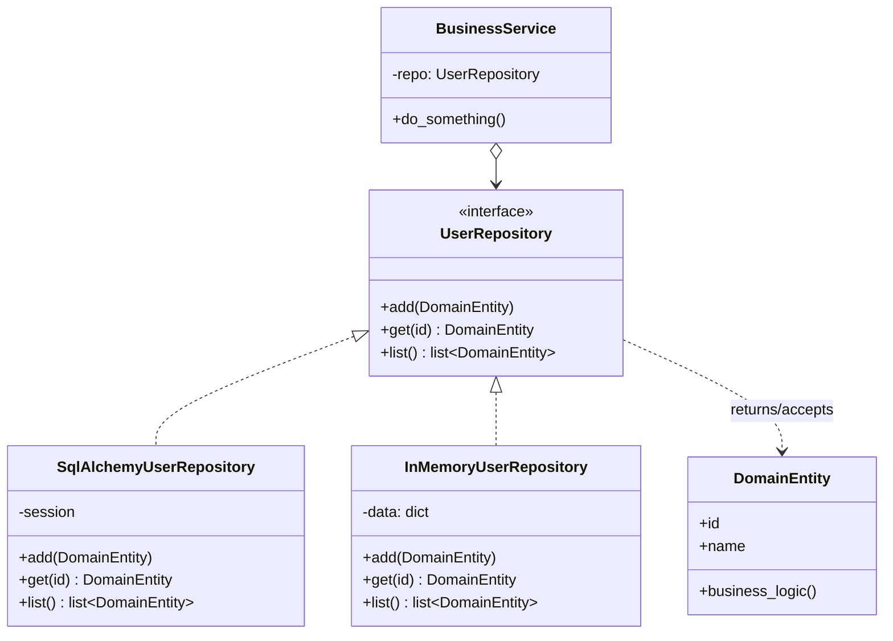
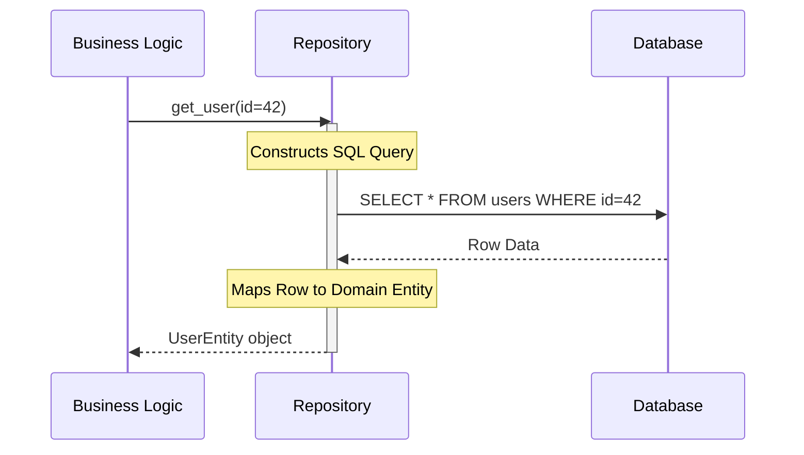

# Pattern 23: Repository (Architectural)

## 🧒 The 5-Year-Old Explanation

Imagine you want to read a book. You don't care if the book is on a shelf, in a locked glass case, or buried in a box in the basement. You just go to the **Librarian** and say "Get me Harry Potter." The librarian finds it and hands it to you.

The **Repository Pattern** is the Librarian. It sits between your business logic (you) and the database (the shelves). Your code just says `user_repo.get_by_id(5)`, and the Repository handles the messy SQL, ORM, or API calls to fetch it.

---

## 📦 Prerequisites

**You should be comfortable with:**
- Domain-Driven Design (DDD) concepts (Entities vs DTOs vs DB Models).
- SQL and basic ORM usage (e.g., SQLAlchemy).
- Interface segregation.

---

## 🔍 How to Spot This Pattern

**Think of Repository when you see:**
- You have complex database queries scattered all over your business logic.
- You want to unit test your business logic without actually connecting to a real database (you can mock the repository!).
- You are using Clean Architecture, Hexagonal Architecture, or Domain-Driven Design.

**Anti-signals:**
- You are building a very simple CRUD app (Create, Read, Update, Delete) where the business logic *is* the database logic. (Just use Django/SQLAlchemy Active Record directly).

---

## 🧩 The Core Idea

### Intent (Fowler / Evans)
> Mediates between the domain and data mapping layers using a collection-like interface for accessing domain objects.

### UML Class Diagram



### UML Sequence Diagram



---

## 🔧 Pattern Anatomy

### Participants

| Participant | Python Type | Role |
|-------------|------------|------|
| `Repository Interface` | `Protocol` / `ABC` | Defines the standard contract (e.g., `add()`, `get()`). Keeps domain logic completely ignorant of the database technology. |
| `Concrete Repository` | Class | Implements the interface using a specific technology (SQLAlchemy, PyMongo, raw SQL). |
| `Domain Entity` | Class / Dataclass | The pure Python object that holds business data and rules. It has NO database connections. |
| `DB Model` | Class | (Optional) The ORM class mapping to the database table. The repository converts between DB Models and Domain Entities. |

---

## 🔄 Without Pattern → With Pattern

### Level 1: Active Record (Tightly Coupled)
```python
# BAD (for complex apps): Business logic is heavily tied to the DB ORM.
# If you want to test this, you MUST spin up a real database.
def apply_discount(user_id):
    # This is an SQLAlchemy ORM call
    user = UserDBModel.query.filter_by(id=user_id).first() 
    user.balance -= 10
    db.session.commit()
```

### Level 3: Repository Pattern (Decoupled)
```python
# GOOD: Business logic only talks to the pure interface.
def apply_discount(user_id, repo: UserRepository):
    user = repo.get(user_id) # Returns a pure Domain Entity
    user.apply_discount(10)
    repo.update(user)
    
# Testing is trivial! Just pass a Fake Repository in memory.
fake_repo = InMemoryUserRepository({1: User(id=1, balance=50)})
apply_discount(1, fake_repo)
```

---

## ⏱️ Trade-offs

| Aspect | Assessment |
|--------|-----------|
| **Complexity** | High - requires creating Interfaces, Repositories, Domain Entities, and DB Models (and mapping between them). |
| **SOLID** | DIP (Business logic depends on abstraction, not database details). SRP (Separates DB queries from business rules). |
| **When Justified** | Enterprise applications, highly testable systems, Domain-Driven Design. |
| **When Over-engineered** | Standard web apps. Frameworks like Django are built around Active Record (`User.objects.get()`). Forcing a Repository pattern on top of Django's ORM is usually a massive anti-pattern that fights the framework. |

---

## 🌍 Real-World Framework Sightings

### .NET / Java Spring
- The Repository pattern is the standard, default way of accessing databases in enterprise C# and Java applications.

### Python (SQLAlchemy 2.0)
- While SQLAlchemy provides Active Record capabilities, its `Session` object combined with explicit mapping allows you to build perfect DDD Repositories natively.

---

## ✅ Examples in This Chapter

| # | Example | Framework | Key Concept |
|---|---------|-----------|-------------|
| 1 | Testable User Service | Pure Python | Decoupling business logic from a simulated database using an Abstract Repository and an In-Memory fake. |
