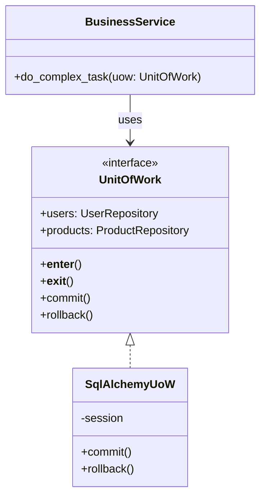
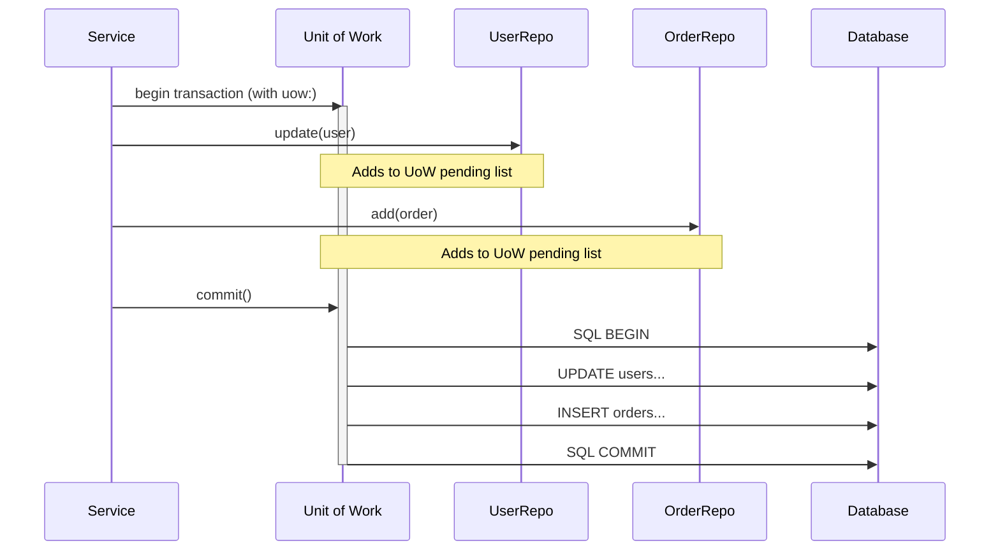

# Pattern 24: Unit of Work (Architectural)

## 🧒 The 5-Year-Old Explanation

Imagine you are at the grocery store. You pick up milk, bread, and eggs. You don't walk to the cashier, pay for the milk, then walk back, get the bread, walk to the cashier, pay for the bread... that would be exhausting!

Instead, you put everything in a **shopping cart**. When you are completely done, you push the cart to the cashier and pay for everything in **one single transaction**.

The **Unit of Work (UoW)** pattern is the shopping cart for your database. It keeps track of everything you changed, and saves it all at once at the very end.

---

## 📦 Prerequisites

**You should be comfortable with:**
- Database Transactions (BEGIN, COMMIT, ROLLBACK).
- The Repository Pattern (Ch 23). UoW and Repository are almost always used together.
- Python Context Managers (`with` blocks).

---

## 🔍 How to Spot This Pattern

**Think of Unit of Work when you see:**
- You need to update multiple different tables/repositories, and if one fails, they ALL need to fail (Atomicity).
- You are making too many small trips to the database (N+1 problem on writes).
- You see `db.session.commit()` scattered randomly throughout your business logic, leading to partial failures.

**Anti-signals:**
- You are building a NoSQL app where documents are strictly isolated and cross-document transactions aren't supported.

---

## 🧩 The Core Idea

### Intent (Fowler)
> Maintains a list of objects affected by a business transaction and coordinates the writing out of changes and the resolution of concurrency problems.

### UML Class Diagram



### UML Sequence Diagram



---

## 🔧 Pattern Anatomy

### Participants

| Participant | Python Type | Role |
|-------------|------------|------|
| `UnitOfWork` | Context Manager | Defines a block of code where all database interactions form a single atomic transaction. Exposes Repositories to the client. |
| `Repositories` | Interface | Handled by the UoW. The UoW injects the shared database session into the repositories. |

---

## 🔄 Without Pattern → With Pattern

### Level 1: Scattered Commits (Partial Failure Risk)
```python
# BAD: If the email server crashes, the user is charged but gets no receipt, 
# and the inventory isn't updated!
def checkout(user_id, cart_id):
    user_repo.deduct_funds(user_id, 100)
    db.commit() # DANGER!
    
    cart_repo.clear(cart_id)
    db.commit() # DANGER!
    
    send_email(user_id) # Crashes here!
    
    inventory_repo.update()
    db.commit()
```

### Level 3: Unit of Work
```python
# GOOD: Everything succeeds, or everything fails cleanly.
def checkout(user_id, cart_id, uow: AbstractUnitOfWork):
    with uow: # Starts transaction
        uow.users.deduct_funds(user_id, 100)
        uow.carts.clear(cart_id)
        uow.inventory.update()
        
        send_email(user_id) # If this crashes, __exit__ triggers ROLLBACK automatically.
        
        uow.commit() # Only hit if everything above succeeds.
```

---

## ⏱️ Trade-offs

| Aspect | Assessment |
|--------|-----------|
| **Complexity** | High - requires wrapping all database interactions inside Context Managers. |
| **SOLID** | SRP (Business logic handles rules, UoW handles transactions). |
| **When Justified** | Applications requiring strict data integrity across multiple tables/repositories. |

---

## 🌍 Real-World Framework Sightings

### SQLAlchemy
- The SQLAlchemy `Session` object is literally a Unit of Work. When you `add()`, `delete()`, and modify objects, nothing hits the database until you call `session.commit()`. 

### Django
- `from django.db import transaction` -> `with transaction.atomic():`. This is Django's built-in Unit of Work context manager.

---

## ✅ Examples in This Chapter

| # | Example | Framework | Key Concept |
|---|---------|-----------|-------------|
| 1 | Bank Transfer | Pure Python | Moving money between accounts ensuring Atomicity using Python Context Managers. |
