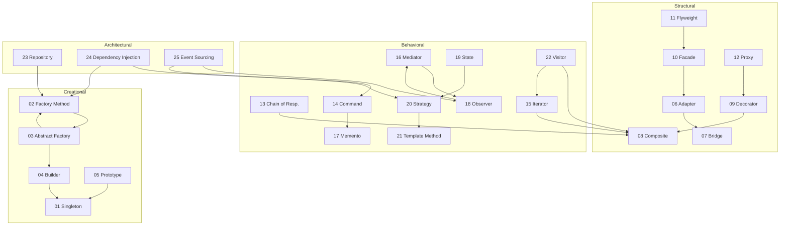

# 🏛️ Design Patterns — The Definitive Python 3.14 Reference

> **One-stop. Evergreen. For all levels — from curious beginners to battle-hardened architects.**

This repository is a comprehensive, notebook-style guide to software design patterns. Every pattern includes vivid real-world analogies, UML diagrams (Mermaid), Python 3.14 code examples, and real-world framework sightings from Django, FastAPI, SQLAlchemy, Celery, and beyond.

---

## 📚 Table of Contents

### 🏗️ Foundations
- [00 - Foundations](./00%20-%20Foundations/) — SOLID, DRY, KISS, YAGNI, Composition vs Inheritance, UML Primer

---

### 🔨 Part I: Creational Patterns
*How objects are created — controlling instantiation to keep systems flexible and decoupled.*

- [01 - Singleton](./01%20-%20Singleton%20%28Creational%29/)
- [02 - Factory Method](./02%20-%20Factory%20Method%20%28Creational%29/)
- [03 - Abstract Factory](./03%20-%20Abstract%20Factory%20%28Creational%29/)
- [04 - Builder](./04%20-%20Builder%20%28Creational%29/)
- [05 - Prototype](./05%20-%20Prototype%20%28Creational%29/)

---

### 🧱 Part II: Structural Patterns
*How objects are composed — building larger structures from individual parts.*

- [06 - Adapter](./06%20-%20Adapter%20%28Structural%29/)
- [07 - Bridge](./07%20-%20Bridge%20%28Structural%29/)
- [08 - Composite](./08%20-%20Composite%20%28Structural%29/)
- [09 - Decorator](./09%20-%20Decorator%20%28Structural%29/)
- [10 - Facade](./10%20-%20Facade%20%28Structural%29/)
- [11 - Flyweight](./11%20-%20Flyweight%20%28Structural%29/)
- [12 - Proxy](./12%20-%20Proxy%20%28Structural%29/)

---

### 💬 Part III: Behavioral Patterns
*How objects communicate — defining interaction protocols and responsibility distribution.*

- [13 - Chain of Responsibility](./13%20-%20Chain%20of%20Responsibility%20%28Behavioral%29/)
- [14 - Command](./14%20-%20Command%20%28Behavioral%29/)
- [15 - Iterator](./15%20-%20Iterator%20%28Behavioral%29/)
- [16 - Mediator](./16%20-%20Mediator%20%28Behavioral%29/)
- [17 - Memento](./17%20-%20Memento%20%28Behavioral%29/)
- [18 - Observer](./18%20-%20Observer%20%28Behavioral%29/)
- [19 - State](./19%20-%20State%20%28Behavioral%29/)
- [20 - Strategy](./20%20-%20Strategy%20%28Behavioral%29/)
- [21 - Template Method](./21%20-%20Template%20Method%20%28Behavioral%29/)
- [22 - Visitor](./22%20-%20Visitor%20%28Behavioral%29/)

---

### 🚀 Part IV: Advanced & Architectural
*Beyond GoF — patterns that shape real-world systems at scale.*

- [23 - Repository Pattern](./23%20-%20Repository%20Pattern%20%28Architectural%29/)
- [24 - Dependency Injection](./24%20-%20Dependency%20Injection%20%28Architectural%29/)
- [25 - Event Sourcing & CQRS](./25%20-%20Event%20Sourcing%20%26%20CQRS%20%28Architectural%29/)
- [26 - Patterns in the Wild (Capstone)](./26%20-%20Patterns%20in%20the%20Wild%20%28Capstone%29/)

---

## 🗺️ Pattern Decision Matrix

> *"I have a problem. Which pattern do I reach for?"*

| Problem | Reach For | Chapter |
|---------|-----------|---------|
| Need exactly one instance globally | Singleton | 01 |
| Create objects without specifying exact class | Factory Method | 02 |
| Create families of related objects | Abstract Factory | 03 |
| Construct complex objects step-by-step | Builder | 04 |
| Clone existing objects instead of creating new | Prototype | 05 |
| Make incompatible interfaces work together | Adapter | 06 |
| Vary abstraction AND implementation independently | Bridge | 07 |
| Treat individual objects and compositions uniformly | Composite | 08 |
| Add behavior to objects dynamically | Decorator | 09 |
| Simplify a complex subsystem | Facade | 10 |
| Share state to support large numbers of fine-grained objects | Flyweight | 11 |
| Control access to an object | Proxy | 12 |
| Pass a request along a chain of handlers | Chain of Responsibility | 13 |
| Encapsulate a request as an object (undo, queue) | Command | 14 |
| Access elements sequentially without exposing internals | Iterator | 15 |
| Reduce chaotic dependencies between objects | Mediator | 16 |
| Save and restore object state | Memento | 17 |
| Notify multiple objects about state changes | Observer | 18 |
| Object behaves differently based on internal state | State | 19 |
| Swap algorithms at runtime | Strategy | 20 |
| Define a skeleton algorithm with customizable steps | Template Method | 21 |
| Add operations to objects without modifying them | Visitor | 22 |
| Abstract data persistence layer | Repository | 23 |
| Decouple construction from usage of dependencies | Dependency Injection | 24 |
| Track state changes as a sequence of events | Event Sourcing & CQRS | 25 |

---

## 🔗 Master Pattern Relationships

---

## 🎯 How to Use This Repository

1. **Start with [Chapter 00 — Foundations](./00%20-%20Foundations/)** if you need a refresher on SOLID, UML, or composition vs inheritance
2. **Go chapter-by-chapter** for a structured learning path, or **jump directly** to a pattern you need
3. **Each chapter has a `theory.md`** — read this first for the conceptual deep-dive
4. **Then explore `example_*.py` files** — runnable Python 3.14 code you can execute immediately
5. **End with [Chapter 26 — Capstone](./26%20-%20Patterns%20in%20the%20Wild%20%28Capstone%29/)** for the decision matrix, anti-patterns, and interview playbook

---

*Built with ❤️ using Python 3.14 • Diagrams in Mermaid • Real-world examples from Django, FastAPI, SQLAlchemy & more*
