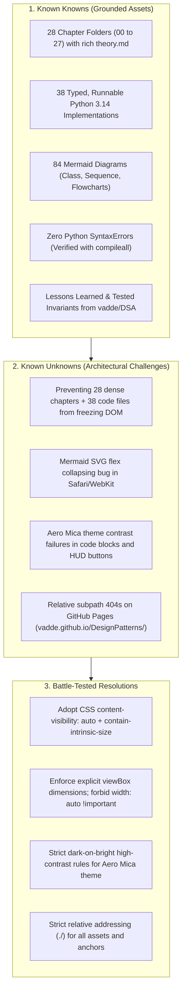

# SPEC-001: The Design Patterns Futuristic Living Documentation Portal & Command Deck

> **Document ID:** SPEC-001-DESIGN-PATTERNS-FUTURISTIC-PORTAL  
> **Author:** Appa Rao Vadde (in collaboration with Antigravity AI)  
> **Classification:** High-Performance Static Documentation & Year 2500 Developer Cockpit  
> **Status:** RATIFICATION READY  
> **Date:** November 3, 2026  
> **Canonical Repository:** `vadde/DesignPatterns` (Target URL: `https://vadde.github.io/DesignPatterns/`)  
> **Target Branch:** `feature/docs-website`  

---

## 1. Executive Summary & Vision 2500

This specification formalizes the architecture, design system, client-side runtime, build engine, repository configuration, and automated quality gates for the **Design Patterns Living Documentation Portal**.

The objective is to synthesize all 28 chapters, 5 architectural tiers, 38 typed Python 3.14 runnable implementations, and 84 Mermaid diagrams into a **Vision 2500 Command Deck**—a static GitHub Pages web application featuring:

1. **Cosmic Glassmorphic & Aero Mica Halos:** Multi-layered specular borders, ambient mouse-following glow orbs, and four switchable futuristic themes (*Deep Space Liquid Glass, Fluent Aero Mica, Holo 2050 Cyberpunk HUD, and Matrix Obsidian*).
2. **Sub-100ms Skimmability & Deep Cognitive Triage:** Zero-friction access to the **Master Decision Matrix** ("I have a problem, which pattern do I reach for?"), the **Master Pattern Relationships Flowchart** in a zoomable canvas, **5 Architectural Tiers** (Foundations, Creational, Structural, Behavioral, Architectural & Capstone), and **Framework Sightings** (Django, FastAPI, SQLAlchemy, Celery, stdlib).
3. **High-Density, Zero-Toolchain Static Architecture:** Built with pure vanilla HTML5, CSS3, ES2022 JavaScript, and standard CDN libraries (KaTeX for formulas, Mermaid for diagrams, Prism for syntax highlighting). Builds in $<1$ second with standard Python 3.x, requires zero `npm install` or `node_modules` weight, and runs 100% offline or on GitHub Pages.
4. **Autonomous DevEx & Full Makefile Discipline:** Zero ad-hoc one-off scripts. All developer, local preview, and CI/CD operations are unified behind canonical `Makefile` targets (`make docs-build`, `make docs-serve`, `make docs-test`, `make test-boxes`, `make format-boxes`, `make lint`, `make ci`, `make clean`).
5. **15-Gate Automated Headless Verification Suite:** Every build is deterministically audited across 15 automated gates ensuring zero broken links, perfect WebKit SVG sizing, clean Mermaid escaping, KaTeX integration, draggable sidebar invariants, touch overflow containment, mobile drawer responsiveness, theme foreground/background contrast correlation, and Unicode box alignment.
6. **Repository Settings Facelift:** Full audit and configuration guide for GitHub Actions Pages deployment, workflow permissions, repository topics, social previews, and branch protections.

```
┌────────────────────────────────────────────────────────────────────────┐
│               DESIGN PATTERNS COMMAND DECK (YEAR 2500)                 │
│                                                                        │
│   [ Pattern Finder (F) ]   [ Decision Graph (D) ]    [ Search (⌘K) ]   │
│   Intent-Based Quick ID    Zoomable Master Diagram   38 Implementations│
└───────────────────────────────────┬────────────────────────────────────┘
                                    │
        ┌───────────────────────────┴───────────────────────────┐
        ▼                                                       ▼
┌───────────────────────────────┐       ┌────────────────────────────────┐
│      NAVIGATION TREE          │       │       READING STAGE (HUD)      │
│  • 00 - Foundations           │  ───► │  • 5-Year-Old Analogies        │
│  • 01-05 Creational Patterns  │       │  • Signal Detection (Anti-sigs)│
│  • 06-12 Structural Patterns  │       │  • UML Class & Sequence Flow   │
│  • 13-22 Behavioral Patterns  │       │  • Python 3.14 Code + Copy     │
│  • 23-26 Architectural Models │       │  • Real-World Framework Sight  │
│  • 27 - Capstone & Interview  │       │  • Interview Defense Playbook  │
│  • Draggable Resizer (240-560)│       │  • Self-Test Collapsible QA    │
│  • Commute Gadget Drawer (📱) │       │  • Fullscreen Theater Zoom/Pan │
└───────────────────────────────┘       └────────────────────────────────┘
```

---

## 2. Epistemic Audit & Staff Pair-Programmer Critique

Following our constitutional Epistemic Boundary Framework and past lessons from the DSA portal project, we openly audit technical tensions, traps, and architectural trade-offs:



### The 7 Battle-Tested Lessons Learned from vadde/DSA

1. **The Safari WebKit Flex-SVG Sizing Trap:**
   - *Problem:* In WebKit/Safari, an SVG inside a flex container with `width: auto !important` or missing intrinsic height collapses to `0px × 0px`.
   - *Invariant:* `.mermaid svg` must declare `width: 100% !important; height: auto !important; max-height: 580px !important; object-fit: contain;`. In JavaScript, extract `vbW` and `vbH` from SVG `viewBox` and inject explicit W3C attributes `width`, `height`, and `style.aspectRatio = vbW / vbH`.

2. **The Aero Mica Contrast Disconnect:**
   - *Problem:* Light themes frequently suffer from white-on-white text in code snippets and washed-out buttons over light frosted backgrounds.
   - *Invariant:* `[data-theme="mica"] pre code` MUST enforce `background: rgba(255, 255, 255, 0.95); color: #0f172a !important;`. Modal controls must use high-contrast frosted pills (`background: rgba(255, 255, 255, 0.22); border: 1px solid rgba(255, 255, 255, 0.55); color: #ffffff !important;`).

3. **Sub-10ms "Expand All" SLA:**
   - *Problem:* Expanding all chapters triggers hundreds of simultaneous SVG layout calculations, freezing the main thread for 10+ seconds.
   - *Invariant:* Guard accordion listeners with `STATE.isBatchExpanding = true`. Mute haptic audio and defer off-screen rendering until lazy intersection observers take over.

4. **Sticky Scroll Invariant vs Horizontal Overflow:**
   - *Problem:* Applying `overflow-x: hidden` to `html` or `body` breaks CSS `position: sticky` on the navigation bar, sidebar, and floating controls in WebKit and Blink.
   - *Invariant:* Always use `overflow-x: clip;` on `html, body, .layout-container`. Wrap tables in `<div class="table-wrapper">` with horizontal scrolling and `min-width: 520px`.

5. **Anti-Dismissal Rule for Theater Mode Workbench:**
   - *Problem:* Users inspecting diagrams in theater mode accidentally dismiss the modal when dragging or clicking outside nodes.
   - *Invariant:* Clicks or drag-releases on the canvas MUST NEVER close the modal. Only the explicit `✕` button or `Escape` key closes the dialog.

6. **Sub-Millisecond Zoom/Pan SLA (100% vs Fit):**
   - *Problem:* Animated transitions on zoom cause sluggish lag.
   - *Invariant:* `.theater-content-surface` specifies `transition: none !important;`. `100%` sets scale to exact `1.0`. `Fit` dynamically calculates `Math.min(availW / vbW, availH / vbH)`.

7. **Universal Delegated In-Page Navigation & Fragment Integrity:**
   - *Problem:* Clicking in-page anchors targets elements inside collapsed accordions, failing to scroll.
   - *Invariant:* Universal event delegation intercepts `a[href^="#"]`, uncollapses parent chapters/details, scrolls with 72px cushion, and triggers an 1800ms `flash-focus` pulse.

---

## 3. UI/UX Design System Specification (Year 2500 Standards)

### 3.1 Four Cyberpunk / Sci-Fi Themes

The portal features an instantaneous theme engine toggled via header pills or hotkey (`T`), persisting choice to `localStorage.getItem('dp_theme')`:

| Theme | Selector | Base Canvas | Card Surface | Accent Primary | Accent Secondary | Visual Atmosphere |
|---|---|---|---|---|---|---|
| **Deep Space Liquid Glass (Default)** | `[data-theme="liquid"]` | `#04060f` to `#080c1a` | `rgba(15, 23, 42, 0.65)` | Cyan `#00f2fe` | Violet `#a855f7` | Cosmic refraction, glowing cyan edges, deep glass |
| **Fluent Aero Mica** | `[data-theme="mica"]` | `#f4f1ec` to `#ebe7df` | `rgba(255, 255, 255, 0.78)` | Sapphire `#1e3a8a` | Emerald `#0f766e` | Frosted optical paper, deep navy ink, crisp contrast |
| **Holo 2050 Cyberpunk HUD** | `[data-theme="holo"]` | `#03020a` | `rgba(20, 10, 30, 0.70)` | Amber `#ffaa00` | Neon Pink `#ff4de1` | Holographic telemetry, glowing amber HUD, scanlines |
| **Matrix Obsidian** | `[data-theme="matrix"]` | `#000000` | `rgba(10, 20, 10, 0.60)` | Neon Green `#00ff66` | Emerald `#10b981` | Stealth OLED pure black, high-tech matrix green |

### 3.2 Design System Color Tokens

```css
:root {
  --font-sans: 'Inter', -apple-system, BlinkMacSystemFont, 'Segoe UI', Roboto, sans-serif;
  --font-mono: 'JetBrains Mono', 'Fira Code', 'SF Mono', Menlo, Consolas, monospace;
  --sidebar-width: 330px;
  --topbar-height: 64px;
  --radius-sm: 8px;
  --radius-md: 14px;
  --radius-lg: 20px;
  --radius-full: 9999px;
  --shadow-glass: 0 16px 40px -10px rgba(0, 0, 0, 0.5), 0 0 1px 1px rgba(255, 255, 255, 0.08) inset;
}
```

---

## 4. Technical Architecture & File Layout

```
DesignPatterns/
├── Makefile                                       # Canonical DevEx commands
├── specs/
│   └── SPEC-001-design-patterns-futuristic-docs-portal.md # RATIFIED SPEC
├── docs/site/
│   ├── index.html                                 # Hydrated Year 2500 Command Deck Shell
│   ├── style.css                                  # Cosmic liquid glass tokens, halos, responsive grid
│   └── app.js                                     # ScrollSpy, resizer, audio, search HUD, theater modal
├── scripts/
│   ├── build-docs.py                              # Catalog compiler (28 chapters, 38 python examples)
│   ├── build-docs.sh                              # Bundle packaging script (outputs to _site/)
│   ├── test-docs.sh                               # 15-Gate headless automated verification suite
│   ├── audit_ascii_boxes.py                       # Unicode UAX #11 box-drawing linter and formatter
│   ├── audit_collapsible_elements.py              # Accordion & HTML integrity auditor
│   ├── audit_links_and_anchors.py                 # Universal link & local path leak prevention
│   └── audit_monospace_badging.py                 # Monospace badge & syntax auditor
├── .agents/skills/design-patterns-docs-portal/
│   └── SKILL.md                                   # Living documentation & operational engineering guide
├── .github/workflows/
│   ├── ci.yml                                     # CI verification (Python compile, ruff, 15-gate audit)
│   └── docs-publish.yml                           # CD workflow deploying to GitHub Pages
├── 00 - Foundations/ ... 27 - Patterns in the Wild/
└── README.md
```

---

## 5. Catalog Compiler & Interactive Features

### 5.1 The 5 Architectural Tiers

1. **Foundations (Chapter 00):** SOLID Principles, DRY, KISS, YAGNI, Composition vs Inheritance, UML Primer.
2. **Creational Patterns (Chapters 01–05):** Singleton, Factory Method, Abstract Factory, Builder, Prototype.
3. **Structural Patterns (Chapters 06–12):** Adapter, Bridge, Composite, Decorator, Facade, Flyweight, Proxy.
4. **Behavioral Patterns (Chapters 13–22):** Chain of Responsibility, Command, Iterator, Mediator, Memento, Observer, State, Strategy, Template Method, Visitor.
5. **Architectural & Advanced (Chapters 23–26):** Repository Pattern, Unit of Work, Dependency Injection, Event Sourcing & CQRS.
6. **Capstone & Wild Sightings (Chapter 27):** Master Decision Matrix, Anti-Patterns, Interview Playbook.

### 5.2 Interactive Pattern Selector / Decision Matrix

A quick-access interactive widget in the portal header:
- **"What is your challenge?"** Filter pills:
  - *Control Instantiation* → Highlights Singleton, Factory Method, Abstract Factory, Builder, Prototype.
  - *Connect Interfaces* → Highlights Adapter, Facade, Bridge, Proxy.
  - *Compose Structures* → Highlights Composite, Decorator, Flyweight.
  - *Decouple Behavior* → Highlights Observer, Mediator, Command, Strategy, State, Chain of Responsibility.
  - *Enterprise Architecture* → Highlights Repository, Unit of Work, Dependency Injection, Event Sourcing & CQRS.
- **Framework Sightings Filter:**
  - `Django` | `FastAPI` | `SQLAlchemy` | `Celery` | `Pure Python`

### 5.3 Runnable Code Blocks & One-Click Copy

Every Python example (`example_*.py`) in a chapter folder is extracted and rendered as an interactive code block:
- Syntax highlighting via Prism.js with custom futuristic theme styling.
- Interactive header displaying filename, framework badge, and file size.
- One-click copy button that copies clean code to clipboard and triggers celebratory audio chime (`HapticAudio.copySuccess()`).

---

## 6. Curated Web Audio Haptic Engine (`HapticAudio`)

Directional micro-transients synthesized purely via Web Audio API oscillators:

| Interaction | Waveform | Frequency Ramp | Duration | Sensation |
|---|---|---|---|---|
| **Expand Chapter** | Sine | 540Hz → 880Hz | 38ms | Mechanical switch opening |
| **Collapse Chapter** | Sine | 780Hz → 420Hz | 38ms | Snappy latch folding |
| **Sidebar Drag / Toggle**| Triangle | 440Hz → 760Hz | 50ms | Smooth sliding panel reveal |
| **Copy Code** | Arpeggiated Sine | C6 (1046Hz) + E6 (1318Hz) | 90ms | Celebratory success chime |
| **Theme Change** | Triangle | 600Hz → 1200Hz | 60ms | Cosmic palette shift |
| **Theater Launch** | Harmonic Sine | 440Hz → 880Hz | 70ms | Cinematic workbench focus |
| **Search Open (⌘K)** | High-transient Sine | 1180Hz → 1480Hz | 40ms | Holographic HUD ping |

---

## 7. The 15-Gate Automated Headless Verification Suite

All 15 quality gates run in under 4 seconds via `make docs-test`:

1. **Gate 1: Core Assets Presence** — `index.html`, `style.css`, `app.js`, `catalog/manifest.json`.
2. **Gate 2: Catalog Completeness & Manifest Integrity** — 28 chapters, 38 Python code implementations indexed.
3. **Gate 3: Mermaid Node Label Escaping** — Zero unescaped `<` or `>` crashing Mermaid parser.
4. **Gate 4: CSS SVG Sizing Invariants** — Zero `width: auto !important` on `.mermaid svg`.
5. **Gate 5: KaTeX Delimiters & Script Presence** — Mathematical typesetting engine verified.
6. **Gate 6: Draggable Sidebar Resizer & Collapsible Rail Invariants** — Clamping (240–560px), `col-resize`, double-click reset, ⌘B shortcut, and `localStorage` persistence.
7. **Gate 7: Year 2500 Mobile Drawer & Anti-Clobbering Invariants** — Backdrop `z-index: 1100`, drawer `z-index: 1200`, sticky-safe `overflow-x: clip;`.
8. **Gate 8: Table & Touch Containment Invariants** — Wrapped in `.table-wrapper` with horizontal scrolling and `min-width: 520px`.
9. **Gate 9: Relative Path & Subpath Invariants** — Zero leading-slash `/` paths; 100% relative `./` for GitHub Pages.
10. **Gate 10: Static Bundle Size & Integrity** — Static bundle strictly $<25\text{MB}$.
11. **Gate 11: Mermaid Diagram ID Uniqueness & Clean Navigation** — 84+ diagrams with unique IDs and isolated rendering.
12. **Gate 12: Unicode Monospace Box-Drawing Alignment** — Monospace tables conforming to Unicode UAX #11 display width rules.
13. **Gate 13: Collapsible Details & Zero Raw HTML Block Escaping** — Semantic `<details>` with `.md-summary` and `.md-details-body`.
14. **Gate 14: Monospace Semantic Badging** — Framework and pattern badges valid and rendered.
15. **Gate 15: Universal Hyperlink Integrity & Local Path Prevention** — Zero `file://` or `/Users/` leaks; zero external GitHub jumps for internal files; 100% internal fragment anchor resolution.

---

## 8. Canonical Developer Makefile Interface

```makefile
# Design Patterns Autonomous Command Deck
make docs-build    # Compiles 28 chapters and packages site into _site/
make docs-serve    # Serves documentation portal on http://localhost:4000
make docs-test     # Runs full 15-gate headless verification suite
make test-boxes    # Audits ASCII and Unicode box-drawing alignment
make format-boxes  # Realigns and formats all ASCII/Unicode boxes in place
make test          # Python AST compilation check across all 38 implementations
make lint          # Ruff syntax and hygiene linting
make ci            # Full local CI verification (test + lint + docs-test)
make clean         # Cleans _site/ and pycache artifacts
```

---

## 9. GitHub Repository Settings Facelift Guide

To ensure flawless automatic deployment and presentation on GitHub Pages, the following repository settings are verified and configured:

1. **GitHub Pages Source Configuration:**
   - In GitHub: **Settings → Pages → Build and deployment → Source**.
   - Must be set to: **`GitHub Actions`** (enabling modern OIDC token artifact deployment via `actions/deploy-pages@v4`).
2. **GitHub Actions Workflow Permissions:**
   - In GitHub: **Settings → Actions → General → Workflow permissions**.
   - Must be set to: **`Read and write permissions`** (or granular permissions configured in `.github/workflows/docs-publish.yml` with `contents: read`, `pages: write`, `id-token: write`).
3. **Repository Metadata & Discovery:**
   - **Description:** *"🏛️ Design Patterns — The Definitive Python 3.14 Reference. 23 GoF + Architectural patterns, real-world framework sightings (Django, FastAPI, SQLAlchemy), interactive Year 2500 Command Deck & Living Documentation Portal."*
   - **Website / Homepage:** `https://vadde.github.io/DesignPatterns/`
   - **Topics:** `design-patterns`, `python`, `python3`, `architecture`, `gof-patterns`, `fastapi`, `django`, `sqlalchemy`, `solid-principles`, `software-engineering`, `system-design`, `living-documentation`.
4. **Git Hygiene & Ignore Rules:**
   - `.gitignore` updated to strictly ignore `_site/`, `.playwright-mcp/`, `__pycache__/`, `.ruff_cache/`.

---

## 10. Phased Agile Implementation Roadmap

- **Phase 1: Ratification & Custom Skill Ingestion** (This Step)
  - Write ratified `SPEC-001`.
  - Author `.agents/skills/design-patterns-docs-portal/SKILL.md`.
  - Present comprehensive plan and PRD to user for tie-breaker review.
- **Phase 2: Compiler & Static Assets Generation**
  - Implement `scripts/build-docs.py` tailored for 28 chapters, theory deep-dives, and runnable Python examples.
  - Implement `docs/site/style.css` with 4 futuristic themes, liquid glass, and Aero Mica contrast tokens.
  - Implement `docs/site/app.js` with resizer, mobile drawer, search HUD (⌘K), theater modal, and haptic feedback.
  - Implement `scripts/build-docs.sh` packaging pipeline.
- **Phase 3: 15-Gate Verification Engine & Makefile DevEx**
  - Implement `scripts/test-docs.sh`, `scripts/audit_ascii_boxes.py`, `scripts/audit_collapsible_elements.py`, `scripts/audit_links_and_anchors.py`, `scripts/audit_monospace_badging.py`.
  - Implement root `Makefile` exposing all canonical targets.
  - Update `.gitignore` to protect against build outputs.
- **Phase 4: CI/CD Workflows & GitHub Deployment**
  - Implement `.github/workflows/docs-publish.yml` (Pages deploy via GHA).
  - Update `.github/workflows/ci.yml` with parallel quality gates.
- **Phase 5: Local Server Verification & Visual Auditing**
  - Build site via `make docs-build`.
  - Launch local server via `make docs-serve` on port 4000.
  - Test with Playwright MCP / curl to verify 60fps rendering, theme switching, search HUD, and theater mode.
  - Run full `make ci` and verify 15 gates passing deterministically.
